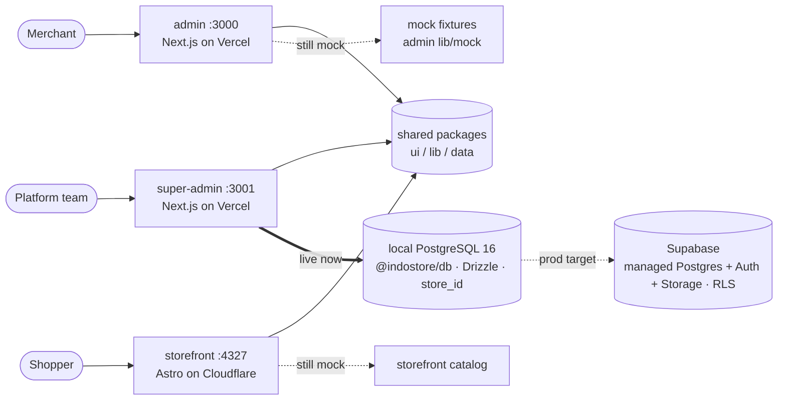
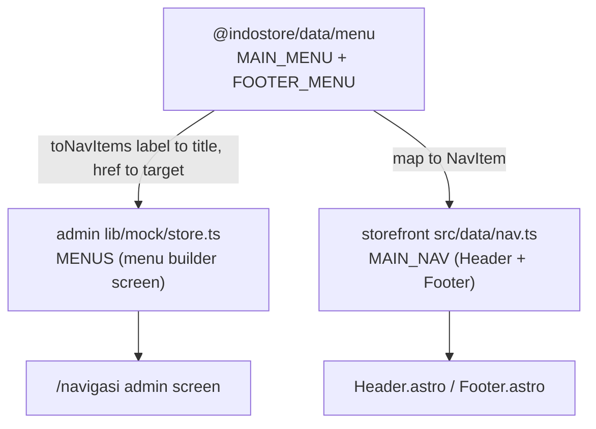

# Indostore — Architecture

> Authoritative architecture doc. Companion to [`../PRD.md`](../PRD.md) (product), [`GUIDE.md`](GUIDE.md) (how to build/contribute), [`UML.md`](UML.md) (detailed diagrams), [`SCHEMA.md`](SCHEMA.md) / [`DATA_MODEL.md`](DATA_MODEL.md) (DB). Describes how the three surfaces are built, the shared **local-Postgres backend now being wired behind the data layer** (super-admin is already live on it — ADR 0007), and the **per-client topology** (ADR 0008).

---

## 1. System overview — three surfaces

Indostore is a Shopify-style commerce SaaS for Indonesia (Bahasa Indonesia UI, IDR). It is **not** a theme editor and has **no** Apps/Plugins marketplace. Three separate front-ends serve three audiences:

| Surface | Package | Stack | Port (dev) | Who uses it |
|---|---|---|---|---|
| **admin** | `@indostore/admin` | Next.js 16 (App Router, Turbopack), React 19 | `:3000` | A **merchant / shop owner** — manages their own store (orders, products, customers, discounts, CRM, pages, blog, nav, settings). |
| **super-admin** | `@indostore/super-admin` | Next.js 16 | `:3001` | **We (the platform)** — cross-tenant control plane: all stores, plans, billing. |
| **storefront** | `@indostore/storefront` | Astro 5 + Tailwind v4 | `:4327` | A **shopper** — one hand-built static storefront per client (browse, cart, checkout, blog, account, contact). |

Phase 1 is **UI/UX with mock data**; the backend is deferred (see §7).



- **One admin app, many stores.** A store switcher in the topbar scopes the UI; every query is scoped by `store_id` (app-layer now, Postgres RLS at Supabase). super-admin is the only surface that reads across tenants.
- **One storefront per client**, deployed from one templated Astro codebase (a `STORE_SLUG` per deploy), sharing design tokens + the shared nav source. Not a self-serve theme editor.
- **Backend status:** super-admin is **live on local Postgres** via `@indostore/db`; admin + storefront still read mock (next). See §9–10 + ADR 0007/0008.

---

## 2. Monorepo layout (npm workspaces)

Workspaces are declared in the root `package.json` as `apps/*` + `packages/*`.

```
indostore/
├─ apps/
│  ├─ admin/         @indostore/admin        Next 16, :3000  — merchant admin
│  ├─ super-admin/   @indostore/super-admin  Next 16, :3001  — platform control plane
│  └─ storefront/    @indostore/storefront   Astro 5, :4327  — shopper site
└─ packages/
   ├─ ui/            @indostore/ui    shadcn-on-Base-UI components + cn + Tailwind tokens
   ├─ lib/           @indostore/lib   IDR/num/pct/timeAgo formatters (id-ID)
   ├─ data/          @indostore/data  canonical MAIN_MENU / FOOTER_MENU (shared source of truth)
   └─ db/            @indostore/db    Drizzle schema + client + versioned migrations (local Postgres; Supabase-target)
```

Plus a root **`docker-compose.yml`** (local PostgreSQL 16, port `5433`) — see §9 + ADR 0007.

### The three shared packages

| Package | Exports | Provides | Consumed by |
|---|---|---|---|
| **`@indostore/ui`** | `./styles.css` (Tailwind v4 tokens), `./lib/utils` (`cn`), `./*` (each component, e.g. `@indostore/ui/button`) | shadcn/ui primitives built on **Base UI** (`@base-ui/react`), Recharts, lucide, cva | **super-admin** (Tailwind picks the components up via `@source` in its `globals.css`). |
| **`@indostore/lib`** | `.` (index), `./format` | Money/number formatters: `IDR()`, `num()`, `pct()`, `timeAgo()` | **super-admin** (`@indostore/lib/format`), **storefront** (`IDR` in Astro pages). |
| **`@indostore/data`** | `.` (re-exports menu), `./menu` | `MAIN_MENU`, `FOOTER_MENU`, `MenuItem`/`MenuItemType` — the **single source of truth for navigation** | **admin** (menu builder), **storefront** (header/footer nav). |
| **`@indostore/db`** | `.`, `./schema`, `./client` | Drizzle **schema** (52 tables, snake_case, money=`bigint` IDR), `db` client singleton, inferred types, versioned migrations, seed/reset. **Server-only** (`postgres` in `serverExternalPackages`). | **super-admin** (`lib/data.ts` — live). **admin**/**storefront** next. |

> **admin is a partial migrant.** admin still keeps its **own** local `components/ui` + `lib` (formatters, utils) — de-duping against `@indostore/ui`/`@indostore/lib` is a tracked backlog task. It has, however, already adopted the shared **data** package (`@indostore/data` is in admin's `transpilePackages`). So today: super-admin + storefront consume ui/lib/data; admin consumes only data (plus its local copies of the rest).

---

## 3. Module resolution

Two different mechanisms, because Next and Astro handle workspace TypeScript sources differently:

- **Next.js apps (admin, super-admin)** import raw `.ts`/`.tsx` from the workspace packages, so those packages must be listed in `transpilePackages` (Next won't transpile `node_modules` by default):
  - `apps/admin/next.config.ts` → `transpilePackages: ["@indostore/data"]`
  - `apps/super-admin/next.config.ts` → `transpilePackages: ["@indostore/ui", "@indostore/lib"]`
- **Astro storefront** resolves the workspace symlink directly — Astro/Vite compiles the package's TypeScript source with no extra config. `apps/storefront/src/data/nav.ts` simply `import`s from `@indostore/data/menu`.
  - Note: storefront's `package.json` currently declares only `@indostore/lib` as a dep but still imports `@indostore/data`; it works because npm workspaces symlink all packages under `node_modules/@indostore/*`. Add the explicit dep if you ever publish/prune.
- **Tailwind v4** is config-less; each consumer's `globals.css` uses `@source` / `@import` to pull the shared component classes and token layer from `@indostore/ui`.

---

## 4. The data-layer seam (most important idea)

Screens NEVER import raw storage. They call **`lib/data/*`** functions that today read the mock and tomorrow call an API/DB — **same signatures**, so the swap is mechanical.

```
component ─▶ apps/admin/lib/data/dashboard.ts (getSummary, getSeries, getTopProducts, getChannels, …)
                    │  today:                         later (M3):
                    └▶ apps/admin/lib/mock/store.ts ──▶ swap body → Supabase query / server action / route handler
```

- `lib/mock/store.ts` is the **single source of demo data** for admin (deterministic — see §5).
- `lib/data/*` is a thin selector layer that derives view models (e.g. range resolution, KPI deltas, channel weights) from the mock. Component props stay identical when the body changes.
- Entity list screens currently read some mock arrays directly (`PAGES`, `ORDERS`, `MENUS`, …) for brevity; the M3 pattern is to introduce `getOrders()/getProducts()/…` wrappers and switch imports, keeping props the same.
- The **storefront** has its own equivalent seam: `apps/storefront/src/data/catalog.ts` (the shopper-facing mock) with helper selectors (`bestsellers`, `byCollection`, `findProduct`, `productImages`).

### How M3 swaps bodies
1. Stand up Supabase; model tables from [`SCHEMA.md`](SCHEMA.md) / [`DATA_MODEL.md`](DATA_MODEL.md); enable RLS keyed on `store_id`.
2. Replace each `lib/data/*` function body with a query (server action / route handler). **Component code unchanged.**
3. Storefront reads published data via a read API or a static build per deploy.

---

## 5. Shared-source pattern (single source of truth)

Beyond the seam, some data must stay **identical across surfaces**. The pattern: put the canonical definition in `@indostore/data`; each surface derives its own shape from it, so they can never drift.

**Nav is the first shared source.** `packages/data/src/menu.ts` defines `MAIN_MENU` + `FOOTER_MENU` (typed `MenuItem[]`). Both surfaces derive from it:



- admin's `MENUS` are built via `toNavItems(MAIN_MENU)` (maps `label→title`, `href→target`, recursing children) in `lib/mock/store.ts`.
- storefront's `MAIN_NAV` maps `MAIN_MENU` into `{label, href, children}` (parents with children become dropdown triggers, `href` undefined).
- Edit `packages/data/src/menu.ts` once → both the admin menu builder and the storefront header/footer update on rebuild. (Live "edit in admin UI → storefront" still needs the backend to persist changes; that's M3.)
- **Expandable:** the catalog is the next candidate to promote into `@indostore/data` (currently duplicated in `apps/storefront/src/data/catalog.ts` vs admin's mock) — tracked in [`TASKS.md`](TASKS.md).

---

## 6. Determinism (why the demo never flickers)

- All admin mock data is generated with a **seeded PRNG (mulberry32)** anchored to a constant **`TODAY = 2026-06-30`**.
- Result: server render === client render → **no hydration mismatch**, and reloads are stable (good for screenshots/demos).
- The only intentional client-only motion (live-visitor ticker) **starts from the SSR value** inside `useEffect`, so first paint matches.
- **Rule:** no `Date.now()` / `Math.random()` in any render path that produces displayed data.

---

## 7. Rendering & UI system

**Admin / super-admin (Next.js 16 App Router):**
- `app/layout.tsx` — root; Geist font, anti-FOUC theme script (applies saved / `prefers-color-scheme` dark before paint), `lang="id"`.
- `app/(admin)/layout.tsx` — server component; renders `<Sidebar/>` + `<Topbar/>` + `<main>` + `<Toaster/>` (sonner).
- Screens are **client components** (`"use client"`) because they hold filter/tab/dialog state and render Recharts. Data selectors are pure and run identically on server + client.
- **UI:** shadcn/ui on **Base UI** (`@base-ui/react`) + Tailwind v4. Tokens in `globals.css` (oklch; indigo `--primary` + chart palette). Base UI's divergence from Radix is the #1 footgun — see [`GUIDE.md` §Conventions](GUIDE.md#conventions) and `apps/admin/CLAUDE.md`.
- Charts use shadcn's `ChartContainer` (wraps Recharts `ResponsiveContainer`); render correctly in real browsers (Playwright) but `chrome --headless --virtual-time-budget` mis-measures them.

**Storefront (Astro 5):**
- Static build (SSG). Dynamic routes (`produk/[handle]`, `kategori/[handle]`) use `getStaticPaths`. Cart is client-side in `localStorage`.
- Tailwind v4 via `@tailwindcss/vite`. Indonesian slugs: `/produk/`, `/kategori/`, `/blog/`, `/halaman/`.

---

## 8. Build & deploy targets

**Build/run** (from repo root; scripts in root `package.json`):
- `npm run dev:admin` / `npm run dev:super` — dev servers on :3000 / :3001.
- `npm run build:admin` / `npm run build:super` — typecheck + lint + build.
- Storefront has no root script yet: `cd apps/storefront && npm run dev|build|preview` (Astro on :4327).

**Deploy (planned):**
- **admin** + **super-admin** → **Vercel** (Next.js).
- **storefront** → **Cloudflare** Pages/Workers, **one deploy per client** (matches the existing petcue/pixsgo pattern).

---

## 9. Backend (in progress) — local Postgres + Drizzle → Supabase

The backend is being wired **behind the data-layer seam** (§4). Dev stack = **plain PostgreSQL 16 in Docker + Drizzle** in `@indostore/db` (ADR 0007); prod target = **Supabase** (managed Postgres + Auth + Storage). Payments & shipping stay **platform-managed** (ADR 0004).

**Local dev:**
```bash
docker compose up -d db              # PostgreSQL 16 @ localhost:5433 (persisted)
npm run migrate -w @indostore/db     # apply versioned migrations
npm run seed    -w @indostore/db     # (re)load demo data (idempotent)
npm run reset   -w @indostore/db     # drop public + drizzle schemas (then migrate + seed)
npm run studio  -w @indostore/db     # Drizzle Studio
```

**Wiring status (per surface):**
| Surface | Data source today | Notes |
|---|---|---|
| **super-admin** | ✅ **PostgreSQL** (`lib/data.ts`, `dynamic="force-dynamic"`) | all 5 pages live; `getStores/getPlatform/getInvoices/…` |
| **admin** | mock (`lib/mock/store.ts`) | next: seed demo store catalog → swap `lib/data/*` bodies |
| **storefront** | mock (`data/catalog.ts`) | after admin: read by `store_id`/`STORE_SLUG` |

**Path to Supabase (no schema rework):** stand up a Supabase project → point `DATABASE_URL` at it → apply the same Drizzle migrations → enable **RLS keyed on `store_id`** (policies written, dormant locally) → wire `supabase-js` Auth (owner/staff via `store_users`) + Storage (media). See [`SCHEMA.md`](SCHEMA.md) for tables, [`UML.md`](UML.md) for diagrams.

---

## 10. Tenancy & per-client provisioning (ADR 0008)

The topology that keeps many clients **easy to manage**: one control plane, one multi-tenant admin, a storefront per client, **one shared database**.

| Layer | Instances | Tenancy |
|---|---|---|
| **Super Admin** (`apps/super-admin`) | 1 app, 1 deploy | cross-tenant — create/suspend stores, plans, billing |
| **Client Admin** (`apps/admin`) | **1 app, 1 deploy — multi-tenant** | merchant signs into the *same* admin; session → `store_id`; RLS scopes to their store |
| **Storefront** (`apps/storefront`) | 1 codebase, **1 deploy per client** | `STORE_SLUG` per deploy; own domain; reads that store from the shared DB |
| **Database** | **1 shared PostgreSQL** | `store_id` on every tenant row + RLS; super-admin bypasses |

> **"Client Admin A / B" is the same admin app, scoped by `store_id` — not a separate deploy per client.**

**Onboard a client = 3 steps (no new admin, no new DB):**
1. super-admin creates the `account` + `store` (+ owner, plan, default settings/location).
2. Seed starter data / merchant fills it in via their scoped admin.
3. Deploy one storefront with that store's `STORE_SLUG` + custom domain (Cloudflare — "1 client 1 deploy").

**Why:** patch/ship the admin once for everyone; one DB to migrate & back up; super-admin's cross-tenant view is free; storefronts stay independent (branding/domain/deploy) where it matters. **Trade-off:** RLS correctness is critical (defence-in-depth: also scope in `lib/data`); a client needing hard isolation can be promoted to a dedicated DB (ADR 0003 escape hatch).
