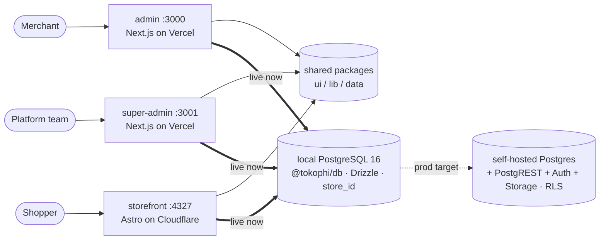

# TokoΦ — Architecture

> **Dated design document (last substantive revision 2026-07-29).** It still says "three surfaces"
> (there are four — `apps/landing`), calls the backend "in progress" (it has been live on Postgres +
> RLS since July), and predates the cron sidecars, the two-pool RLS runtime (`db` owner / `appDb`
> restricted), custom domains, the ledger, courier village ids and the payment-advice loop. **For what
> the code does today read the record: repository-root [`ARCHITECTURE.md`](../../ARCHITECTURE.md)**
> (one screen, every count read off disk, updated 2026-09-11) and [`SYSTEM_MAP.md`](SYSTEM_MAP.md)
> for the cross-surface edges. This file keeps the *rationale* behind the shape — the data-layer
> seam, shared-source pattern, determinism, tenancy model — which has not changed. Where the two
> disagree, the record wins, and the disagreement is a bug to fix here.

> Authoritative architecture doc. Companion to [`../PRD.md`](../PRD.md) (product), [`GUIDE.md`](GUIDE.md) (how to build/contribute), [`UML.md`](UML.md) (detailed diagrams), [`SCHEMA.md`](SCHEMA.md) / [`DATA_MODEL.md`](DATA_MODEL.md) (DB). Describes how the three surfaces are built, the shared **local-Postgres backend fully wired behind the data layer** (all three surfaces live on it — ADR 0007), and the **per-client topology** (ADR 0008, **amended by [ADR 0009](../decisions/0009-self-serve-store-builder.md)**: storefront is SSR multi-tenant + self-serve store builder, not per-client hand-built static).

---

## 1. System overview — three surfaces

TokoΦ is a Shopify-style commerce SaaS for Indonesia (Bahasa Indonesia UI, IDR). It has **no** Apps/Plugins marketplace, but **does** have a self-serve, section-based store builder (ADR 0009 — curated sections, not free-form theme code). Three separate front-ends serve three audiences:

| Surface | Package | Stack | Port (dev) | Who uses it |
|---|---|---|---|---|
| **admin** | `@tokophi/admin` | Next.js 16 (App Router, Turbopack), React 19 | `:3000` | A **merchant / shop owner** — manages their own store (orders, products, customers, discounts, CRM, pages, blog, nav, settings, **store builder/theme**). |
| **super-admin** | `@tokophi/super-admin` | Next.js 16 | `:3001` | **We (the platform)** — cross-tenant control plane: all stores, plans, billing. |
| **storefront** | `@tokophi/storefront` | Astro 5 + Tailwind v4 | `:4327` | A **shopper** — one **SSR multi-tenant** storefront (resolves store by `Host`), rendering each store's chosen section templates (browse, cart, checkout, blog, account, contact). |

Started as **UI/UX with mock data**; the **local backend is wired** on PostgreSQL (see §9) — all surfaces read + all admin editors write + local auth/RBAC/RLS enforcing. (`lib/mock/store.ts` was deleted 2026-09-09; demo data is `packages/db/src/seed.ts`.)



- **One admin app, many stores.** A store switcher in the topbar scopes the UI; every query is scoped by `store_id` (app-layer now, Postgres RLS at self-hosted Postgres). super-admin is the only surface that reads across tenants.
- **One storefront per client**, deployed from one templated Astro codebase (a `STORE_SLUG` per deploy), sharing design tokens + the shared nav source. Not a self-serve theme editor.
- **Backend status:** **super-admin + all 16 admin modules + storefront** are **live on local Postgres** via `@tokophi/db` — reads **and** writes end-to-end (all 12 admin editors persist via `lib/actions/*`; super-admin provisioning/lifecycle/settings/billing; real variants). See §9–10 + ADR 0007/0008.

---

## 2. Monorepo layout (npm workspaces)

Workspaces are declared in the root `package.json` as `apps/*` + `packages/*`.

```
tokophi/
├─ apps/
│  ├─ admin/         @tokophi/admin        Next 16, :3000  — merchant admin
│  ├─ super-admin/   @tokophi/super-admin  Next 16, :3001  — platform control plane
│  └─ storefront/    @tokophi/storefront   Astro 5, :4327  — shopper site
└─ packages/
   ├─ ui/            @tokophi/ui    shadcn-on-Base-UI components + cn + Tailwind tokens
   ├─ lib/           @tokophi/lib   IDR/num/pct/timeAgo formatters (id-ID)
   ├─ sections/      @tokophi/sections  Store Builder section registry (ADR 0009) — shared by the admin Puck config and the Astro SectionRenderer
   └─ db/            @tokophi/db    Drizzle schema + client + versioned migrations (local Postgres; VPS-target)
```

Plus a root **`docker-compose.yml`** (local PostgreSQL 16, port `5433`) — see §9 + ADR 0007.

### The shared packages

| Package | Exports | Provides | Consumed by |
|---|---|---|---|
| **`@tokophi/ui`** | `./styles.css` (Tailwind v4 tokens), `./lib/utils` (`cn`), `./*` (each component, e.g. `@tokophi/ui/button`) | shadcn/ui primitives built on **Base UI** (`@base-ui/react`), Recharts, lucide, cva | **super-admin** (Tailwind picks the components up via `@source` in its `globals.css`). |
| **`@tokophi/lib`** | `.` (index), `./format` | Money/number formatters: `IDR()`, `num()`, `pct()`, `timeAgo()` | **super-admin** (`@tokophi/lib/format`), **storefront** (`IDR` in Astro pages). |
| **`@tokophi/db`** | `.`, `./schema`, `./client` | Drizzle **schema** (70 tables, snake_case, money=`bigint` IDR), `db` client singleton, inferred types, versioned migrations, seed/reset. **Server-only** (`postgres` in `serverExternalPackages`). | **super-admin** + **admin** (13 modules via `lib/data/*` — live). **storefront** next. |

> **The de-dup is done**: `apps/admin/components/ui` and its local formatters were deleted (2026-07-14); admin imports `@tokophi/ui` and `@tokophi/lib`. `apps/admin/lib` stays app-local on purpose (tenant/RBAC/data code). The former `@tokophi/data` package is gone — nav is per-tenant DB data (§5). The tree above omits `apps/landing` and `apps/docs`; see `AGENTS.md` → Monorepo for the four live surfaces.

---

## 3. Module resolution

Two different mechanisms, because Next and Astro handle workspace TypeScript sources differently:

- **Next.js apps (admin, super-admin)** import raw `.ts`/`.tsx` from the workspace packages, so those packages must be listed in `transpilePackages` (Next won't transpile `node_modules` by default):
  - `apps/admin/next.config.ts` → `transpilePackages: ["@tokophi/db", "@tokophi/lib", "@tokophi/sections", "@tokophi/ui"]`
  - `apps/super-admin/next.config.ts` → `transpilePackages: ["@tokophi/ui", "@tokophi/lib", "@tokophi/db"]`
- **Astro storefront** resolves the workspace symlink directly — Astro/Vite compiles the package's TypeScript source with no extra config. `apps/storefront/src/data/nav.ts` reads the store's own `menus`/`menu_items` through `@tokophi/db`.
- **Tailwind v4** is config-less; each consumer's `globals.css` uses `@source` / `@import` to pull the shared component classes and token layer from `@tokophi/ui`.

---

## 4. The data-layer seam (most important idea)

Screens NEVER import raw storage. They call **`lib/data/*`** (reads) and **`lib/actions/*`** (writes). The seam this section was written to protect has been used: the bodies are Postgres queries now and the components did not change.

```
component ─▶ apps/admin/lib/data/<entity>.ts ─▶ withCurrentTenant(async (db, storeId) => …) ─▶ Postgres (RLS, role tokophi_app)
component ─▶ apps/admin/lib/actions/<entity>.ts ("use server") ─▶ requireCapability ─▶ withTenant(storeId, …)
```

- `lib/data/*` returns flat **view shapes** (types in `apps/admin/lib/types/domain.ts`), so a component's props are independent of the table layout. The tenant/RLS and RBAC rules every new read or write must follow are in `AGENTS.md` → Database and `specs/docs/rules/database-rls.md`.
- The **storefront** has its own seam: `apps/storefront/src/data/catalog.ts` → `getCatalog(store)`, per request and per store (the store comes from the `Host` header), memoised with a short TTL. Nothing there may run at module scope or build time — `astro build` must stay DB-free.
- Demo data for a fresh database is `packages/db/src/seed.ts`; the old `lib/mock/store.ts` was deleted 2026-09-09 (Task 6.7). Production is self-hosted Postgres on the VPS (`PROD_PLAN.md`, `DEPLOY.md`).

---

## 5. Shared-source pattern (single source of truth)

Some data must stay **identical across surfaces**. The pattern: one canonical definition in a shared package, and each surface derives its own shape from it, so they cannot drift.

- **Nav** used to be the first shared source (`@tokophi/data` → `MAIN_MENU`/`FOOTER_MENU`). That package was **deleted**: nav is now per-tenant data — the store's own `menus`/`menu_items` rows, written by the Seller Navigasi editor (`apps/admin/lib/actions/menus.ts`) and read by the storefront (`apps/storefront/src/data/nav.ts`, falling back to a list derived from the store's own collections when it has none).
- **Catalog and pricing** are single-sourced in the database; the storefront and the order API both read `product_variants`, never a client-supplied price.
- Cross-surface constants live in `@tokophi/lib`: catalog ids (`tracking-ids.ts`), billing (`billing.ts`), payment fees (`payment-fees.ts`), couriers (`couriers.ts`), validation (`validate.ts`). A second copy of any of them is how the weaker one survives a fix — see `AGENTS.md`.

---

## 6. Determinism (why the demo never flickers)

- All admin mock data is generated with a **seeded PRNG (mulberry32)** anchored to a constant **`TODAY = 2026-06-30`**.
- Result: server render === client render → **no hydration mismatch**, and reloads are stable (good for screenshots/demos).
- The only intentional client-only motion (live-visitor ticker) **starts from the SSR value** inside `useEffect`, so first paint matches.
- **Rule:** no `Date.now()` / `Math.random()` in any render path that produces displayed data.

---

## 7. Rendering & UI system

**Admin / super-admin (Next.js 16 App Router):**
- `app/layout.tsx` — root; Geist font, anti-FOUC theme script (applies saved / `prefers-color-scheme` dark before paint), `lang="id"`.
- `app/(admin)/layout.tsx` — server component; renders `<Sidebar/>` + `<Topbar/>` + `<main>` + `<Toaster/>` (sonner).
- Screens are **client components** (`"use client"`) because they hold filter/tab/dialog state and render Recharts. Data selectors are pure and run identically on server + client.
- **UI:** shadcn/ui on **Base UI** (`@base-ui/react`) + Tailwind v4. Tokens in `globals.css` (oklch; indigo `--primary` + chart palette). Base UI's divergence from Radix is the #1 footgun — see [`GUIDE.md` §Conventions](GUIDE.md#conventions) and `apps/admin/CLAUDE.md`.
- Charts use shadcn's `ChartContainer` (wraps Recharts `ResponsiveContainer`); render correctly in real browsers (Playwright) but `chrome --headless --virtual-time-budget` mis-measures them.

**Storefront (Astro 5):**
- ~~Static build (SSG)~~ → **now SSR** (`@astrojs/node` standalone, `output: 'server'`; converted 2026-07-10). The catalog is read from Postgres at **server boot** (module-level in `src/data/catalog.ts`); dynamic routes render per-request from `Astro.params`. Fast container start = no build-at-start deploy downtime. Cart stays client-side in `localStorage`.
- **Still single-tenant** (store resolved by slug at boot). ADR 0009's **`Host`-header multi-tenant** (per-request store resolution so Store Builder saves appear without a redeploy; live `page_templates` through the section registry) builds on this SSR base — **still TODO**.
- Tailwind v4 via `@tailwindcss/vite`. Indonesian slugs: `/produk/`, `/kategori/`, `/blog/`, `/halaman/`.

---

## 8. Build & deploy targets

**Build/run** (from repo root; scripts in root `package.json`):
- `npm run dev:admin` / `npm run dev:super` — dev servers on :3000 / :3001.
- `npm run build:admin` / `npm run build:super` — typecheck + lint + build.
- Storefront has no root script yet: `cd apps/storefront && npm run dev|build|preview` (Astro on :4327).

**Deploy (planned):**
- **admin** + **super-admin** → **Vercel** (Next.js).
- **storefront** → ~~Cloudflare Pages/Workers, one deploy per client~~ → per `PROD_PLAN.md` §6: **SSR on the VPS** (direct Postgres access, no per-client deploy), Cloudflare in front for CDN/cache/custom-domain only (ADR 0009).

---

## 9. Backend (in progress) — local Postgres + Drizzle → self-hosted Postgres (VPS)

The backend is fully wired **behind the data-layer seam** (§4). Dev stack = **plain PostgreSQL 16 in Docker + Drizzle** in `@tokophi/db` (ADR 0007); prod target = **self-hosted Postgres** (managed Postgres + Auth + Storage). Payments & shipping stay **platform-managed** (ADR 0004).

**Local dev:**
```bash
docker compose up -d db              # PostgreSQL 16 @ localhost:5433 (persisted)
npm run migrate -w @tokophi/db     # apply versioned migrations
npm run seed    -w @tokophi/db     # (re)load demo data (idempotent)
npm run reset   -w @tokophi/db     # drop public + drizzle schemas (then migrate + seed)
npm run studio  -w @tokophi/db     # Drizzle Studio
```

**Wiring status (per surface):**
| Surface | Data source today | Notes |
|---|---|---|
| **super-admin** | ✅ **PostgreSQL** (`lib/data.ts`, `dynamic="force-dynamic"`) | all 5 pages live; `getStores/getPlatform/getInvoices/…` |
| **admin** | ✅ **all reads on PostgreSQL** | ✅ **all 16 modules** — Produk / Diskon / Pelanggan / Kategori / Pesanan / Halaman / Blog / Inventori / CRM / Pembelian / Segmen / Ulasan / Navigasi / Dashboard / Analitik / Pemasaran — the WHOLE admin reads `lib/data/*` + all 12 editors write via `lib/actions/*` |
| **storefront** | mock (`data/catalog.ts`) | after admin: read by `store_id`/`STORE_SLUG` |

**Path to the VPS (no schema rework):** stand up the VPS Postgres → point `DATABASE_URL` at it → apply the same Drizzle migrations → enable **RLS keyed on `store_id`** (policies written, dormant locally) → wire self-hosted (JWT) Auth (owner/staff via `store_users`) + Storage (media). See [`SCHEMA.md`](SCHEMA.md) for tables, [`UML.md`](UML.md) for diagrams.

---

## 10. Tenancy & provisioning (ADR 0008, amended by ADR 0009)

The topology that keeps many clients **easy to manage**: one control plane, one multi-tenant admin, one multi-tenant storefront, **one shared database**.

| Layer | Instances | Tenancy |
|---|---|---|
| **Super Admin** (`apps/super-admin`) | 1 app, 1 deploy | cross-tenant — create/suspend stores, plans, billing |
| **Client Admin** (`apps/admin`) | **1 app, 1 deploy — multi-tenant** | merchant signs into the *same* admin; session → `store_id`; RLS scopes to their store; includes the **Store Builder** (ADR 0009) |
| **Storefront** (`apps/storefront`) | ~~1 codebase, 1 deploy per client~~ → **1 codebase, 1 deploy — SSR multi-tenant** | resolves `store_id` from `Host`/custom domain per-request; renders that store's `page_templates` live from the shared DB |
| **Database** | **1 shared PostgreSQL** | `store_id` on every tenant row + RLS; super-admin bypasses |

> **"Client Admin A / B" is the same admin app, scoped by `store_id` — not a separate deploy per client.**

**Onboard a client = 3 steps (no new admin, no new DB):**
1. super-admin creates the `account` + `store` (+ owner, plan, default settings/location).
2. Seed starter data / merchant fills it in via their scoped admin.
3. Deploy one storefront with that store's `STORE_SLUG` + custom domain (Cloudflare — "1 client 1 deploy").

**Why:** patch/ship the admin once for everyone; one DB to migrate & back up; super-admin's cross-tenant view is free; storefronts stay independent (branding/domain/deploy) where it matters. **Trade-off:** RLS correctness is critical (defence-in-depth: also scope in `lib/data`); a client needing hard isolation can be promoted to a dedicated DB (ADR 0003 escape hatch).

---

## 11. Conversion tracking (ADR 0012) — tenant-owned marketing pixels

Every store advertises with **its own** Meta/Google/TikTok assets. TokoΦ automates the plumbing; it
never owns the merchant's advertising data (that is the whole point of ADR 0012 — no shared platform
pixel, no cross-tenant audience pooling).

```text
Seller · Pemasaran → Pelacakan
   │  pixel id (public) + CAPI token (encrypted)
   ▼
store_tracking_channels  ─────────────┐
   │                                   │
   │ storefront reads (Host → store_id)│ admin reads (RLS)
   ▼                                   ▼
MarketingPixels.astro            diagnostics card
   fbq / gtag / ttq                (7-day delivery health)
   PageView · ViewContent · AddToCart · InitiateCheckout · Purchase

/api/public/order  ─(COD: on creation)─┐
/api/public/pay/callback ─(prepaid: on confirmed payment)─┐
                                       ▼
                          tracking_event_deliveries   ← THE QUEUE
                                       │
                     cron-tracking-events (60 s sidecar)
                                       ▼
                    Meta CAPI · GA4 MP · TikTok Events API
```

**The three rules that make it measurable:**

1. **One id for the catalog, and it never moves.** `content_ids` are the exact strings the product
   feeds emit as `<g:id>`. ONE helper (`@tokophi/lib/tracking-ids` `retailerId`) is called by both feeds
   AND by the conversion payload, so they cannot drift. Since **ADR 0013** the id is
   `{products.number}-{variant.seq}` — system-generated, allocate-once — because the handle-derived id
   changed whenever a merchant renamed a product, reordered variants, or simply added a second one, and
   all three providers read a changed id as "this product was deleted". Existing stores stay on the
   legacy scheme until they choose to switch (`stores.catalog_id_scheme`); the re-key is one-way.

   **Two feed endpoints, one builder** (`apps/storefront/src/lib/product-feed.ts`): `/feed/google.xml`
   serves Google Merchant Center **and** Meta Commerce (both ingest RSS 2.0 + the `g:` namespace);
   `/feed/tiktok.xml` exists because TikTok requires `sku_id` and caps `google_product_category` at
   three levels, which cannot be satisfied inside Google's feed without degrading Google.
2. **One id for the sale.** `purchase:{order_number}` is issued by the server, returned to
   the browser in the order response, and sent by BOTH the pixel (`eventID`) and the Conversions API.
   Same id = one conversion, not two.
3. **Purchase comes from the order row, never the success page.** COD counts at order creation
   (product decision, 2026-07-29); prepaid counts when the gateway callback confirms payment.

**Security boundary:** the CAPI token is AES-256-GCM at rest (`INTEGRATION_TOKEN_KEY`), decrypted only
inside the cron process, never selected into a client component, and stripped out of every persisted
error message. The pixel *id* is public by nature — it ships in the storefront's JS — so it is stored
plaintext, deliberately.

**Not built (deliberately, ADR 0012 §4 + §0.2):** Meta OAuth / asset discovery, catalog PUSH via the
Meta Catalog API (the existing pull feed covers it), webhooks, and any shared platform pixel. Those are
the remaining phases in `TASKS.md`, and they need a Meta Developer App that does not exist yet.
