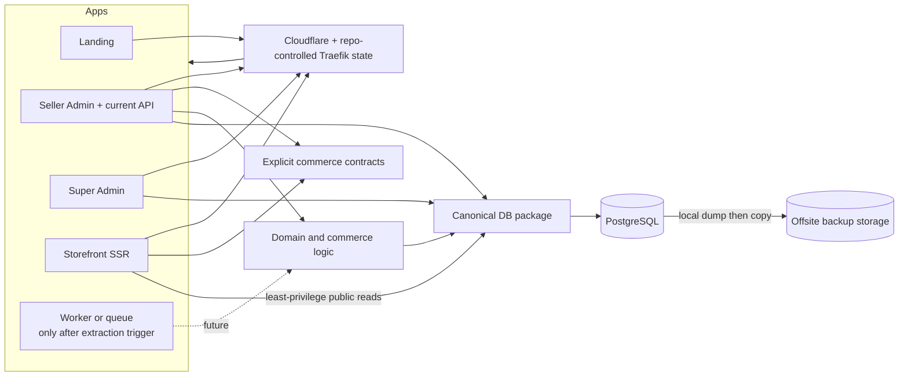

# TokoΦ — Architecture Recommendations

> **Assessment date:** 2026-08-07  
> **Source baseline:** `origin/main` at `a0107c3`  
> **Scope:** repository structure, runtime boundaries, operational ownership, validation, and documentation.  
> **Status:** recommendation, not an architecture decision record and not evidence of production state.
>
> **Salvage note (2026-08-12):** assessment dated 2026-08-07 at baseline `a0107c3`; salvaged from
> branch `docs/local-task-headless-20260811`. That branch's board analysis (its `OPEN.md` edits and
> "recommended sequence") was stale and is superseded by the 2026-08-12 session close — for any
> recommendation here that overlaps work closed on 2026-08-12, check the current
> `specs/docs/tasks/OPEN.md` before acting.
>
> **Dated corrections (2026-08-12), original text below left as written:**
> - The P0 backup finding ("documented, not re-observed") is now **re-observed**: the 2026-08-12
>   DB-parity screen measured backups ~6-hourly, **local-only, still no offsite copy**
>   (`specs/docs/tasks/2026-08-12-n41-seed-drift-parity.md`).
> - The P0 quality-gate finding remains accurate as written: CI exists (N59,
>   `.github/workflows/ci.yml`) and still deliberately omits the red Seller Admin lint;
>   Storefront and Landing still have no `lint` script.

## Executive decision

Keep TokoΦ in **one GitHub monorepo with independently deployable applications**.

Do not split Seller Admin, Super Admin, Storefront, or Landing into separate repositories. They share one product model, database schema, tenant model, UI contracts, and changes that frequently cross surfaces. A repository split would add package publishing, contract versioning, coordinated releases, and cross-repository migrations without creating a meaningful runtime or security boundary.

The current structure is directionally correct:

- four applications under `apps/`;
- five purpose-named workspace packages under `packages/`;
- one canonical Drizzle schema and migration stream;
- separate Docker images and processes for each user-facing surface;
- one multi-tenant storefront resolving the tenant from the request host;
- PostgreSQL RLS enforced for Seller Admin tenant operations;
- a static Landing application with no database dependency.

The next improvements should strengthen **operational state, documentation accuracy, validation, and runtime permissions**. A new repository or a new service is not the first answer.

## Evidence and limits

This assessment checked the following repository sources at the baseline commit:

- root `README.md`, `package.json`, and `.github/workflows/ci.yml`;
- `docker-compose.coolify.yml`;
- application and package manifests under `apps/*` and `packages/*`;
- `specs/README.md`;
- `specs/docs/ARCHITECTURE.md`, `SYSTEM_GUIDE.md`, `SYSTEM_MAP.md`, and `CODE_MAP.md`;
- `specs/docs/tasks/2026-08-08-handoff.md`;
- Seller Admin API routes and the custom-domain action flow.

Production was **not queried** for this assessment. Statements about live infrastructure or data that come only from a handoff are labelled as documented rather than independently observed.

## Current architecture

```mermaid
flowchart TB
  subgraph Repository[GitHub monorepo]
    Admin[Seller Admin\nNext.js]
    Super[Super Admin\nNext.js]
    Storefront[Storefront\nAstro SSR]
    Landing[Landing\nAstro static]

    DBPkg[@tokophi/db]
    Lib[@tokophi/lib]
    UI[@tokophi/ui]
    Sections[@tokophi/sections]
    Data[@tokophi/data]
  end

  Shopper([Shopper]) --> Storefront
  Merchant([Merchant]) --> Admin
  Operator([Platform operator]) --> Super
  Visitor([Visitor]) --> Landing

  Storefront --> DB[(PostgreSQL)]
  Admin --> DB
  Super --> DB
  Admin --> Providers[Payment, shipping, tracking providers]
  Storefront -->|public commerce API| Admin

  Admin --> DBPkg
  Super --> DBPkg
  Storefront --> DBPkg
  Admin --> Lib
  Super --> Lib
  Storefront --> Lib
  Admin --> Sections
  Storefront --> Sections
```

### Deployable units in the production Compose file

| Unit | Responsibility | Boundary today |
|---|---|---|
| `admin` | Seller UI, auth routes, uploads, public commerce API, cron handlers | Next.js container |
| `super-admin` | Cross-tenant platform control plane | Next.js container |
| `storefront` | Host-resolved public shops | Astro SSR container |
| `landing` | Public platform front door | Static Astro container, intentionally DB-free |
| `migrate` | Apply schema migrations and seed rules | One-off container built from the Admin image |
| `cron`, `cron-tracking`, `cron-tracking-events` | Trigger bounded Admin cron endpoints | Alpine polling sidecars |
| `backup` | Local PostgreSQL dumps | PostgreSQL sidecar and local volume |

This is already a monorepo with multiple runtime units. Repository boundaries and deployment boundaries are correctly treated as different decisions.

## What should remain unchanged

### One repository

All surfaces depend on the same concepts: store lifecycle, tenant identity, catalog, orders, payments, billing, domains, permissions, and audit history. Cross-surface changes should remain atomic and reviewable in one pull request.

### One canonical database package

`@tokophi/db` should remain the sole owner of schema, migrations, and low-level tenant transaction primitives. Applications may consume it with different credentials and permissions, but they must not create their own schema copies or migration streams.

### One shared multi-tenant storefront

Do not return to one storefront deployment per merchant. Host-based tenant resolution gives the platform one patch and release path while preserving merchant domains and themes as data.

### Landing without a database dependency

The apex must remain available when commerce services or PostgreSQL are unavailable. Do not merge Landing into Seller Admin merely to reduce the number of applications.

### Shared packages named by responsibility

Keep `db`, `ui`, `sections`, and `data` explicit. Do not introduce a generic `common` or `shared` package.

## Findings and recommendations

### P0 — Reconcile the architecture documentation

**Observed problem:** the repository declares more than one document authoritative, but those documents describe incompatible systems.

Examples at the baseline commit:

- `specs/docs/ARCHITECTURE.md` says there are three surfaces while the repository has four;
- the same document contains both one-storefront-per-client and one shared Host-resolved storefront descriptions;
- it still describes mock data, future database wiring, Vercel, and Cloudflare deployment paths that the current source and Compose topology no longer use;
- `SYSTEM_GUIDE.md` still describes the system as running locally with production deferred;
- volatile counts for tables, migrations, and RLS coverage differ across `README.md`, `specs/README.md`, `SYSTEM_GUIDE.md`, and `CODE_MAP.md`;
- `specs/README.md` correctly warns that several older documents predate the backend, but root `README.md` still directs new contributors to one of them as the whole-system guide.

**Recommendation:** make the current system map the canonical descriptive source and reduce other documents to distinct jobs:

| Document | Single responsibility |
|---|---|
| `README.md` | Short onboarding and runnable local commands |
| `specs/docs/SYSTEM_MAP.md` | Current source-backed runtime and code topology |
| `specs/docs/ARCHITECTURE.md` | Stable decisions, boundaries, and trade-offs; no session status |
| `specs/docs/STATUS.md` | Current product truth and known non-real behavior |
| `specs/docs/DEPLOY.md` | Current deployment procedure and production topology |
| `specs/docs/WORKLOG.md` and handoffs | Historical observations; never canonical current state |
| ADRs | Accepted decisions and their supersession chain |

Do not manually repeat volatile counts in several documents. Generate them, link to the generated source, or state the invariant without a count.

**Done when:** a cold reader can follow the root README to one current topology, and a search finds no active statement that the storefront is per-client, the product has three surfaces, or production is still planned.

### P0 — Finish the custom-domain control loop without manual state drift

**Observed problem:** on `main`, Seller Admin verifies TXT ownership and CNAME servability, then intentionally stops at `provisioning`; the code says Cloudflare for SaaS certificate issuance is not built. The production handoff also says part of Traefik's authoritative dynamic configuration exists outside Git in `/data/coolify/proxy/dynamic/`.

This leaves one feature represented in three state systems:

1. `store_domains` in PostgreSQL;
2. Cloudflare Custom Hostnames and certificate state;
3. live Traefik dynamic routers on the VPS.

**Recommendation:** complete one idempotent control loop that creates or finds the provider hostname, polls certificate state, reconciles the database, and manages the explicit production route. Every external resource identifier must be persisted. Retries must resume from persisted state rather than create duplicate provider resources.

Keep production mutations behind explicit operator approval. Prefer explicit `Host()` routers for merchant domains on the shared proxy; do not use a broad catch-all whose correctness depends on priorities of unrelated applications.

**Done when:** one real hostname progresses from merchant DNS instructions to HTTPS storefront, repeated activation is idempotent, provider failure is visible in Seller Admin and Super Admin, deletion reconciles all three state systems, and rollback is documented and exercised.

### P0 — Move backups off the database host

**Documented, not re-observed:** the latest handoff says local dumps and restore drills are healthy, but dumps remain on the same VPS as PostgreSQL.

A backup on the failed host is not disaster recovery.

**Recommendation:** retain the local dump as the first step, then upload a copy to independent object storage. A remote-upload failure must not discard or block the local dump. Add restore verification from the offsite object, retention, encryption, and a visible stale-backup signal.

**Done when:** a fresh environment can restore from an offsite artifact without reading the original VPS volume, and the measured recovery point and recovery time are recorded.

### P0 — Make every application participate in a green quality gate

**Observed problem:** CI runs database-backed tests, migration verification, Astro checks, RLS checks, and TypeScript checks. It deliberately omits Seller Admin lint because the baseline is red. Storefront has `verify` and responsive audit scripts but no `lint` script; Landing has `check` but no `lint` script.

The existing CI is valuable and should not be weakened. The missing checks create uneven coverage between applications.

**Recommendation:** fix the known lint baseline, add the smallest appropriate lint/static-analysis command for both Astro applications, and then add all four surfaces to CI. Keep the database-backed and RLS checks mandatory. Do not hide existing failures behind warning-only configuration.

**Done when:** every application has an explicit validation script, the root gate invokes each one, and the CI workflow is green before the checks become required.

### P1 — Keep the public API in Admin for now, but make the boundary explicit

**Observed problem:** `apps/admin/app/api/` hosts auth, uploads, public order/ongkir/payment/promo routes, and cron endpoints. Storefront therefore depends on the Seller Admin container as both a UI and a commerce backend.

This coupling is real, but creating `apps/api` today would add deployment and authentication complexity without proof that it solves an operational problem.

**Recommendation now:** document the public endpoint contract, keep provider/domain logic outside route components, apply consistent authentication, rate limits, idempotency, timeouts, and structured error responses, and monitor the API separately from Seller UI page health.

**Extract `apps/api` only when at least one trigger is observed:**

- API traffic needs different scaling from Seller UI traffic;
- Seller UI deployments interrupt checkout or callbacks;
- API and UI require materially different network or secret policies;
- more independent consumers need a versioned contract;
- backend ownership and release cadence become independent.

If extracted, keep it in this monorepo and migrate all callers in one cutover.

### P1 — Treat cron sidecars as workers with contracts

**Observed problem:** three Alpine sidecars periodically call Admin cron routes. The design is simple and appropriate at current scale, but the job contract is distributed between Compose intervals, route timeouts, database claim logic, and Super Admin liveness rendering.

**Recommendation now:** keep the sidecars, but require each job to have:

- one named owner and one row in cron liveness;
- a documented interval and stale threshold;
- bounded batch size and execution time;
- idempotent processing or a durable claim;
- retry classification and a terminal/dead-letter state where relevant;
- an observable result, not only a log line.

Create `apps/worker` or adopt a queue only when overlapping execution, sustained backlog, provider fan-out, or retry orchestration exceeds this model. Do not add a worker merely to improve folder symmetry.

### P1 — Reduce Storefront database privilege before adding more public reads

**Observed boundary:** Seller Admin tenant operations use RLS through a non-owner role. Root documentation states that Storefront uses the owner connection and relies on explicit `store_id` predicates because anonymous requests have no tenant session GUC.

That is an application boundary, not defence in depth. A missed predicate in a public path can become a cross-tenant leak.

**Recommendation:** design a least-privilege Storefront database path. Prefer a dedicated read-oriented role plus reviewed query functions/views that resolve a host to one public store and expose only published shopper data. Checkout mutations should remain behind server-side commerce commands, not broad table grants.

Do not rewrite this boundary blindly. First inventory every Storefront query and preserve Host resolution, preview behavior, locked-store behavior, and build-without-database deployment semantics.

**Done when:** a Storefront credential cannot read another tenant's private or unpublished rows even if an application predicate is removed in a mutation test.

### P2 — Classify `@tokophi/lib` before splitting it

**Observed problem:** `@tokophi/lib` contains formatting, auth/session primitives, password and TOTP code, billing/tax, provider clients, tracking identifiers, cache helpers, validation, and PostgreSQL error handling.

The package is broad, but package splitting has a cost. Do not replace one broad package with many single-file packages.

**Recommendation:** first define supported export groups and ownership boundaries. Split only a cohesive group that has multiple consumers, a distinct dependency profile, or a security boundary. Likely future candidates are `contracts`, `auth`, `commerce`, and `integrations`, but those names are proposals—not work until the boundary is demonstrated.

### P2 — Add affected-graph CI only after all gates are trustworthy

The current CI runs one comprehensive job. It is slower than a path-aware graph but easier to reason about while migration, RLS, and lint gates are still being stabilised.

**Recommendation:** keep the full required gate first. Add path-aware builds later using explicit dependency rules:

```text
packages/db/**       -> database gates + admin + super-admin + storefront
packages/sections/** -> admin + storefront
packages/ui/**       -> admin + super-admin + landing consumers
apps/storefront/**   -> storefront only
apps/landing/**      -> landing only
```

Run a periodic full graph even after path filtering exists. A skipped required consumer is worse than a slower build.

## Recommended target

This is an evolution of the current design, not a rewrite:



`Worker` and a standalone API are conditional. They are not required milestones.

## Execution order

### Stage 1 — Truth and recoverability

1. Reconcile canonical architecture and onboarding documents.
2. Complete and prove the custom-domain provider/router/database reconciliation.
3. Add offsite backups and restore evidence.
4. Close the lint baseline and gate all four applications.

These items reduce operational ambiguity and data-loss risk without changing the product topology.

### Stage 2 — Harden current runtime boundaries

1. Document and test the public commerce API contract.
2. Normalize cron job ownership, liveness, idempotency, and terminal states.
3. Introduce a least-privilege Storefront database path.
4. Verify service-specific secrets and database credentials in deployment configuration.

### Stage 3 — Scale only from evidence

1. Measure API traffic, Seller UI deploy impact, cron backlog, and CI duration.
2. Extract `apps/api` only if an API trigger is observed.
3. Extract `apps/worker` or adopt a queue only if a worker trigger is observed.
4. Add affected-graph CI only after the dependency graph is encoded and periodically cross-checked.
5. Split `@tokophi/lib` only along demonstrated consumer or security boundaries.

## Do not do

- Do not split the four applications into separate GitHub repositories.
- Do not create one storefront deployment or database per ordinary merchant.
- Do not create `apps/api` or `apps/worker` for visual symmetry.
- Do not give every runtime the database owner credential because the schema package is shared.
- Do not introduce a generic `common` package.
- Do not duplicate schema, validation, money, or tenant rules between applications.
- Do not treat build success as proof of checkout, custom-domain, or browser-visible behavior.
- Do not treat handoff notes as current production truth without re-observing production.

## Decision summary

| Question | Recommendation |
|---|---|
| One repository or several? | One monorepo |
| One app or several? | Four existing applications; keep separate deploys |
| Standalone API now? | No; harden the current boundary and extract only on measured triggers |
| Standalone worker now? | No; formalize current cron contracts first |
| Shared database? | Yes, with service-specific least privilege and tenant enforcement |
| Per-merchant storefront deploy? | No; retain one Host-resolved SSR storefront |
| Highest-priority architecture work? | Documentation truth, custom-domain reconciliation, offsite recovery, complete quality gates |

## References

- `README.md`
- `package.json`
- `.github/workflows/ci.yml`
- `docker-compose.coolify.yml`
- `specs/README.md`
- `specs/docs/SYSTEM_MAP.md`
- `specs/docs/ARCHITECTURE.md`
- `specs/docs/DEPLOY.md`
- `specs/docs/SECURITY.md`
- `specs/docs/SLA-DRP.md`
- `specs/docs/tasks/2026-08-08-handoff.md`
- ADR 0005 — monorepo and shared packages
- ADR 0007 — PostgreSQL and Drizzle backend
- ADR 0009 — Store Builder and multi-tenant storefront
