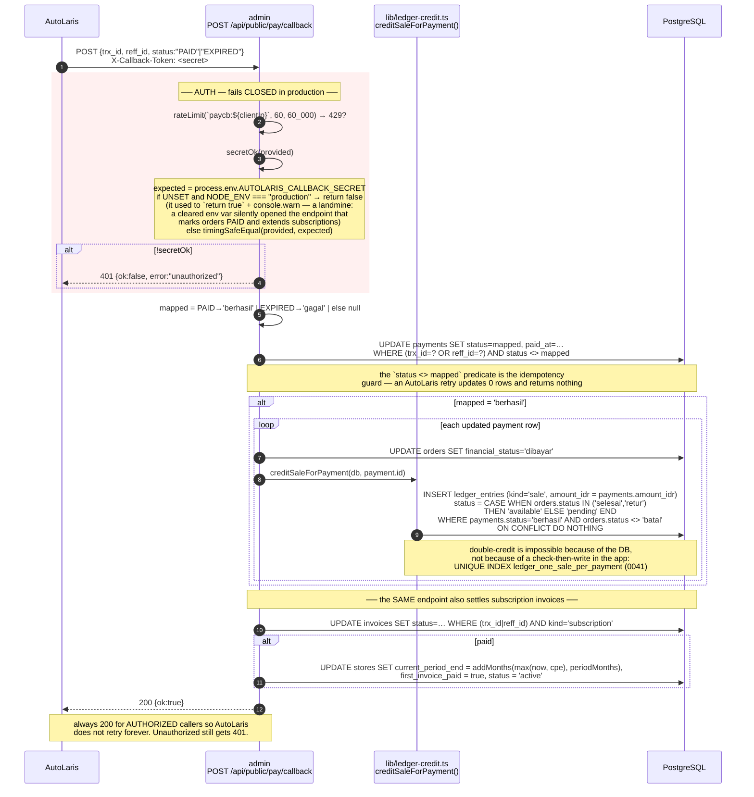
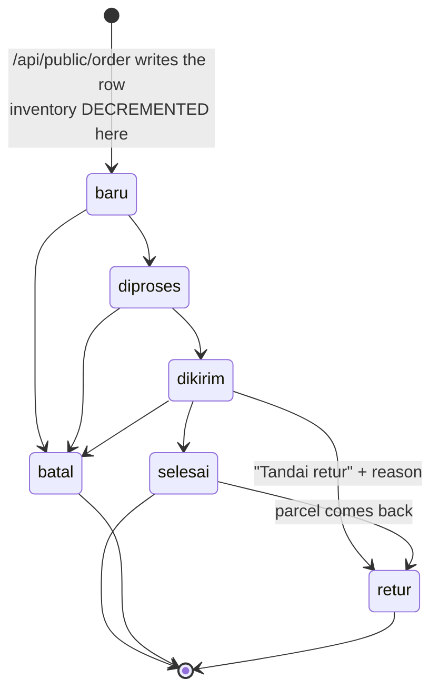
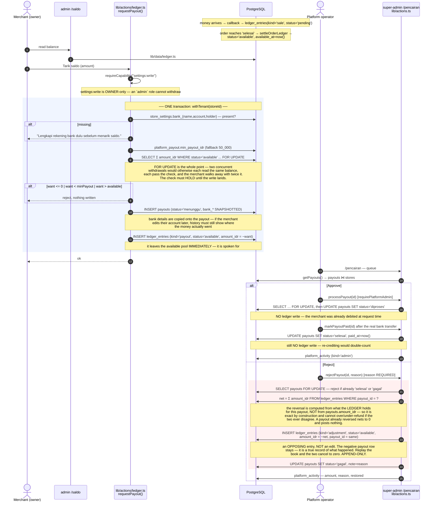
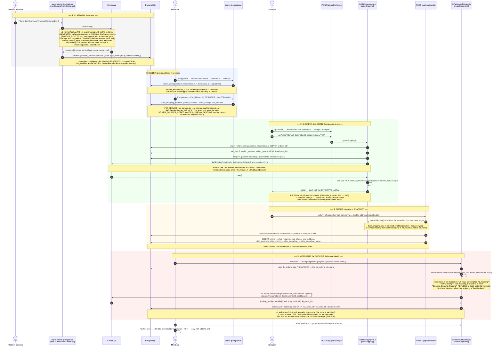
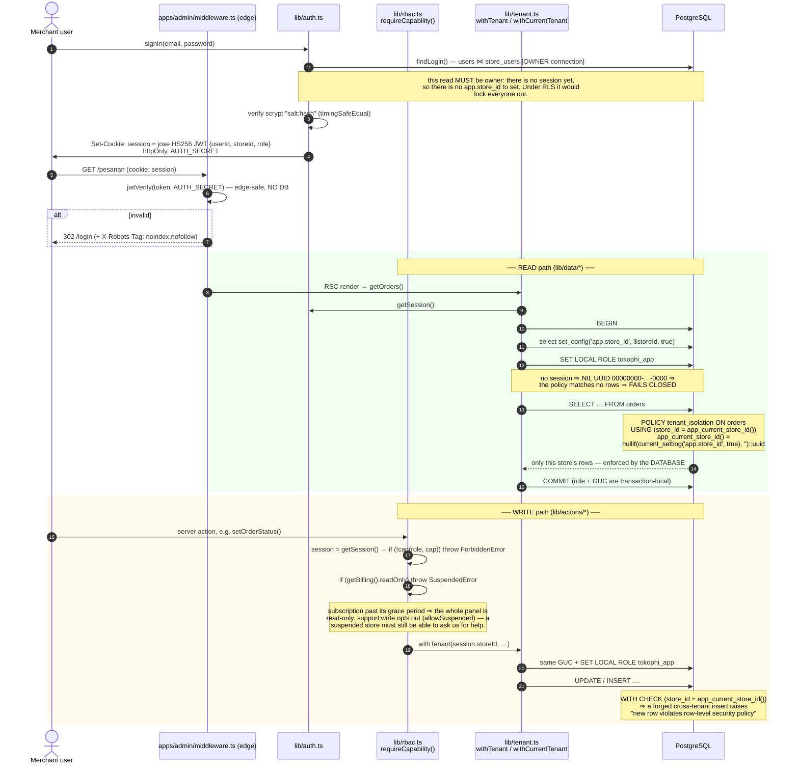
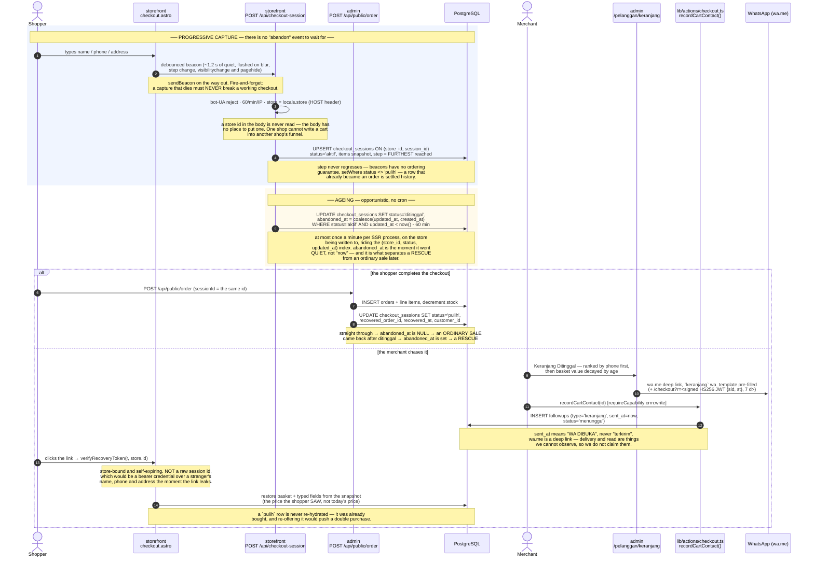

# TokoΦ — CRITICAL FLOWS

> Every diagram below carries the **real file and function names** and the **actual guards** as they exist
> in the tree on **2026-07-14**. Read with [`SYSTEM_MAP.md`](./SYSTEM_MAP.md) (structure) and
> [`STATUS.md`](./STATUS.md) (what is real vs. seeded vs. fake).
>
> **§5 is the shipping flow end to end** (address cascade → quote → order snapshot → booking → label) and
> is the doc to read before touching anything that prices or ships a parcel.

---

## 1. Shopper checkout — including the COD gate

The COD decision is a **money** decision, so it is enforced at the API boundary, **before any row is written**.
Hiding the option in the storefront UI is UX. A script POSTing `channelCode:"cod"` straight at the endpoint gets a
**403 with no order created** — never a silently-downgraded order (which would hide a COD request as a "transfer").

```mermaid
sequenceDiagram
    autonumber
    actor S as Shopper
    participant SF as storefront<br/>checkout.astro
    participant ONG as admin<br/>POST /api/public/ongkir
    participant ORD as admin<br/>POST /api/public/order
    participant COD as lib/cod.ts<br/>getCodPolicy()
    participant KA as KiriminAja
    participant AL as AutoLaris
    participant DB as PostgreSQL<br/>(owner conn)

    S->>SF: fill address
    SF->>ONG: {op:"search", q}
    ONG->>DB: resolveArea() → kiriminaja_areas
    ONG-->>SF: districts[] (each with destId)

    SF->>ONG: {op:"kelurahan", destinationId}
    ONG->>KA: kaKelurahan(kecamatanId) → POST /api/mitra/kelurahan
    ONG-->>SF: kelurahan[] {id, name, postcode}
    Note over SF,ONG: THE CASCADE is kecamatan → kelurahan.<br/>Kota, provinsi and kodepos are DERIVED from the pick —<br/>the shopper never types them. `id` is KiriminAja's own<br/>village id: the ONLY one request_pickup accepts, and<br/>null for the ~4% of districts that fall back to the local<br/>Kemendagri table (a name + a kodepos we have, a bookable<br/>id we do not — never invent one).

    SF->>ONG: {op:"rates", storeSlug, destinationId, items[], scope:"primary"|"all"}
    Note over SF,ONG: NO weight, NO price, NO originCity in the body.<br/>The cart says WHAT is in it — the server says what it<br/>weighs, what it costs and where it ships from.<br/>`scope` chooses how MANY couriers are priced, never<br/>what they cost: "primary" = the chain SPX → JNE on<br/>first paint, and "all" only when the shopper opens<br/>"Lihat kurir lainnya". Both go through the SAME<br/>quoteShipping() the order re-quotes with.
    ONG->>DB: origin = store_settings.sender_kecamatan_id (the seller's PICKUP address)
    Note over ONG,DB: ⚠️ Fixed in a68f7af: origin used to be resolveArea(body.originCity),<br/>a CITY NAME posted by the shopper's browser — so the seller's real<br/>warehouse was ignored AND an untrusted client string set the price.<br/>sender_kecamatan_id IS a KiriminAja district id (same currency as<br/>destinationId): nothing to resolve, nothing to guess. No pickup<br/>address → fall back to the store's REGISTERED city and say so<br/>(originFrom:"store-city") — a fuzzy match is a guess, so show it.
    ONG->>DB: platform_couriers.enabled ∩ store_shipping_methods (per SERVICE)
    Note over ONG,DB: keyed "courier:service_type" — a service_type is only<br/>unique within its courier. NO rows = the merchant never<br/>opened the Jasa Kirim card → fall back to the courier-level<br/>list, never a checkout with zero shipping options
    ONG->>DB: weightForCart() — Σ product_variants.weight_grams, min 1 kg billable
    ONG->>KA: kaShippingPrice(origin, destination, billableGrams, couriers:[…])
    Note over ONG,KA: ALWAYS name the couriers. Unfiltered, KiriminAja walks<br/>its whole roster: measured 5.513 ms / 18 services vs<br/>512 ms / 14 when the enabled couriers are named.<br/>NO village id is sent — pricing is KECAMATAN-level (§5).
    KA-->>ONG: services[] (each with a raw cod flag)
    ONG->>COD: getCodPolicy(store.id)
    Note over ONG,COD: rate.cod = KiriminAja's cod<br/>AND policy.allows(service, serviceType)<br/>— the EFFECTIVE flag, not the raw one
    ONG-->>SF: {rates[], codEnabled, origin, originFrom, weight, billableWeight}

    S->>SF: pick service + channel, submit
    SF->>ORD: {storeSlug, items, customer,<br/>address:{alamat, kodepos, kelurahanId},<br/>shipping:{service,serviceType,destId}, channelCode}
    Note over SF,ORD: `shipping.cost` is NOT sent and would not be read.<br/>kota/provinsi are not sent — they are DERIVED from destId.

    rect rgb(240, 245, 255)
        Note over ORD,DB: ── EVERY NUMBER THAT DECIDES MONEY IS RECOMPUTED HERE ──
        ORD->>DB: areaById(destId) → kota + provinsi DERIVED (typed values ignored)
        ORD->>DB: verifyKelurahan(destId, address.kelurahanId)
        Note over ORD,DB: the village id is proven to BELONG to destId before it is<br/>stored. A village id from another kecamatan would sail<br/>through request_pickup and land the parcel somewhere<br/>nobody chose. Unverifiable ⇒ null — the village is optional<br/>to the courier, and losing a real sale over it is the worse bug.
        ORD->>DB: prices ← product_variants.price_idr (items[].price ignored)
        ORD->>ORD: quoteShipping() — the SAME function /api/public/ongkir used
        Note over ORD: findRate(courier + service_type). A picked service that is<br/>NOT in the fresh quote is REJECTED — never silently<br/>re-couriered. body.shipping.cost is never read.
    end

    rect rgb(255, 240, 240)
        Note over ORD,COD: ── THE COD GATE — before ANY row is written ──
        ORD->>ORD: rateLimited(req,"order",10,60_000) → 429?
        ORD->>DB: stores WHERE slug = storeSlug
        ORD->>ORD: total = subtotal + shippingIdr (both OURS)
        alt channelCode === "cod"
            ORD->>COD: getCodPolicy(store.id)
            ORD->>DB: provinceForDistrict(destId)
            Note over ORD: province comes from the DISTRICT the quote<br/>was issued for — NOT address.provinsi,<br/>which the buyer types and can lie about
            alt district unverifiable AND allowedProvinces is non-empty
                ORD-->>SF: 403 cod_not_allowed (FAIL CLOSED)
            end
            ORD->>COD: policy.reason({courier, serviceType, total, province})
            Note over COD: 1 platform_cod.enabled<br/>2 store_settings.cod_enabled<br/>3 total <= platform_cod.max_amount_idr<br/>4 province ∈ allowed_provinces (normalised)<br/>5 platform_couriers.services[].cod && codAllowed
            alt any of the five fails
                ORD-->>SF: 403 {code:"cod_not_allowed", error}
            end
        end
    end

    ORD->>DB: upsert customers (by canonical `62…` PHONE, within store)
    Note over ORD,DB: in Indonesia the WA number IS the identity. Keying on it<br/>only works because normalizePhone() made it canonical —<br/>the same person used to land twice as 0812… and +62 812…
    ORD->>DB: resolve each item → product_variants, then check inventory_levels
    alt any line is short
        ORD-->>SF: {ok:false, "Stok … tidak mencukupi"} — nothing written
    end
    ORD->>DB: INSERT orders (status='baru', financial_status='pending')<br/>+ ship_recipient, ship_phone, ship_address, ship_postcode,<br/>ship_district_id, ship_kelurahan_id, ship_kelurahan_name
    Note over ORD,DB: THE ADDRESS SNAPSHOT (0042 + 0049). The address belongs<br/>to the TRANSACTION, not to the person: without it a buyer<br/>who moves house moves every past order with them.<br/>ship_district_id + ship_kelurahan_id are the ids the<br/>parcel will actually be BOOKED with (§5).
    ORD->>DB: INSERT order_line_items[]
    ORD->>DB: UPDATE inventory_levels SET available = GREATEST(available - qty, 0)

    ORD->>DB: UPDATE checkout_sessions SET status='pulih', recovered_order_id, recovered_at, customer_id<br/>WHERE store_id = ? AND session_id = ?
    Note over ORD,DB: THIS session became THAT order — the only honest<br/>definition of "recovered". Non-fatal by design: a paid<br/>order must never fail because a marketing table did.

    alt COD
        ORD->>DB: INSERT payments (method='cod', status='menunggu', provider='cod')
        Note over ORD,DB: menunggu, NOT berhasil — the platform holds<br/>NOTHING at checkout. Cash exists at the door.
        ORD-->>SF: {ok, orderNumber, cod:true}
    else prepaid (VA / QRIS / e-wallet)
        ORD->>AL: alCreatePayment({reffId: order.number, channelCode, amount: total, callbackUrl})
        AL-->>ORD: {trxId, virtualAccount|qr|paymentCode, admin, total}
        ORD->>DB: INSERT payments (status='menunggu', provider='autolaris', trx_id, reff_id)
        ORD-->>SF: {ok, orderNumber, payment:{channel:{code,label,kind}, va|qr|url}}
        Note over SF: only a GENERIC channel label crosses the wire —<br/>the PSP brand is never exposed (ADR 0004)
    end
    SF->>S: redirect /checkout/sukses
```



**No shipment is booked at checkout.** The order is written, and the parcel is booked later by the merchant from
Pesanan → "Buat pengiriman" (§5). `orders.courier` / `awb` / `ka_order_id` stay NULL until then.

**Instant / same-day is GONE.** `kaInstantPricing` / `kaCreateInstantOrder` (KiriminAja `/api/mitra/v4/instant/*`),
the checkout option and the shopper/store lat-lng they needed were **deleted** (`1c084ad`). TokoΦ ships by
expedition courier only. `isInstantCourier()` / `isInstantService()` in `@tokophi/lib/couriers` remain as a **guard**:
if KiriminAja ever folds an on-demand courier into the express roster, it still cannot reach a store. Note the
boundary — `one_day` (AnterAja Same Day, SAP One Day) is an *expedition* service and stays.

---

## 2. Payment callback (AutoLaris → admin)

Single endpoint, four jobs: mark the payment, sync the order, **credit the ledger**, and extend subscriptions.



**Amount, precisely.** The ledger credits `payments.amount_idr` (the order total the merchant is owed), **not**
`payments.total` (which adds the gateway's admin fee — the gateway's money, never the merchant's). This is what keeps
Dashboard revenue, the Pesanan list and the Saldo ledger the same number.

---

## 3. Order lifecycle — and what each transition does to inventory and to the ledger

One function: `apps/admin/lib/actions/orders.ts#setOrderStatus`. Guarded by `requireCapability("orders:write")`,
then the whole body — the status change, the inventory move and the ledger move — runs inside **one**
`withTenant(storeId, …)` transaction, so the book can never disagree with the order it describes.



| Transition | Inventory | Payments | Ledger (`settleOrderLedger`) |
|---|---|---|---|
| **→ `baru`** (order created) | **−qty** on each `inventory_levels` row (`GREATEST(available - qty, 0)`) | prepaid: `menunggu` bill · COD: `menunggu` COD row | nothing — no money has been collected |
| `baru → diproses → dikirim` | unchanged | unchanged | nothing. **Release does NOT happen at despatch**, deliberately: a parcel can only be *returned* after it shipped, and for COD the cash does not exist yet |
| **→ `selesai`** | unchanged | `collectCodOnDelivery()` flips any `method='cod' AND status='menunggu'` payment to **`berhasil`** — `selesai` **is** the delivery signal (there is no courier "delivered" webhook) | `creditSalesForOrder()` books anything collected and not yet in the book, then `UPDATE ledger_entries SET status='available', available_at=now() WHERE order_id=? AND kind='sale' AND status='pending'` |
| **→ `batal`** | **+qty restored** | any `menunggu` payment → **`gagal`** | nothing is booked (`creditSaleForPayment` explicitly skips `orders.status='batal'`) |
| **→ `retur`** | **+qty restored** — the goods are back on the shelf, same as `batal` | any `menunggu` payment → **`gagal`** (a refused COD parcel collected no cash) | an **OPPOSING entry**, never an edit of the sale: `INSERT ledger_entries (kind='retur', amount_idr = -sale.amount_idr, status = sale.status)`. Also sets `orders.returned_at` + `return_reason`. |

Two subtleties that are easy to get wrong and are handled:

1. **The claw-back carries the SAME status as the sale it reverses.** A parcel can be returned straight from `dikirim`,
   where the sale is still `pending`. Reversing that out of `available` (as an earlier version did, unconditionally)
   would drive the withdrawable balance **negative** while the held pool still showed the money. Reverse a pending sale
   out of `pending`, a released one out of `available`; either way the pair nets to zero.
2. **The inventory restore is guarded on the previous status** (`if (restores && order.status !== status)`), so a repeat
   click cannot double-restore stock. The ledger's equivalent guarantee is the DB's:
   `UNIQUE INDEX ledger_one_retur_per_order`.

---

## 4. Money — sale → pending → available → payout → approval / rejection

The balance is **derived, never stored**: `Σ amount_idr WHERE status='available'`. A stored balance is a number that can
silently disagree with the movements that produced it; a derived one cannot.



**Release timing.** `platform_payout.release_on` defaults to `'selesai'` and the super-admin can flip it to `'dikirim'`.
✅ **It IS read now (fixed 2026-07-14, `0776e99`).** `settleOrderLedger()` reads the row and releases at whatever it
says. It previously hardcoded `if (status === "selesai")`, so the toggle persisted and changed nothing — an operator
could flip it, believe the policy had changed, and it had not. **A knob that moves nothing is worse than no knob.**

The default should stay `selesai`. Release-on-despatch looks generous and is a trap: a shipped parcel can still come
back, so the merchant could withdraw money for goods that return — and on COD the cash does not exist at despatch at
all (the courier collects at the door and settles days later).

---

## 5. Shipping, end to end — address cascade → quote → snapshot → booking → label

**The one rule to carry out of this section:**

> ### 🚚 Kecamatan PRICES the parcel. Kelurahan BOOKS it.
>
> `shipping_price` accepts `subdistrict_origin` / `subdistrict_destination` and **silently ignores them** — a
> nonsense village id returns the identical services at identical costs (verified on the sandbox). Tariffs are
> **kecamatan-level**. The **kelurahan matters for the BOOKING and the printed label**, where `request_pickup`
> takes `destination_kelurahan_id` and a driver has to find the door.
>
> **Do not re-add village ids to the pricing call.** It would imply a precision the price does not have.

### 5.1 The address cascade: kecamatan → kelurahan → (kota, provinsi, kodepos)

The shopper picks **two** things. Everything else is derived.

| Field | Where it comes from | Why not typed |
|---|---|---|
| **Kecamatan** | autocomplete → `kiriminaja_areas` (`op:"search"` → `resolveArea`) | the `dest_id` is what the ongkir is priced against and what the parcel is booked to |
| **Kelurahan** | `op:"kelurahan"` → **`POST /api/mitra/kelurahan`** (`kaKelurahan`) | only KiriminAja's own village id is bookable |
| **Kodepos** | the `postal_code` KiriminAja returns **per village** (100% coverage in sampling) | a kodepos is assigned per *kelurahan*, not per kecamatan — 17% of kecamatan span several |
| **Kota, Provinsi** | **derived** from the district id (`areaById`) | typed values are a *claim*: "DKI Jakarta" + a Papua district was the COD hole |

**Two kelurahan sources, and they are NOT interchangeable:**

| Source | Id looks like | Bookable? |
|---|---|---|
| KiriminAja `POST /api/mitra/kelurahan` | `31483` (numeric) | ✅ **the only id `request_pickup` accepts** |
| local `kelurahan` table (0046, Kemendagri/BPS) — 78.764 rows | `34.02.13.2004` | ❌ a name and a kodepos, useless to the courier |

KiriminAja wins when it answers; the local table is the fallback for the ~4% of districts it has no list for
(and for when the API is down — a checkout must not lose its kodepos field because an upstream is having a bad
day). **Fallback rows carry `id: null` deliberately.** A null id books a parcel with no village, which is legal.
A *wrong* id books it to the wrong village, which is not. **Never invent one to fill the column.**

> **The cross-surface bug worth remembering.** The checkout posted `kelurahanId` as a JSON **string**; the API
> guarded it with `Number.isFinite()` — which is **false for a string** — so every village id was silently
> discarded and `ship_kelurahan_id` stayed NULL. **Both builds were green.** `verifyKelurahan()` now coerces at
> the boundary. **A cross-surface contract is proven by DRIVING it, never by two passing typechecks.**

### 5.2 The whole path



### 5.3 The legacy fallback, and why it must be loud

An order written **before** 0042 has no `ship_district_id`. `createShipment` then falls back to matching the
**city name** — the exact behaviour that once booked a Surabaya parcel to Lampung. It still works, but it now
returns `destinationGuessed` and the UI raises a **warning toast**. A guess that succeeds quietly is how the bug
survived; a guess must be visible as one.

### 5.4 Courier policy (ADR 0010)

| Constant (`packages/lib/src/couriers.ts`) | Value | Meaning |
|---|---|---|
| `SELLER_COURIER_CODES` | spx, jne, jnt, lion, sap, sicepat, idx, anteraja | the **only** couriers a SELLER may offer. Super Admin sees everything KiriminAja carries (minus instant). **J&T Cargo / TIKI are platform-only.** |
| `BASELINE_COURIER_CODES` | **spx, jne** | the baseline pair. SPX is the primary + the COD rail; JNE is the backup. **Binds only their STANDARD service** — see below. |
| `PRIMARY_CHAIN` | spx → jne | the order the checkout's first quote walks. |
| `INSTANT_COURIER_CODES` | gosend, grab, borzo, … | out of scope — a guard, not a feature. |

**The baseline binds the STANDARD service only.** Express and economy are the seller's choice; what they may
not do is leave a route with no ordinary way to ship on it.

| Courier | Service | `type` | `group` | Baseline? |
|---|---|---|---|---|
| SPX | SPX Standard | `1` | `regular` | ✅ **mandatory** (and the COD rail) |
| SPX | SPX Economy | `3` | `economy` | ⬜ optional |
| JNE | JNE Express **Reguler** | `REG23` | `regular` | ✅ **mandatory** |
| JNE | JNE Express **YES** | `YES23` | `next_day` | ⬜ optional (the express one) |

> ⚠️ **Match on `group`, never on the name.** JNE's *standard* service is called **"JNE Express Reguler"** —
> the word "Express" sits in the name of the service that is **not** express. The baseline service is the
> **`group: "regular"`** one; `economy`, `next_day`, `one_day` and `cargo` are all optional.
>
> **Code gap (open):** `BASELINE_COURIER_CODES` is courier-level, so it currently locks the whole courier —
> a seller cannot drop SPX Economy or JNE YES, which they are entitled to drop. The policy is
> **service-level**. See BACKLOG.

> ⚠️ **"Enabled" ≠ "the shopper will see it". Availability is decided per PICKUP ORIGIN.** Measured 2026-07-14:
> **J&T quotes from Jakarta and Yogyakarta origins but NEVER from Gubeng (Surabaya)** — to any destination. A
> courier that does not collect from the seller's warehouse is simply absent from the quote.
>
> ✅ **The seller is now TOLD this.** `apps/admin/lib/courier-coverage.ts` (→ `kaCoverage(originId)`) probes a
> representative route from the store's own pickup district and the Jasa Kirim card states, per courier,
> whether it collects from *that* warehouse. **UNKNOWN is a first-class answer**: no pickup address set, or a
> failed probe, renders **no coverage state at all** rather than a guess — and a failed probe is never cached
> as "does not collect", because "the API was down" must not be remembered for a day as a fact about a courier.
> ⚠️ Still unknown: *why* J&T behaves this way (KiriminAja account limit? J&T coverage? sandbox artefact?).

**COD is SPX-only by OUR policy, not by a courier limit.** KiriminAja marks JNE, SiCepat, Lion, Ninja and
AnterAja COD-capable too. The restriction rests on the belief that a refused SPX parcel returns free — **which is
still unverified** (it is a *Shopee Seller Center* benefit; we reach SPX through *KiriminAja*, a different
contract, whose API has no return field at all). Widening COD is a **data change**
(`platform_couriers.services[].codAllowed`), never `if (courier === "spx")` in code. See BACKLOG.

### 5.5 Where each concern lives

| Concern | File |
|---|---|
| **The one place a shipping PRICE is produced** | `apps/admin/lib/shipping-quote.ts` (`quoteShipping`, `findRate`) |
| **The one place COD is decided** | `apps/admin/lib/cod.ts` (`getCodPolicy` — five conditions) |
| Parcel weight, from the DB | `apps/admin/lib/shipping-weight.ts` (`weightForCart`; NULL → 500 g fallback, **reported** in `weightFallback[]`; 1 kg billable minimum) |
| Area / village resolution | `apps/admin/lib/data/areas.ts` (`resolveArea`, `areaById`, `kelurahanOptions`, `verifyKelurahan`) |
| Address composition | `apps/admin/lib/address.ts` (`composeAddress`) |
| Booking / cancel / track | `apps/admin/lib/actions/shipping.ts` (`createShipment`, …) |
| KiriminAja client | `packages/lib/src/kiriminaja.ts` — ⚠️ **version prefixes VARY per endpoint**: `shipping_price` = **v6.1**, `request_pickup` = **v6.1**, `get_address_by_name` = **v2**, `cancel_shipment` = **v3**, `kelurahan` / `province` / `tracking` = **unversioned** |
| Courier policy | `packages/lib/src/couriers.ts` (ADR 0010) |

Tracking: the storefront has **no** shipment lookup; `kaTrack()` is reachable from the merchant admin only.

---

## 6. Auth, session, and how RLS actually enforces tenancy

Three separate identities. They do not overlap.

| Identity | Table | Cookie | Guard |
|---|---|---|---|
| Merchant user | `users` ⋈ `store_users` (role) | `session` | `middleware.ts` (edge JWT) + `requireCapability(cap)` (real boundary) |
| Platform operator | `platform_admins` | `platform_session` | `middleware.ts` + `requirePlatformAdmin()` |
| Shopper | none — there is no shopper account system | none | `/akun` on the storefront is a **non-functional demo form** |



**43 of the 44 store-scoped tables carry that policy** — every table with a `store_id` except `platform_activity`
(our log *about* tenants; deliberate). 68 tables in total. Re-verified from `pg_class.relrowsecurity`, 2026-07-14.
The DB, not application code, is the tenant boundary — for the Seller panel (`apps/admin`).

**The deliberate exceptions**, and why:

| Exception | Connection | Why it is not a bug |
|---|---|---|
| `lib/auth.ts` | owner | Reads `store_users` before a session exists. |
| `apps/super-admin/**` | owner | Cross-tenant by definition. `withTenant` is never called there (grepped: zero source hits). |
| `apps/storefront` | owner | Resolves the tenant from `Host`, then reads that store's catalog + writes `analytics_events` (`/api/track`) and `checkout_sessions` (`/api/checkout-session`) with a **Host-derived** `store_id` (never client-supplied — the capture body has no field for one). |
| **`/api/public/*`** | owner + an explicit `store_id` from `storeSlug` | ⚠️ **The real hole.** The shopper has no session, so there is no GUC to set. Tenant correctness on the *checkout* path — the path that writes orders, payments and inventory — rests on application code. On the VPS this becomes PostgREST with the `store_id` JWT claim feeding the GUC. Until then, treat `/api/public/order` as unguarded by the database. |
| `/api/cron/billing` | owner | Iterates every store on purpose. |

---

## 7. Abandoned checkout — progressive capture, ageing, and WhatsApp recovery

Migrations **0044** / **0045**. The flow that has **no event of its own**: abandonment is the *absence*
of an order, so nothing fires when it happens. The row is therefore written **as the shopper types**,
and judged later by what never happened to it.

Indonesia abandons **82–83%** of carts (market research, not our measurement, against a ~70% global
figure) and we recorded **none** of them — while the CRM was already showing `keranjang` follow-ups
with a WhatsApp template ready to send, pointing at baskets that did not exist.



### 7.1 The four numbers on the screen, and why one of them needed a migration

Every figure on `/pelanggan/keranjang` is a `count` / `sum` over `checkout_sessions` + `orders`
(`apps/admin/lib/data/checkout.ts`, wrapped in `withCurrentTenant`). Nothing is modelled, blended or
estimated, and what cannot be counted — *was the message delivered? read?* — is **not shown at all**.

```sql
rescued       = abandoned_at IS NOT NULL AND recovered_at IS NOT NULL   -- a save
straight-thru = abandoned_at IS NULL     AND recovered_at IS NOT NULL   -- an ordinary sale, NOT a save
abandonRate   = ditinggal / (ditinggal + orders)
recoveryRate  = rescued   / (rescued + ditinggal)
```

**`aktif` sessions are excluded from both sides of both ratios** — the shopper is still typing, and
nobody has abandoned anything yet. An order counts as a completed checkout **even if it was later
cancelled**: the checkout still finished.

**Why `abandoned_at` (0045) had to exist.** A checkout that sailed straight through *also* ends as
`status='pulih'`. On the local data (store `batik-nusantara`, 30-day window anchored at
`CHECKOUT_TODAY = 2026-07-02`): **792 ditinggal · 198 orders · 100 rescued · 90 straight-through** →
abandonRate **80,0%**, recoveryRate **11,2%**. The naive `pulih / (pulih + ditinggal)` reports
**19,3%** on that same data — it would tell a shop it "rescued" every ordinary sale it ever made. A
number that looks real and is wrong is worse than no number.

**`phone` is the column this table is paid for.** Recovery in Indonesia travels on WhatsApp, not email,
so the list ranks carts with a number first and says plainly that the rest (`anonim`) cannot be
contacted at all — rather than quietly hiding them and implying every cart is actionable.
