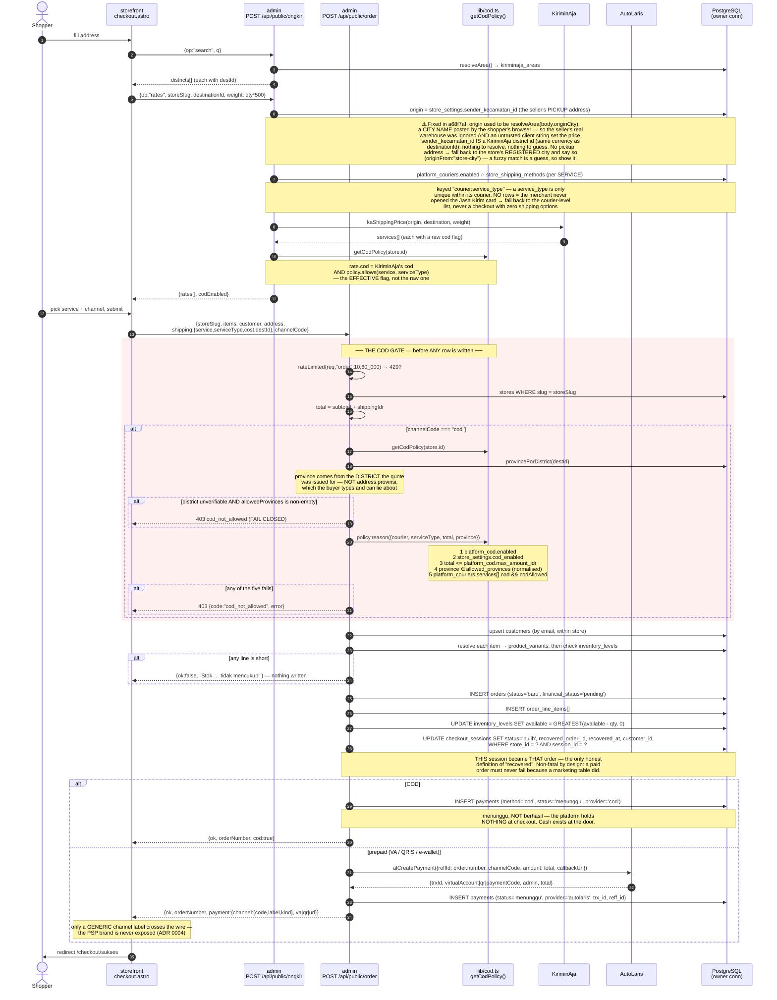
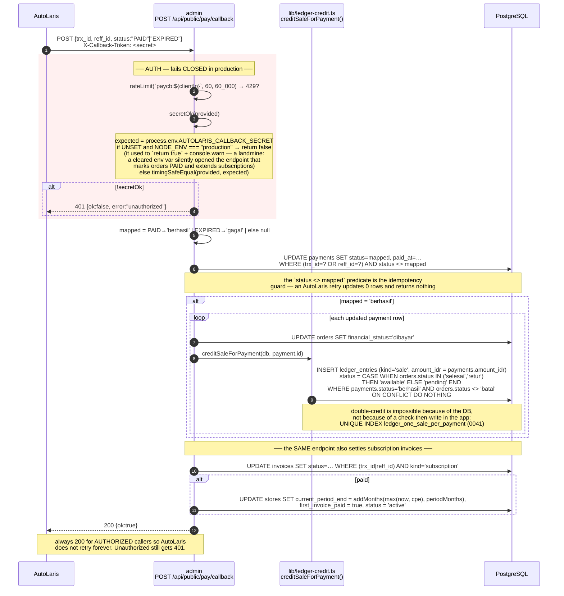
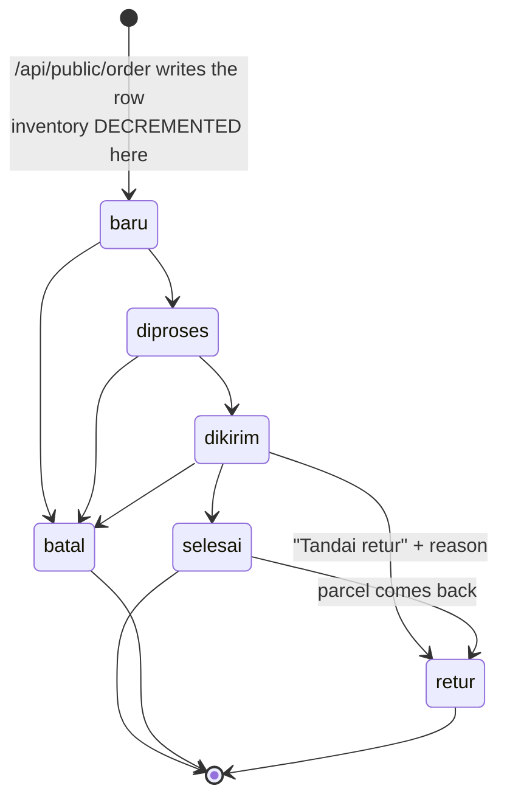
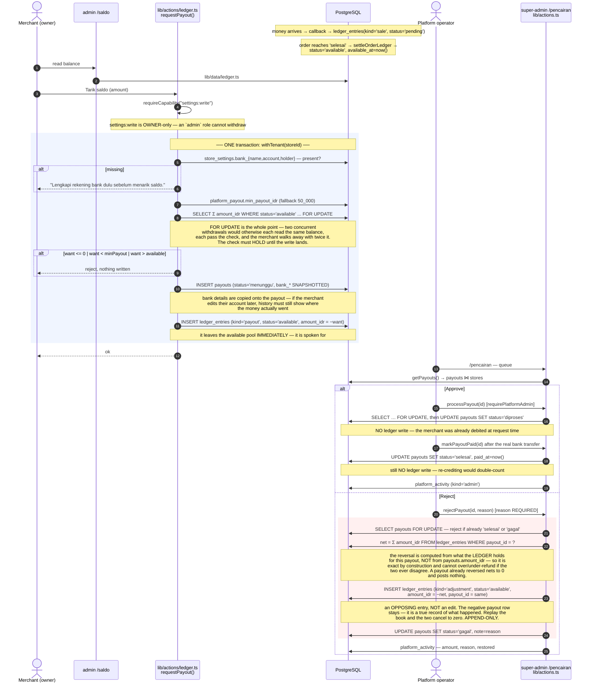
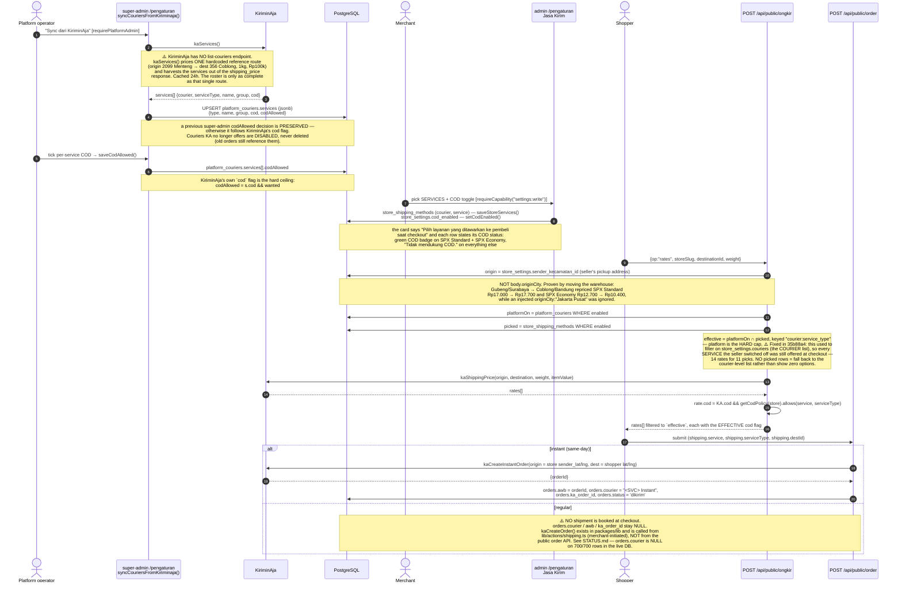
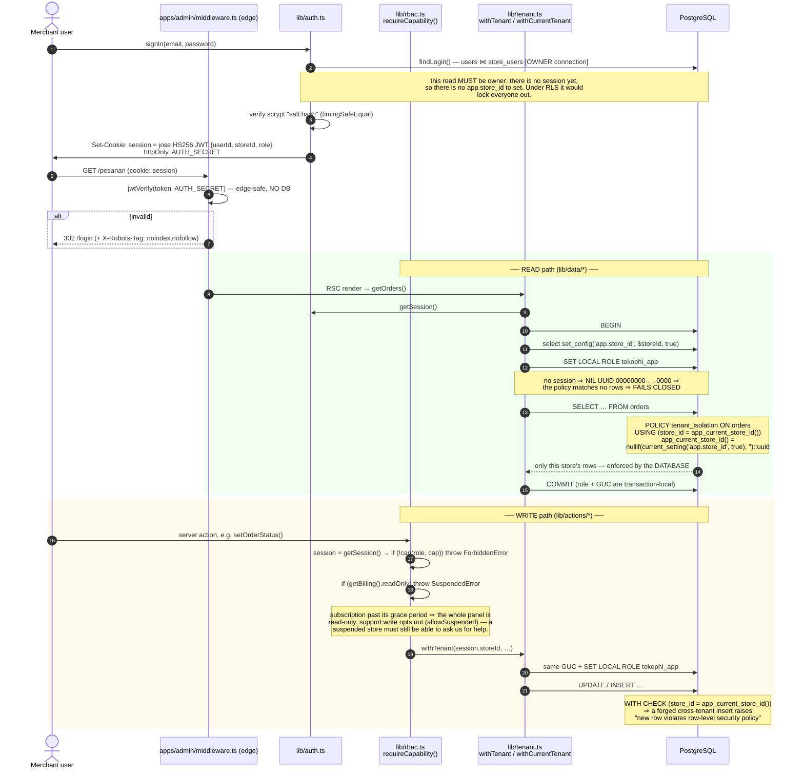
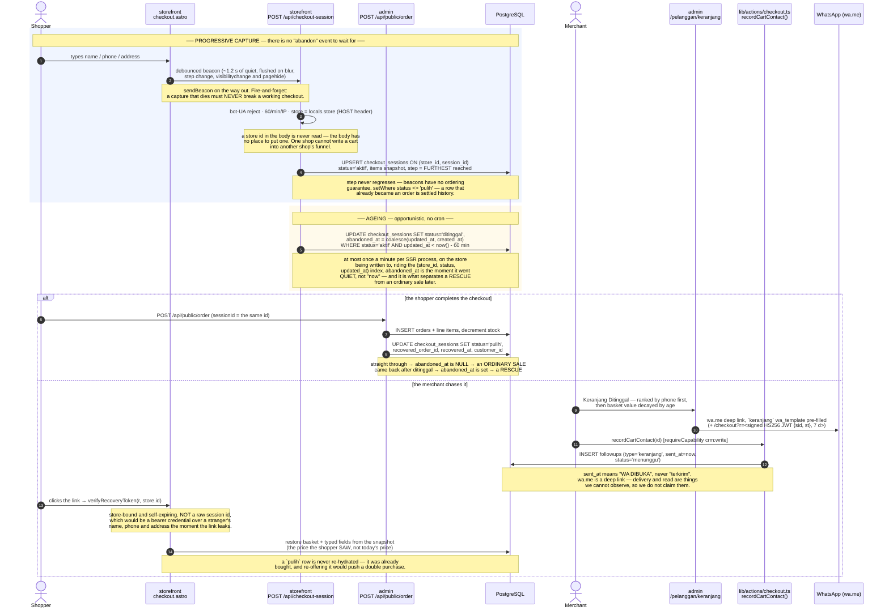

# TokoΦ — CRITICAL FLOWS

> Every diagram below carries the **real file and function names** and the **actual guards** as they exist
> in the tree on **2026-07-13**. Read with [`SYSTEM_MAP.md`](./SYSTEM_MAP.md) (structure) and
> [`STATUS.md`](./STATUS.md) (what is real vs. seeded vs. fake).

---

## 1. Shopper checkout — including the COD gate

The COD decision is a **money** decision, so it is enforced at the API boundary, **before any row is written**.
Hiding the option in the storefront UI is UX. A script POSTing `channelCode:"cod"` straight at the endpoint gets a
**403 with no order created** — never a silently-downgraded order (which would hide a COD request as a "transfer").



**Instant (same-day) is a separate leg.** If the shopper picks an instant service, `/api/public/order` calls
`kaCreateInstantOrder()` with the store's `sender_lat/lng` and, on success, sets `orders.awb`, `orders.courier`,
`orders.ka_order_id` and jumps the order straight to `dikirim`. Instant is **never COD** — `lib/cod.ts` nulls the
service out for instant orders because instant is not in the roster.

---

## 2. Payment callback (AutoLaris → admin)

Single endpoint, four jobs: mark the payment, sync the order, **credit the ledger**, and extend subscriptions.



**Amount, precisely.** The ledger credits `payments.amount_idr` (the order total the merchant is owed), **not**
`payments.total` (which adds the gateway's admin fee — the gateway's money, never the merchant's). This is what keeps
Dashboard revenue, the Pesanan list and the Saldo ledger the same number.

---

## 3. Order lifecycle — and what each transition does to inventory and to the ledger

One function: `apps/admin/lib/actions/orders.ts#setOrderStatus`. Guarded by `requireCapability("orders:write")`,
then the whole body — the status change, the inventory move and the ledger move — runs inside **one**
`withTenant(storeId, …)` transaction, so the book can never disagree with the order it describes.



| Transition | Inventory | Payments | Ledger (`settleOrderLedger`) |
|---|---|---|---|
| **→ `baru`** (order created) | **−qty** on each `inventory_levels` row (`GREATEST(available - qty, 0)`) | prepaid: `menunggu` bill · COD: `menunggu` COD row | nothing — no money has been collected |
| `baru → diproses → dikirim` | unchanged | unchanged | nothing. **Release does NOT happen at despatch**, deliberately: a parcel can only be *returned* after it shipped, and for COD the cash does not exist yet |
| **→ `selesai`** | unchanged | `collectCodOnDelivery()` flips any `method='cod' AND status='menunggu'` payment to **`berhasil`** — `selesai` **is** the delivery signal (there is no courier "delivered" webhook) | `creditSalesForOrder()` books anything collected and not yet in the book, then `UPDATE ledger_entries SET status='available', available_at=now() WHERE order_id=? AND kind='sale' AND status='pending'` |
| **→ `batal`** | **+qty restored** | any `menunggu` payment → **`gagal`** | nothing is booked (`creditSaleForPayment` explicitly skips `orders.status='batal'`) |
| **→ `retur`** | **+qty restored** — the goods are back on the shelf, same as `batal` | any `menunggu` payment → **`gagal`** (a refused COD parcel collected no cash) | an **OPPOSING entry**, never an edit of the sale: `INSERT ledger_entries (kind='retur', amount_idr = -sale.amount_idr, status = sale.status)`. Also sets `orders.returned_at` + `return_reason`. |

Two subtleties that are easy to get wrong and are handled:

1. **The claw-back carries the SAME status as the sale it reverses.** A parcel can be returned straight from `dikirim`,
   where the sale is still `pending`. Reversing that out of `available` (as an earlier version did, unconditionally)
   would drive the withdrawable balance **negative** while the held pool still showed the money. Reverse a pending sale
   out of `pending`, a released one out of `available`; either way the pair nets to zero.
2. **The inventory restore is guarded on the previous status** (`if (restores && order.status !== status)`), so a repeat
   click cannot double-restore stock. The ledger's equivalent guarantee is the DB's:
   `UNIQUE INDEX ledger_one_retur_per_order`.

---

## 4. Money — sale → pending → available → payout → approval / rejection

The balance is **derived, never stored**: `Σ amount_idr WHERE status='available'`. A stored balance is a number that can
silently disagree with the movements that produced it; a derived one cannot.



**Release timing.** `platform_payout.release_on` defaults to `'selesai'` and the super-admin can flip it to `'dikirim'`.
✅ **It IS read now (fixed 2026-07-14, `0776e99`).** `settleOrderLedger()` reads the row and releases at whatever it
says. It previously hardcoded `if (status === "selesai")`, so the toggle persisted and changed nothing — an operator
could flip it, believe the policy had changed, and it had not. **A knob that moves nothing is worse than no knob.**

The default should stay `selesai`. Release-on-despatch looks generous and is a trap: a shipped parcel can still come
back, so the merchant could withdraw money for goods that return — and on COD the cash does not exist at despatch at
all (the courier collects at the door and settles days later).

---

## 5. Shipping — roster sync → merchant selection → ongkir → shipment



Tracking: the storefront has **no** `/api/track`-style shipment lookup; `kaTrack()` exists in `packages/lib` and is
reachable from the merchant admin only.

---

## 6. Auth, session, and how RLS actually enforces tenancy

Three separate identities. They do not overlap.

| Identity | Table | Cookie | Guard |
|---|---|---|---|
| Merchant user | `users` ⋈ `store_users` (role) | `session` | `middleware.ts` (edge JWT) + `requireCapability(cap)` (real boundary) |
| Platform operator | `platform_admins` | `platform_session` | `middleware.ts` + `requirePlatformAdmin()` |
| Shopper | none — there is no shopper account system | none | `/akun` on the storefront is a **non-functional demo form** |



**45 of the 70 tables carry that policy** (re-verified from `pg_class.relrowsecurity` on 2026-07-14). The DB, not
application code, is the tenant boundary — for the Seller panel (`apps/admin`).

**The deliberate exceptions**, and why:

| Exception | Connection | Why it is not a bug |
|---|---|---|
| `lib/auth.ts` | owner | Reads `store_users` before a session exists. |
| `apps/super-admin/**` | owner | Cross-tenant by definition. `withTenant` is never called there (grepped: zero source hits). |
| `apps/storefront` | owner | Resolves the tenant from `Host`, then reads that store's catalog + writes `analytics_events` (`/api/track`) and `checkout_sessions` (`/api/checkout-session`) with a **Host-derived** `store_id` (never client-supplied — the capture body has no field for one). |
| **`/api/public/*`** | owner + an explicit `store_id` from `storeSlug` | ⚠️ **The real hole.** The shopper has no session, so there is no GUC to set. Tenant correctness on the *checkout* path — the path that writes orders, payments and inventory — rests on application code. On the VPS this becomes PostgREST with the `store_id` JWT claim feeding the GUC. Until then, treat `/api/public/order` as unguarded by the database. |
| `/api/cron/billing` | owner | Iterates every store on purpose. |

---

## 7. Abandoned checkout — progressive capture, ageing, and WhatsApp recovery

Migrations **0044** / **0045**. The flow that has **no event of its own**: abandonment is the *absence*
of an order, so nothing fires when it happens. The row is therefore written **as the shopper types**,
and judged later by what never happened to it.

Indonesia abandons **82–83%** of carts (market research, not our measurement, against a ~70% global
figure) and we recorded **none** of them — while the CRM was already showing `keranjang` follow-ups
with a WhatsApp template ready to send, pointing at baskets that did not exist.



### 7.1 The four numbers on the screen, and why one of them needed a migration

Every figure on `/pelanggan/keranjang` is a `count` / `sum` over `checkout_sessions` + `orders`
(`apps/admin/lib/data/checkout.ts`, wrapped in `withCurrentTenant`). Nothing is modelled, blended or
estimated, and what cannot be counted — *was the message delivered? read?* — is **not shown at all**.

```sql
rescued       = abandoned_at IS NOT NULL AND recovered_at IS NOT NULL   -- a save
straight-thru = abandoned_at IS NULL     AND recovered_at IS NOT NULL   -- an ordinary sale, NOT a save
abandonRate   = ditinggal / (ditinggal + orders)
recoveryRate  = rescued   / (rescued + ditinggal)
```

**`aktif` sessions are excluded from both sides of both ratios** — the shopper is still typing, and
nobody has abandoned anything yet. An order counts as a completed checkout **even if it was later
cancelled**: the checkout still finished.

**Why `abandoned_at` (0045) had to exist.** A checkout that sailed straight through *also* ends as
`status='pulih'`. On the local data (store `batik-nusantara`, 30-day window anchored at
`CHECKOUT_TODAY = 2026-07-02`): **792 ditinggal · 198 orders · 100 rescued · 90 straight-through** →
abandonRate **80,0%**, recoveryRate **11,2%**. The naive `pulih / (pulih + ditinggal)` reports
**19,3%** on that same data — it would tell a shop it "rescued" every ordinary sale it ever made. A
number that looks real and is wrong is worse than no number.

**`phone` is the column this table is paid for.** Recovery in Indonesia travels on WhatsApp, not email,
so the list ranks carts with a number first and says plainly that the rest (`anonim`) cannot be
contacted at all — rather than quietly hiding them and implying every cart is actionable.

---

## 8. Ad click → order → conversion at the provider (ADR 0011 / 0012 / 0013)

Two halves of ONE sale. The shopper's browser and our server both report it, and they carry the **same
`event_id`**, so the provider counts one conversion rather than two. Everything here is per store — the
pixel id and the CAPI token belong to the merchant, not to TokoΦ (ADR 0012).

### The rules this flow exists to protect

1. **The order row is the evidence, never the request.** `purchaseFacts()` re-reads value, line items,
   discount, ongkir and PPN from the database (`apps/admin/lib/tracking-events.ts`). A success page is
   not proof that a sale happened.
2. **One id helper, or nothing matches.** `<g:id>` in the feed and `content_ids` in every event both come
   from `retailerId()` (`packages/lib/src/tracking-ids.ts`), with `stores.catalog_id_scheme` as a
   *parameter*, never an `if` at a call site. A mismatch does not degrade matching — it **zeroes** it.
3. **Prepaid is not a conversion until the money lands.** COD converts at the thanks page; VA/QRIS is
   enqueued HELD (parked at `2126-01-01`) and released by the payment callback.
4. **`value` does not mean the same thing to every provider.** Meta and TikTok take the all-in total;
   GA4 takes goods only (subtotal − discount), with `shipping` and `tax` as their own parameters. All
   four numbers ride on the delivery row so the sender chooses, instead of one figure lying to two of
   them. Browser and server must compute goods **identically** or GA4 receives two revenues for one
   `transaction_id`.
5. **Every layout a shopper can convert under must render `MarketingPixels`.** `CheckoutLayout` was
   missed once and `LandingLayout` twice — the second time it cost the entire paid-traffic funnel, with
   build, lint and `astro check` all green.

### The path

```
LANDING (any page)                  MarketingPixels.astro
  ?fbclid / ?gclid / ?ttclid   →    vendor SDKs write _fbc / _gcl_aw; we persist ttclid (28 d)
  ?utm_source / ?utm_medium    →    we persist utm (30 d) — the ONLY signal that says "paid"
  PageView · ViewContent (exact variant id, ADR 0013 §7.2)

CHECKOUT  /checkout  or  /promo/<handle> · /lp/<slug>  (OrderFunnel)
  InitiateCheckout — exact ids win; value and units describe the SAME lines as the ids
  POST /api/public/order  { trackingCookies: { fbp, fbc, ga, gcl, ttp, ttclid, utmSource, utmMedium } }

SERVER  api/public/order
  adChannel(trackingCookies)  →  orders.channel        (lib/ad-channel.ts)
  enqueuePurchase(store, order, client, { hold: !isCod })
      → one tracking_event_deliveries row per configured channel
      → COD: due now.   Prepaid: parked at 2126-01-01 (HELD)
  responds { tracking: { eventId, contentIds, browserPurchase } }

BROWSER  /checkout/sukses  or  /thanks
  Purchase, only when the SERVER said browserPurchase === true

PAYMENT  api/public/pay/callback  →  releasePurchase()  →  held rows become due

CRON  api/cron/tracking-events, every 60 s
  purge (30 d) → reconcile (release paid, back-fill missing) → claim → send → verdict
```

### 8.1 Facts worth stating once, here

- **`event_id` is `purchase:{order_number}`, the order number alone.** ADR 0012 §14.3 proposed
  `purchase:{store_id}:{order_id}`; `orders.number` already carries a platform-wide unique constraint, so
  the store namespace buys no collision resistance and would publish the tenant key into three ad
  platforms' logs. An identifier handed to Meta cannot be un-handed.
- **`fbclid` is NOT proof of an ad.** Meta appends it to every outbound Facebook/Instagram/Messenger
  link, organic included. Google's `gclid` and TikTok's `ttclid` really are paid-only. So `adChannel`
  reads `utm_medium` first, then the paid-only click ids, and books a bare `_fbc` as `other` — "came
  from Meta", not "came from a Meta ad". A merchant who tags their ad URLs (`utm_medium=cpc`) gets
  `meta_ads` properly; one who does not gets an honest `Lainnya` instead of inflated ad revenue.
- **`send_to` is mandatory on the GA4-shaped gtag event.** Without it gtag broadcasts to the DEFAULT
  group — including any `AW-` tag configured on the same page — and Google Ads receives two purchases
  per sale, only one of which carries a `transaction_id`.
- **The browser Purchase is gated by the server.** `browserPurchase` is true only for COD:
  `/checkout/sukses` is where an **unpaid** VA/QR is displayed, so firing there for a prepaid order
  would report a conversion for every abandoned payment screen.
- **A store with no channel configured pays nothing.** `enqueuePurchase` checks `store_tracking_channels`
  FIRST, before building the four-query fact set, because it runs inline on the checkout's hot path.
- **Non-fatal by contract.** Callers wrap `enqueuePurchase` in try/catch — a marketing table must never
  fail an order. Which is exactly why the cron's back-fill sweep has to exist.
- **Ops:** sidecar `cron-tracking-events` (`sleep 60`) in `docker-compose.coolify.yml`. Needs
  `CRON_SECRET` (fail-closed in production) **and** `INTEGRATION_TOKEN_KEY`. See `DEPLOY.md`.
