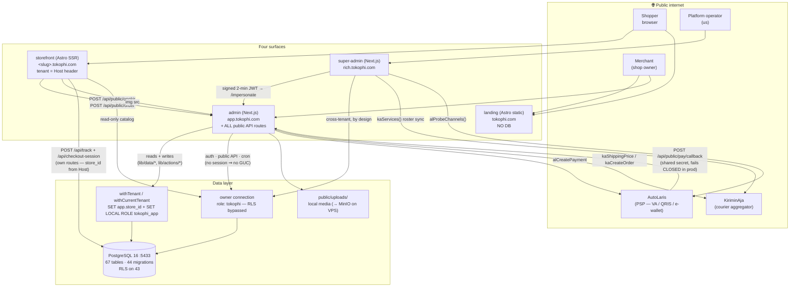
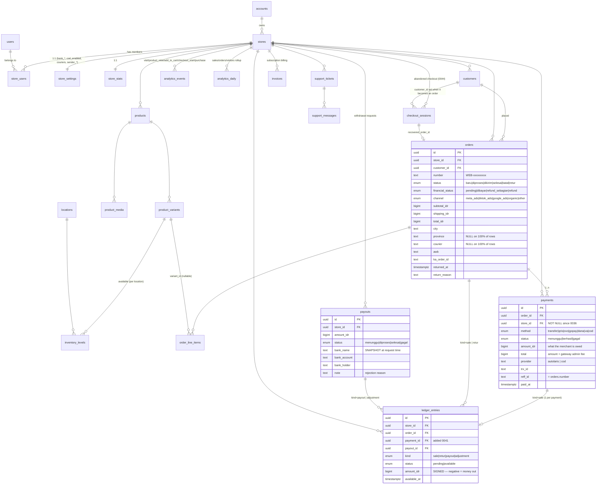

# TokoΦ — SYSTEM MAP

> **Provenance.** Every claim below was checked against the **source tree** and the **live database**
> (`docker exec tokophi-db psql -U tokophi -d tokophi`) on **2026-07-13**, not against the older docs
> in this folder. Where a fact could not be verified it is marked **UNVERIFIED** and says why.
> Companion docs: [`FLOWS.md`](./FLOWS.md) (sequence diagrams), [`STATUS.md`](./STATUS.md) (what is real vs. fake).
>
> **Corrections to prior docs are listed at the bottom** ([§12](#12-corrections-to-the-existing-docs)).

---

## 1. The four surfaces

TokoΦ is an npm-workspaces monorepo. Four deployable surfaces, five shared packages, one Postgres.

| # | Surface | Package | Framework | Port (dev) | Prod host | Owns |
|---|---------|---------|-----------|-----------|-----------|------|
| 1 | **admin** | `@tokophi/admin` | Next.js (App Router, RSC + server actions) | 3000 | `app.tokophi.com` | The merchant panel. **Also hosts the entire public HTTP API** (`/api/public/*`, `/api/cron/*`, `/api/uploads/*`) and the local media store. |
| 2 | **super-admin** | `@tokophi/super-admin` | Next.js (App Router, RSC + server actions) | 3001 | `rich.tokophi.com` | The platform control plane. Cross-tenant. **Owner DB connection — deliberately outside RLS.** |
| 3 | **storefront** | `@tokophi/storefront` | Astro **SSR** (`output: "server"`, `@astrojs/node` standalone) | 4327 | `<slug>.tokophi.com` (+ `toko.`) | The shopper site. **One container serves every tenant**, resolved from the `Host` header (ADR 0009). |
| 4 | **landing** | `@tokophi/landing` | Astro **static** (`output: "static"`) | 4328 | `tokophi.com` / `www.` | The apex marketing page. **Zero DB dependency, on purpose** — the front door must serve when everything behind it is down. |

| Package | What it is | Consumed by |
|---|---|---|
| `@tokophi/db` | Drizzle schema (`src/schema.ts`, 971 lines), `db` client, `withTenant()` (RLS), migrations, seed. | admin, super-admin, storefront |
| `@tokophi/lib` | `format` (IDR/num/timeAgo), `billing`, `autolaris` (PSP client), `kiriminaja` (courier client), `cache` (+ in-process `rateLimit`), `colors`, `couriers`, `totp`, `integration-status`, `payment-fees`. | admin, super-admin, storefront |
| `@tokophi/ui` | 22 shadcn primitives on **Base UI** (not Radix) + Tailwind v4 tokens. | super-admin (admin still has its own local copy) |
| `@tokophi/sections` | **Types only, zero runtime.** The Store-Builder section contract (`SECTION_TYPES`, `SECTION_DEFAULTS`, `StoredTemplateData` = the shape of `page_templates.sections`). | admin (Puck editor) **and** storefront (Astro renderer) — this is what stops the two from drifting. |
| `@tokophi/data` | Small shared menu/nav data. | admin, storefront |

### 1.1 The whole system



### 1.2 Who talks to whom (the only four cross-surface edges)

| Edge | Mechanism | File |
|---|---|---|
| storefront → admin | `fetch` to `PUBLIC_ONGKIR_API` / `PUBLIC_ORDER_API` (defaults `http://localhost:3000/api/public/…`) | `apps/storefront/src/pages/checkout.astro:12-13` |
| storefront → admin (images) | `ADMIN_BASE` is derived as `new URL(PUBLIC_ONGKIR_API).origin` — **a load-bearing coupling**: change the ongkir URL and product images silently move | `apps/storefront/src/data/catalog.ts` |
| super-admin → admin | "Buka Dashboard Seller" mints a **2-minute JWT** signed with the shared `AUTH_SECRET`, redirects to `${ADMIN_URL}/impersonate?token=…&slug=…`, which exchanges it for a real `session` cookie on the admin domain (cookies don't cross subdomains) | `apps/super-admin/lib/session.ts` → `apps/admin/app/impersonate/route.ts` |
| AutoLaris → admin | webhook `POST /api/public/pay/callback` | `apps/admin/app/api/public/pay/callback/route.ts` |

Everything else is **through the database**. There is no service mesh, no internal RPC, no queue.

---

## 2. The tenant boundary (where RLS actually sits)

Verified from the catalog, not from a doc:

```sql
select count(*) from information_schema.tables where table_schema='public';   -- 68
select count(*) from pg_class c join pg_namespace n on n.oid=c.relnamespace
 where n.nspname='public' and c.relkind='r' and c.relrowsecurity;             -- 44
```

- **68 tables**, **46 migrations** (`0000` … `0045`). *(Re-verified 2026-07-14: `0042_order_address_snapshot`,
  `0043_chat`, and then `0044_customers_and_abandoned_checkout` / `0045_checkout_abandoned_at` landed after this
  file was first written. `0043` is the shopper⇄merchant chat feature; `0044`/`0045` add **`checkout_sessions`**
  and the guest/registered columns on `customers` — see `SCHEMA.md` §1 and §3.4.)*
- **44 tables have `relrowsecurity = true`.** Every one carries the same policy:
  `USING (store_id = app_current_store_id()) WITH CHECK (store_id = app_current_store_id())`.
- `app_current_store_id()` is `SELECT nullif(current_setting('app.store_id', true), '')::uuid`.
- Two DB roles exist: **`tokophi`** (owner, bypasses RLS) and **`tokophi_app`** (non-owner, 256 table grants, policies enforce).
- **Exactly one table has a `store_id` and no RLS: `platform_activity`** — the platform audit log, deliberately owner-only.
  There are **no other gaps**. (`media` and `payments` were closed by migration `0036`.)

`withTenant()` (`packages/db/src/rls.ts`) is the whole mechanism, and it is 8 lines:

```ts
export async function withTenant<T>(storeId: string, fn: (tx: typeof db) => Promise<T>): Promise<T> {
  return db.transaction(async (tx) => {
    await tx.execute(sql`select set_config('app.store_id', ${storeId}, true)`);
    await tx.execute(sql`set local role tokophi_app`);
    return fn(tx as unknown as typeof db);
  });
}
```

| Caller | Connection | Why |
|---|---|---|
| admin **reads** (`lib/data/*`) | `withCurrentTenant()` → session cookie → `withTenant` | The GUC + `tokophi_app` role. An unauthenticated call passes the **nil UUID**, which matches no rows → **fails closed**. |
| admin **writes** (`lib/actions/*`) | `requireCapability(cap)` → `withTenant(session.storeId, …)` | RBAC first (throws `ForbiddenError`), then RLS. |
| admin **auth** (`lib/auth.ts`) | owner | Reads `store_users` *before a session exists* — under RLS it would lock everyone out. |
| admin **public API** (`/api/public/*`) | owner + an **explicit** `store_id` resolved from `storeSlug` | The shopper has no session, so there is no GUC to set. **This is the largest deliberate RLS hole in the system** — tenant correctness on the checkout path rests on application code, not the database. |
| admin **cron** (`/api/cron/billing`) | owner | Iterates every store by design. |
| **storefront** | owner | Resolves the tenant from `Host`, then reads that store's catalog — and **writes two tables with a Host-derived `store_id`**: `analytics_events` (`/api/track`) and `checkout_sessions` (`/api/checkout-session`). The client never names a store. |
| **super-admin** | owner | Cross-tenant by definition. `withTenant` is **never called** anywhere in `apps/super-admin` (grepped: zero source hits). |

---

## 3. Core domain — ER diagram

Only the load-bearing tables. Money is `bigint` IDR throughout; all names are snake_case.



**The ledger is the only correct source of a merchant's balance.**
`saldo tersedia = Σ amount_idr WHERE status='available'` · `dana dalam proses = Σ WHERE status='pending'`.
It is append-only: nothing is ever edited in place, and three partial unique indexes make double-credit
physically impossible rather than merely unlikely:

| Index | Guarantees |
|---|---|
| `ledger_one_sale_per_payment` (0041) | a gateway callback retry cannot credit twice |
| `ledger_one_sale_per_order` (0040) | one sale per order |
| `ledger_one_retur_per_order` (0040) | a double-clicked "Retur" cannot double-refund |

Live state (2026-07-13): 645 entries — 595 `sale/available` (Rp209.374.000), 47 `sale/pending` (Rp18.436.000), 2 `payout/available` (−Rp17.345.000), 1 `adjustment/available` (+Rp12.345.000, a rejected payout restored).

---

## 4. `apps/admin` — routes → data layer → tables

Layout `app/(admin)/`. Guard: `middleware.ts` verifies the `session` JWT at the edge (jose, no DB) and
redirects to `/login`. Excluded from the matcher: `/api/public/`, `/api/cron/`, `/api/uploads/`, `/products/`, `robots.txt`.
Every mutating server action re-checks with `requireCapability(cap)` — **that** is the security boundary, not the middleware.

### 4.1 Merchant screens

| Route | Reads (`lib/data/…`) | Tables read | Writes (`lib/actions/…`) | Tables written |
|---|---|---|---|---|
| `/` Dashboard | `analytics`, `orders`, `products`, `activity`, `returns`, `support`, `funnel` | `analytics_daily`, `orders`, `order_line_items`, `products`, `customers`, `reviews`, `inventory_levels`, `support_tickets` | — | — |
| `/pesanan`, `/pesanan/[id]` | `orders` | `orders`, `order_line_items`, `customers` | `orders.setOrderStatus` | `orders`, `inventory_levels`, `payments`, **`ledger_entries`** |
| `/produk`, `/produk/[id]`, `/produk/baru` | `products` | `products`, `product_variants`, `product_media`, `product_options`, `inventory_levels` | `products`, `media` | same + `locations`, `media` |
| `/produk/kategori/*` | `collections` | `collections`, `collection_products` | `collections` | + `collection_conditions` |
| `/produk/inventori` | `products` | `inventory_levels`, `product_variants` | `inventory` | `inventory_levels` |
| `/produk/pembelian` | `purchases` | `purchase_orders`, `purchase_order_items`, `suppliers` | `purchases` | same + `inventory_levels` (on "Terima barang") |
| `/pelanggan`, `/pelanggan/[id]` | `customers` | `customers` (incl. `registered_at` → **Tamu / Terdaftar**), `orders`, `order_line_items` | `customers` | `customers` |
| **`/pelanggan/keranjang`** (Keranjang Ditinggal) | `checkout` | **`checkout_sessions`**, `orders` (the completed-checkout denominator), `followups`, `wa_templates` | `checkout.recordCartContact` | `followups` (`type='keranjang'`) |
| `/pelanggan/segmen` | `segments` | `customer_segments` | `segments` | `customer_segments` |
| `/pelanggan/ulasan` | `reviews` | `reviews`, `customers` | — | — |
| `/crm`, `/crm/{followup,pipeline,template}` | `crm` | `followups`, `leads`, `wa_templates`, `customers` | `crm` | `followups` |
| `/diskon/*` | `discounts` | `discounts` | `discounts` | `discounts`, `discount_usages` |
| `/analitik` | `analytics`, `funnel` | `orders`, `order_line_items`, `products`, `analytics_daily`, **`analytics_events`** | — | — |
| `/pemasaran` | `marketing` | `orders` (+ `ad_channels` for *labels only*) | — | — |
| **`/saldo`** | `ledger` | `ledger_entries`, `payouts`, `platform_payout`, `store_settings`, `orders`, `payments` | `ledger.requestPayout` | `payouts`, **`ledger_entries`** |
| `/tema`, `/tema/[id]` (Puck) | `theme` | `page_templates`, `collections`, `products`, `stores` | `theme` | same |
| `/halaman/*`, `/blog/*`, `/navigasi`, `/files` | `pages`, `articles`, `menus` | `pages`, `blogs`, `articles`, `menus`, `menu_items`, `media` | `pages`, `articles`, `menus`, `media` | same |
| `/bantuan`, `/bantuan/[id]` | `support` | `support_tickets`, `support_messages` | `support` | same |
| `/pengaturan` | `store`, `payments` | `stores`, `store_settings`, `platform_couriers` | `shipping`, `rekening`, `payment-settings` | `store_settings`, `store_shipping_methods` |
| `/akun/{profil,keamanan,langganan}`, `/faktur/[number]` | `billing` | `stores`, `users`, `store_users`, `invoices` | `profile`, `security`, `billing` | `users`, `stores`, `invoices` |
| `/login`, `/daftar` | — | `users`, `store_users` (owner conn) | `auth`, `register` → `lib/provision.ts` | `accounts`, `users`, `stores`, `store_users`, `locations`, `store_settings`, `store_stats`, `platform_activity` |

### 4.2 The public HTTP API (all hosted by admin)

| Route | Auth | Rate limit | What it does |
|---|---|---|---|
| `POST /api/public/ongkir` | **none** (CORS `*`) | 60/min/IP | `op=search` → `kiriminaja_areas` autocomplete · `op=rates` → live `kaShippingPrice`, filtered by **(platform-enabled couriers) ∩ (the merchant's per-service picks in `store_shipping_methods`)**, keyed `"<courier>:<service_type>"`; no picked rows = fall back to the courier-level list rather than a checkout with zero options. ⚠️ **Fixed `35b88a4`** — it filtered on `store_settings.couriers` (the COURIER list) while the Jasa Kirim card writes per *service*, so every service the seller switched off was still offered (**14 rates for 11 picks** → **10**). Each rate is labelled with the **effective** COD flag (KiriminAja capability × platform `codAllowed` × the store's `cod_enabled`) · `op=instant` → same-day pricing from the store's `sender_lat/lng`. |
| `POST /api/public/order` | **none** (CORS `*`) | 10/min/IP | The checkout. **Enforces the 5-condition COD gate before any row is written**, then upserts `customers`, checks stock, writes `orders` + `order_line_items`, decrements `inventory_levels`, and creates either a `cod` payment (`menunggu`) or an AutoLaris bill. Finally flips the matching `checkout_sessions` row (scoped to the **unique** `(store_id, session_id)`) to `pulih` + `recovered_order_id` + `recovered_at` + `customer_id` — **the only honest definition of "recovered"**: not "we sent a WhatsApp and they bought something later", but *this session became that order*. Non-fatal: a paid order must never fail because a marketing table did. |
| `POST /api/public/pay` | **none** | 20/min/IP | Standalone `alCreatePayment`. **Dead**: `PUBLIC_PAY_API` is declared in `apps/storefront/.env.example` but no storefront source file reads it. |
| `POST /api/public/pay/callback` | **shared secret** `X-Callback-Token` / `?token=`, constant-time compare; **returns 401 in production when `AUTOLARIS_CALLBACK_SECRET` is unset** (fails closed) | 60/min/IP | Marks payments paid → syncs `orders.financial_status` → **credits the ledger** → extends store subscriptions. |
| `GET /api/cron/billing` | `CRON_SECRET` header/query. ✅ **Fails CLOSED (fixed 2026-07-14, `0776e99`)** — 401 in production when the secret is unset. It used to read `if (secret && provided !== secret)`, so **no secret meant no check at all**, on a route excluded from the auth middleware that walks every store to suspend it or bill it. | none | Syncs `stores.status` to the computed lifecycle; generates renewal VA invoices for `past_due`/`suspended` stores. |
| `GET /api/uploads/[name]` | **none** (public by design — storefronts embed these) | none | Serves runtime-uploaded media from `public/uploads/`. Filename regex `^[a-zA-Z0-9._-]+$` blocks traversal. |
| `GET /api/auth/google/{start,callback}` | — | none | Google OAuth (feature-flagged; routes redirect when env is unset). |
| `GET /impersonate` | 2-min JWT from super-admin | none | Exchanges the token for a `session` cookie on the admin domain. |

### 4.3 RBAC

`lib/rbac-policy.ts` is the client-safe matrix; `lib/rbac.ts#requireCapability` is the server guard. Roles come from `store_users.role`.

| Role | Capabilities |
|---|---|
| `owner` | all |
| `admin` | all **except `settings:write`** |
| `staff` | `products:write`, `discounts:write`, `content:write`, `orders:write`, `customers:write`, `crm:write`, `media:write`, `support:write` |
| `gudang` | `inventory:write`, `purchases:write`, `support:write` |

Two consequences worth naming:
- **`requestPayout` requires `settings:write` → only an `owner` can withdraw money.** Correct, and probably not obvious.
- `requireCapability` also blocks writes when the subscription is past its grace period (`getBilling().readOnly` → `SuspendedError`). `support:write` opts out via `allowSuspended` — a suspended store must still be able to contact us about the billing problem that suspended it.

---

## 5. `apps/super-admin` — routes → data → tables

Separate identity: table **`platform_admins`**, cookie **`platform_session`** (distinct from the admin's `session`, so an
admin login never grants control-plane access). Guard = `requirePlatformAdmin()`, and **every exported action in
`lib/actions.ts` calls it as its first statement** (verified line by line). No API routes at all — RSC pages + server actions only.

| Route | Reads | Tables |
|---|---|---|
| `/` Dashboard | `getPlatform`, `getMrrSeries`, `getDeltas`, `getSubscriptionStats`, `getInvoices`, `getStatusDistribution`, `getActivity` | `stores`, `store_stats`, `invoices`, `accounts`, `platform_activity` |
| `/toko`, `/toko/[id]` | `getStores`, `getStoreBilling`, `getStoreInvoices`, `getStoreUsers`, `getStoreActivity`, `getStoreBalance`, `getStoreMovements`, `getStorePayouts`, `getStoreMoneySignals` | `stores`, `store_stats`, `store_users`, `users`, `invoices`, `platform_activity`, `ledger_entries`, `payouts`, `orders` |
| `/paket` | `getInvoices` | `invoices`, `accounts` |
| **`/pencairan`** | `getPayouts`, `getPayoutSummary`, `getPayoutPolicy` | `payouts`, `stores`, `platform_payout` |
| `/tiket`, `/tiket/[id]` | `getAllTickets`, `getTicketAdmin` | `support_tickets`, `support_messages`, `stores` |
| `/analitik` | `getFinanceStats`, `getSystemStatus`, `getServerMetrics` | `invoices`, `stores` + `node:os` |
| `/pengaturan` | `getPaymentChannels`, `getPaymentGateways`, `getCouriers`, `getPlatformAdmins`, `getAggregator` | `platform_payment_channels`, `platform_payment_gateways`, `platform_cod`, `platform_couriers`, `platform_admins`, `shipping_aggregator` |

Mutations that touch **money or identity** (all audit-logged to `platform_activity` with `kind='admin'`):
`processPayout`, `markPayoutPaid`, **`rejectPayout`** (posts an opposing `adjustment` entry — see FLOWS §4), `savePayoutPolicy`,
`compStore`, `extendTrial`, `setStoreComped`, `resetOwnerPassword`, `resetStoreUserPassword`, `addStoreUser`, `removeStoreUser`,
`createManualInvoice`, `setStoreStatus`.

✅ **FIXED 2026-07-14 (`0776e99`, `571ed17`): `requirePlatformAdmin(min)` now enforces the role** — ranked
`support` 1 < `admin` 2 < `owner` 3. `impersonateStore` and `resetOwnerPassword` require **`owner`**, and
**impersonation is audit-logged**. Before this, the role was carried in the JWT and read by nothing.

⚠️ **Audit gaps that REMAIN** (they mutate, they do not log): `createStore`, `setInvoiceStatus` (**money**),
`invitePlatformAdmin`, `setStoreUserRole`, `saveGateways`, `saveCodAllowed` (**COD risk policy**), every ticket action.

🔴 **The role check has a hole:** `invitePlatformAdmin` is `admin`-gated, takes `role` **unvalidated**
(`role: input.role || "admin"`), and is **unlogged** — so an `admin` operator can mint themselves an `owner` and
reach the two owner-only actions. Role enforcement is also **action-only**: the middleware and page guards check for
*a* session, not a role, so a lower-privileged operator sees every screen. See STATUS.md §3.3.

---

## 6. `apps/storefront` — routes → data → tables

`output: "server"`, `@astrojs/node` standalone. **`astro build` is DB-free** (verified in a prior session with `DATABASE_URL` unset), which is what preserves the zero-downtime deploy.

**Tenant resolution** — `src/middleware.ts` → `src/data/store.ts#getStoreByHost`, in order:
1. custom domain — **a `return null` stub today** (no `stores.custom_domain` column; the `domains` table exists and is unused),
2. `<slug>.$STOREFRONT_BASE_DOMAIN`,
3. first host label (the sslip box),
4. `STORE_SLUG` / `DEFAULT_STORE_SLUG` fallback — **only if the host named no store at all**.

A host that names an *unknown* slug returns a clean **404**, never another merchant's shop. `RESERVED` labels
(`www`, `app`, `rich`, `admin`, `api`, `cname`, `toko`, `storefront`, `localhost`) never resolve as a store slug.
The resolved `{store, catalog}` goes on `Astro.locals`; all reads are memoised per store id (15 s TTL, `STOREFRONT_CACHE_TTL_MS`).

| Route | Source | Tables |
|---|---|---|
| `/` | `index.astro` | `page_templates` (homepage), `products`, `collections`, `store_settings`+`platform_cod` (COD badge) |
| `/produk/[handle]` | `produk/[handle].astro` | `products`, `product_variants`, `product_media`, `product_options`, `inventory_levels` |
| `/kategori/[handle]` | `kategori/[handle].astro` | `collections`, `collection_products` (+ 2 **hardcoded virtual** collections: `semua`, `promo-gajian`) |
| `/keranjang` | `keranjang.astro` | none — pure `localStorage` |
| `/checkout` | `checkout.astro` | `platform_payment_channels`, COD policy → then `fetch` to the admin API. Also **captures** into `checkout_sessions` as the shopper types, and **restores** a basket + typed fields from `?r=<signed token>` (`src/lib/recovery.ts`) — a `pulih` session is never re-hydrated (it was already bought) |
| `/checkout/sukses` | `sukses.astro` | none — renders `localStorage.lastOrder` |
| `/blog` | `blog/index.astro` | **none — 4 articles hardcoded in a source literal.** The `blogs`/`articles` tables are never read; there is no detail route. |
| `/akun` | `akun.astro` | **none — non-functional demo form** ("sistem akun aktif setelah backend terhubung") |
| `/kontak` | `kontak.astro` | `stores` — but `email` is the hardcoded `halo@batiknusantara.id` |
| **`POST /api/track`** | `api/track.ts` | **INSERT `analytics_events`** |
| **`POST /api/checkout-session`** | `api/checkout-session.ts` | **UPSERT `checkout_sessions`** |

These two are the storefront's only API routes and its only writes. Both carry the same guards, in order:
1. `store_id` comes from `Astro.locals.store` (Host-derived) — **never from the client**. The checkout-capture body has **no field for a store id**, and one would be ignored if it did: one shop's page cannot write a cart into another shop's funnel;
2. **bot filter** — a ~40-pattern UA regex (`bot|crawl|spider|headless|puppeteer|curl/|python-requests|axios/|…`); an **empty UA is treated as a bot**;
3. **rate limit** — in-process per-IP fixed window: **30 / 60 s** for track, **60 / 60 s** for checkout capture (a debounced checkout fires a handful);
4. rejections are a silent `204` with a reason header (`x-track:` / `x-capture:`). **Failing quiet is the point** for the capture: a broken beacon must never break a checkout that is otherwise working.

**`/api/checkout-session` is progressive capture.** There is no "abandon" event to listen for — abandonment is the *absence* of an order — so the row is written **as the shopper types** (debounced beacons from `checkout.astro`; `sendBeacon` on `pagehide`/hidden). It upserts on the `(store_id, session_id)` unique key, `step` only ever moves **forward** (beacons have no ordering guarantee), and a session already `pulih` is **never** resurrected to `aktif` by a late beacon (`pagehide` fires on the redirect to `/checkout/sukses` — un-recovering a real sale). The same endpoint carries the **ageing sweep**: `aktif → ditinggal` after 60 minutes of silence, at most once a minute per SSR process, riding the `(store_id, status, updated_at)` index. **No cron.**

⚠️ The bot and rate-limit guards are **per-process in-memory** — they do not hold across replicas, and there is no proof-of-work, no signature, and no session validation. A distributed script with a browser UA can still inflate the funnel (and now the cart table).

---

## 7. `apps/landing`

Two files: `src/pages/index.astro` (hero + 3 facts + JSON-LD `Organization`/`WebSite`/`SoftwareApplication`, deliberately **no `offers`/price**) and `src/pages/sitemap.xml.ts` (hand-rolled from `import.meta.glob`). `public/robots.txt` allows everything.
CTAs come from build-time `PUBLIC_LOGIN_URL` / `PUBLIC_SIGNUP_URL`, joined with `||` not `??` **on purpose** — an unset Docker `ARG` becomes `""`, not `undefined`, and `??` would have shipped `href=""` (it did, once).
**No `@tokophi/db` dependency. No `DATABASE_URL`.** That is the feature.

---

## 8. Payments — AutoLaris (`packages/lib/src/autolaris.ts`)

- Env: `AUTOLARIS_BASE` (default `https://api-h2h.autolaris.com`), `AUTOLARIS_API_KEY`, `AUTOLARIS_CALLBACK_SECRET`.
- **AutoLaris H2H has no list-channels endpoint.** `alProbeChannels()` discovers which channels the platform account has by *calling `create_payment` and reading the response code*: `rc="00"` = active, anything else (commonly `rc="07"`) = not enabled. That rule lives in one place (`integration-status.ts#channelActiveFromRc`) so the probe, the checkout, and the tests cannot drift.
- The brand is **never** exposed to shoppers (ADR 0004) — the storefront only ever sees generic labels (`{code, label, kind}`).
- `payments.amount_idr` = what the merchant is owed. `payments.total` = that **plus the gateway admin fee**, which is the gateway's money and never the merchant's. **The ledger credits `amount_idr`** — which is why Dashboard revenue, the Pesanan list and Saldo agree by construction.

## 9. Shipping — KiriminAja (`packages/lib/src/kiriminaja.ts`)

- Env: `KIRIMINAJA_API_KEY`, `KIRIMINAJA_ENV` — **defaults to `sandbox`** (`https://tdev.kiriminaja.com`). An unset env in production silently talks to the sandbox.
- **KiriminAja also has no "list couriers" endpoint.** `kaServices()` prices **one hardcoded reference route** (origin `2099` Menteng → dest `356` Coblong, 1 kg, item value Rp100k) and harvests the service list out of the `shipping_price` response, cached 24 h. **The roster is therefore only as complete as that one route.**
- Two-level control, and the merchant's level is **per SERVICE**: super-admin sets the hard-enabled courier pool (`platform_couriers.enabled`); the merchant ticks the individual services shown at checkout (`store_shipping_methods`, written by the Jasa Kirim card). Effective = `platform-enabled ∩ picked services`, keyed `"<courier>:<service_type>"` — no picked rows = fall back to the courier-level list. `store_settings.couriers` is the older courier-level list and is now only that fallback.
- Live roster (12 rows): `anteraja, jne, jnt, lion, ninja, sap, sicepat, spx` enabled · `idx, jtcargo, pos, tiki` disabled.

## 10. COD — the five conditions

`apps/admin/lib/cod.ts#getCodPolicy` is the single place that answers "may this be paid on delivery?". All five must agree:

| # | Condition | Source | Today |
|---|---|---|---|
| 1 | platform allows COD at all | `platform_cod.enabled` | **true** |
| 2 | **this merchant** wants COD | `store_settings.cod_enabled` (0038, default **false**) | **true** for batik-nusantara (the other six demo stores are off — the toggle means something) |
| 3 | order total ≤ the cap | `platform_cod.max_amount_idr` (0 = no cap) | **Rp2.000.000** |
| 4 | destination province is allow-listed | `platform_cod.allowed_provinces` (empty = anywhere) | **6**: DI Yogyakarta, Jawa Tengah, Jawa Barat, DKI Jakarta, Banten, Jawa Timur |
| 5 | the **service** the shopper picked may carry it | `platform_couriers.services[].cod && .codAllowed !== false`, courier row `enabled` | **SPX only** — SPX Standard (`type=1`) + SPX Economy (`type=3`). Every other courier is `codAllowed=false` **even where KiriminAja reports `cod=true`** |

The merchant's half of the chain is Pengaturan → **Pengiriman** → "Bayar di Tempat (COD)" (*"Tersedia lewat Shopee Express (SPX)."*); the Jasa Kirim list below it badges the two SPX services **COD** and tells every other row "Tidak mendukung COD." (`components/admin/pengaturan/jasa-kirim-card.tsx` · `getCodEnabled`/`setCodEnabled` in `lib/actions/shipping.ts`).

Condition 4's province is taken from the **KiriminAja district id the ongkir quote was issued for**, resolved via `provinceForDistrict(destId)` — *never* from `address.provinsi`, which the buyer types by hand and a hostile client can lie about. If COD is requested and the district cannot be verified, the request is **refused** (fail closed).

`platform_cod.fee_pct` exists in the schema and is seeded to `0`, and **nothing anywhere reads it**.

## 11. Money — the release rule

`platform_payout` is a single-row policy table: `release_on` (default `'selesai'`), `min_payout_idr` (default `50000`), `auto_approve`.

- `min_payout_idr` **is** read — `apps/admin/lib/actions/ledger.ts`, falling back to `50_000`.
- ✅ **`release_on` IS read now (fixed 2026-07-14, `0776e99`).** `settleOrderLedger()` reads the row and releases at
  whatever it says, defaulting to `selesai`. It previously hardcoded `selesai` while the super-admin's "Rilis: Dikirim"
  toggle saved a value and changed nothing — an operator could flip it, believe the policy had changed, and it had not.
  The default should stay `selesai`: a parcel can only be *returned* after it shipped, and on COD the cash does not
  exist at despatch at all.
- `auto_approve` is read into the type and never written or displayed. **Still dead.**
- ✅ **`platform_payout` now has its row** (fixed 2026-07-14, `ab68abe`). It used to be **empty** — the seed truncates
  every table and never re-inserted this one, so the policy screen displayed values that did not exist in the database
  and `min_payout_idr` silently fell back to a code default.

---

## 12. Corrections to the existing docs

Found while writing this. Nothing below is a guess — each was checked against the code or the catalog.

| Prior doc says | Reality |
|---|---|
| `AGENTS.md` / `CLAUDE.md`: "**54 tables**" | **64 tables** (`information_schema`). |
| Task brief / docs: "migrations 0000–0040" | **0000–0041** — 42 migrations. `0041_ledger_credit_sale.sql` is the one that actually credits the ledger. |
| `AGENTS.md`: "RLS on **36 of 39**; 3 known exceptions: `media`, `payments`, `platform_activity`" | **39 tables have RLS.** `media` + `payments` were closed by `0036`. **`platform_activity` is the only store_id table without RLS**, and that is deliberate. |
| `CLAUDE.md`: "merchant picks who bears the [payment] fee (`store_settings.payment_fee_bearer`)" | **The feature does not exist.** `packages/lib/src/payment-fees.ts` has **zero importers** anywhere in the repo. The client-admin Pembayaran tab was removed. The column is dead. |
| `CLAUDE.md`: "3 surfaces" | **Four.** `apps/landing` exists. |
| `CLAUDE.md`: admin has "16 modules wired" | Also `/saldo`, `/tema`, `/bantuan`, `/files` now. |
| `apps/admin/lib/data/analytics.ts` header comment: `analytics_events` "has ZERO rows and NO writer anywhere" | Stale. 47.804 rows, and `apps/storefront/src/pages/api/track.ts` is the writer. |
| `apps/admin/lib/data/funnel.ts` header: "the storefront tracking script … is still open (BACKLOG P1.8)" | Stale — it shipped (commit `b7ae0ff`). The rows in the DB today are still overwhelmingly **seeded**, though; see STATUS.md. |
| `packages/db/src/schema.ts` (above `analyticsEvents`): "Nothing writes here from the app yet" | Stale, same reason. |
| Migration `0040` header: `release_on` is "kept as a platform SETTING so it can be loosened without a deploy" | It cannot. Nothing reads it. |
| Super-admin `/pengaturan` COD copy: "limit & area diatur di sini" | There is **no UI and no action** for `max_amount_idr`, `allowed_provinces` or `fee_pct` anywhere in super-admin. They are enforced (from the seed), but not editable from the panel. |
| ADR 0004 "provider brands hidden from clients" | Holds. Verified: the storefront only ever receives `{code, label, kind}`. |
