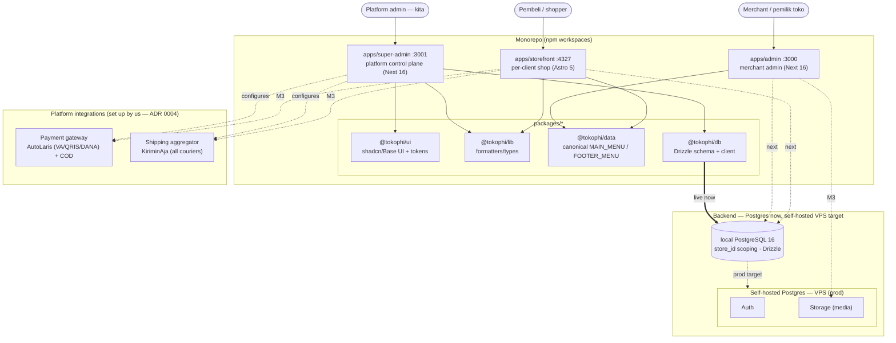
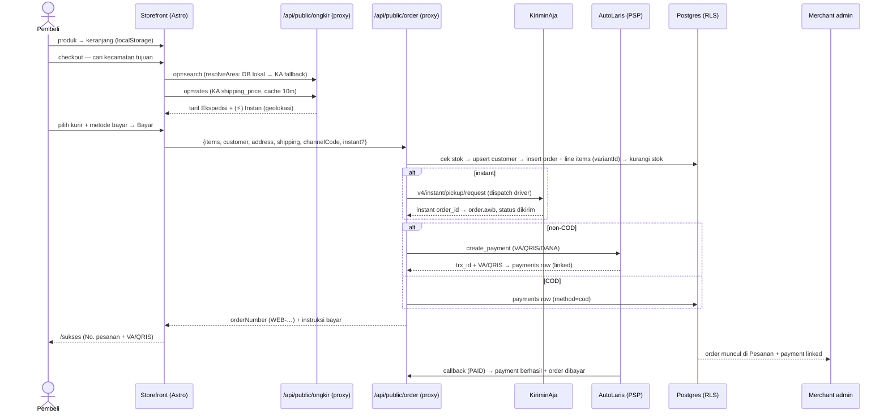
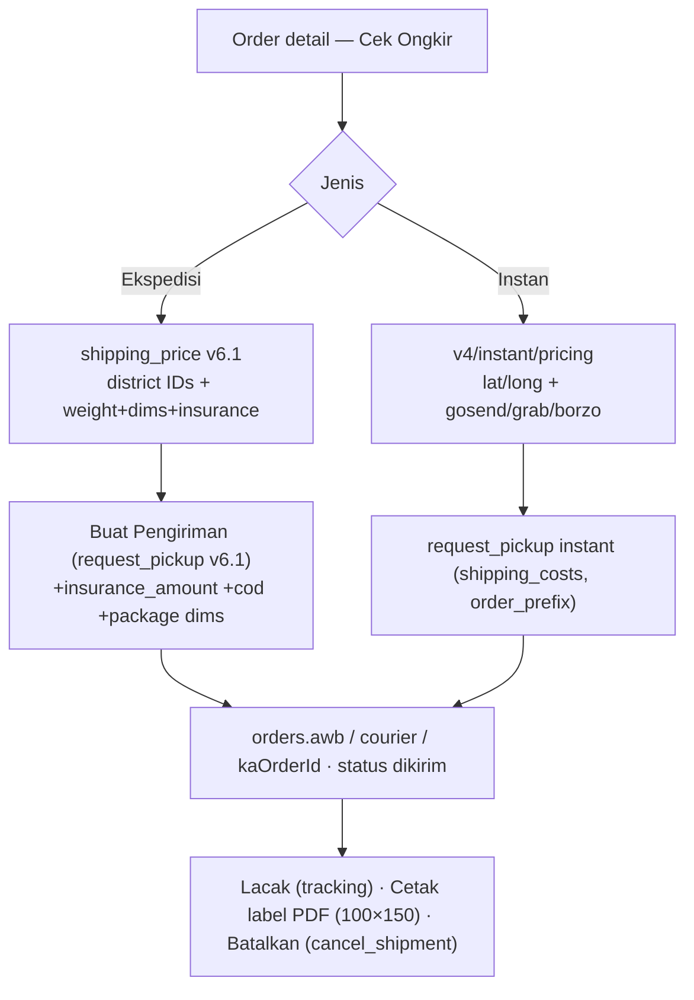
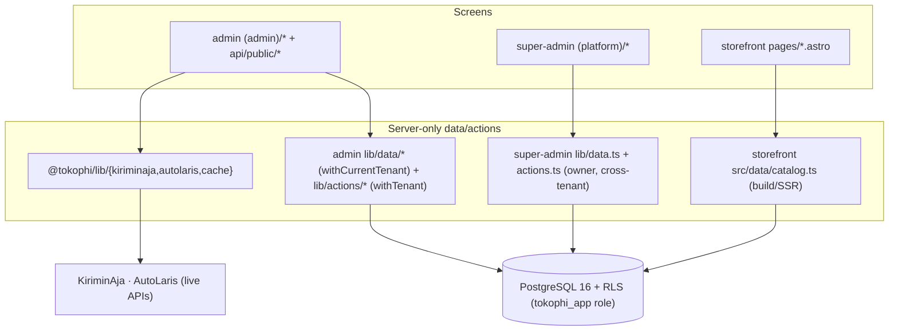
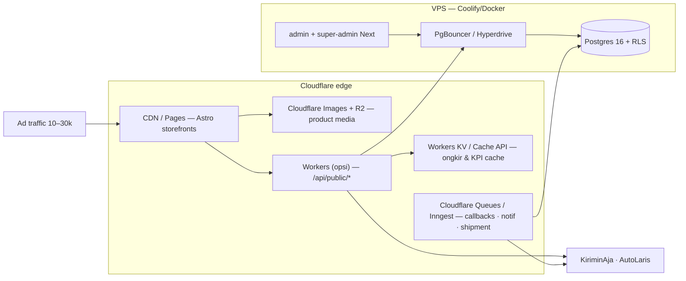
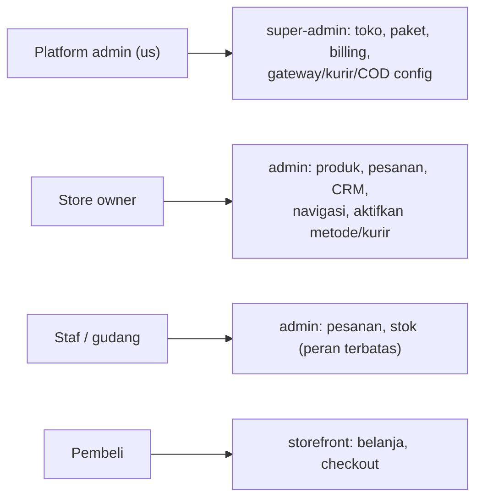
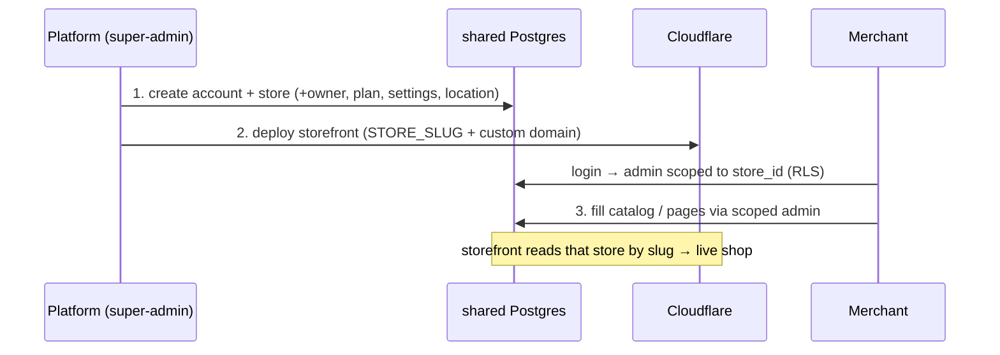

# TokoΦ — Diagrams (UML / Mermaid)

> Renders on GitHub / any Mermaid viewer. Kept text-based so it lives with the code.
> Companion to `SYSTEM_GUIDE.md` (overview), `../PRD.md`, `SCHEMA.md`. Updated 2026-07-09.
>
> **Current state:** monorepo (npm workspaces) — 3 apps (`apps/admin` Next 16 :3000, `apps/super-admin` Next 16 :3001, `apps/storefront` Astro 5 :4327) + **4 shared packages** (`@tokophi/db`, `@tokophi/lib` [+ server-only `kiriminaja`/`autolaris`/`cache` subpaths], `@tokophi/ui`, `@tokophi/data`). **Backend fully wired** on local PostgreSQL 16 (Docker :5433) via `@tokophi/db` (55 tables, migrations 0000–0018, RLS enforcing). **Commerce loop is COMPLETE**: storefront checkout → real DB order + inventory + payment + shipping; merchant admin runs it; callbacks close it. **Real integrations**: KiriminAja (shipping — express + instant, area DB, pricing cache) + AutoLaris (payment — VA/QRIS/DANA + COD), both platform-managed + brand-hidden from clients. Prod target = self-hosted Postgres on a VPS (ADR 0007, NOT Supabase) + Cloudflare-native edge (CDN/R2/Images/KV); per-client topology = ADR 0008.

## 1. System context / container (C4-ish)
> Who talks to what: shoppers→storefront, merchants→admin, platform→super-admin; the 3 apps sit on shared packages; self-hosted Postgres + payment/shipping integrations are platform-managed and land at M3.

## 2. Monorepo components — who imports what
> The 3 apps and 3 packages, with **actual** import edges verified in the repo. `@tokophi/data` is the only package shared by *both* admin and storefront (single nav source). Admin still ships its **own local `components/ui/*`** (Base UI) rather than `@tokophi/ui` — de-dup is backlog (ADR 0005).

## 3. Data model (ER — key entities)
> Target relational shape for M3. Adds content/nav entities (`pages`, `menus`+`menu_items`, `articles`) alongside catalog, orders, customers, discounts. Payments/shipping config lives at platform level, not here (see note + ADR 0004).

> Payments/shipping/COD config is **platform-level** (see `SCHEMA.md`): `shipping_aggregator`, `platform_couriers`, `platform_payment_gateways`, `platform_cod`; per-store rows keep only `enabled` flags. `menus`/`menu_items` mirror the canonical shapes in `@tokophi/data` (see §6).

## 4. Commerce loop — storefront checkout → order → payment → shipping (IMPLEMENTED)
> The real, working end-to-end loop. Cart lives in `localStorage`; checkout calls the platform proxy endpoints (in `apps/admin/app/api/public/*`, no-auth, CORS) which own the KiriminAja/AutoLaris keys. `/api/public/order` creates the order + inventory + payment; callbacks close it. Provider brands are hidden from the shopper (white-label).

## 5. Shipping — express (resi/AWB) + instant (same-day) (IMPLEMENTED)
> Merchant admin creates shipments from an order. Express = district-id based (pickup → AWB); Instant = coordinate based (dispatch a driver now). Insurance/COD/dimensions supported (volumetric). Area names resolve from the local `kiriminaja_areas` table first (no rate limit).

## 6. Shared nav — single source of truth (`@tokophi/data`)
> `@tokophi/data/menu` exports canonical `MAIN_MENU` + `FOOTER_MENU`. Both the admin menu builder and the storefront header **derive** from it, so they stay in sync. **Today** this is a build-time sync (edit the file → rebuild both). **M3** persists menus in self-hosted Postgres so runtime edits in the admin UI go live on the storefront (ADR 0006).

> Sync direction now is **file → both surfaces (build-time)**. The dotted edges are the M3 upgrade: admin UI edits persist to `menus`/`menu_items` and the storefront reads them live.

## 7. Data-layer seam (IMPLEMENTED — server-only → Postgres via RLS)
> Screens never touch storage directly. Admin/super-admin read through server-only `lib/data/*` selectors + write via `lib/actions/*` server actions; the storefront reads `src/data/catalog.ts` (via `@tokophi/db`). Admin tenant queries run inside `withTenant`/`withCurrentTenant` (sets `app.store_id` GUC + `SET LOCAL ROLE tokophi_app`) so RLS enforces. `lib/mock/*` remains only as deterministic seed-parity shape.

## 8. Deployment & scaling (target — Cloudflare-native, sized for 50–100 clients / 10–30k ad traffic)
> Storefront static+edge absorbs ad traffic cheaply; the load-bearing paths are **images** and **live ongkir** — solved by R2+Cloudflare Images and KV/in-proc pricing cache. DB is self-hosted Postgres on a VPS (ADR 0007, NOT Supabase) behind a pooler.

> **Priority before ads:** ① R2 + Cloudflare Images (media) · ② KV cache for `shipping_price` (avoid KiriminAja rate-limit) · ③ DB pooling · ④ Queue for async (callbacks/notif/shipment). Backend extraction (Hono/Workers) + full Redis are optional at this scale. Open decision: storefront **SSG-rebuild-per-store** vs **SSR + edge-cache** (better for 50–100 stores with frequent updates).

## 9. User roles (who touches what)
> Access map across the three surfaces; RLS by `store_id` enforces tenant isolation at M3 (ADR 0003), super-admin is the cross-tenant platform plane.

## 10. Per-client topology & provisioning (ADR 0008)
> One control plane + one **multi-tenant** admin + a **storefront per client**, all on one shared DB. "Client Admin A/B" = the *same* admin app scoped by `store_id` — not a deploy per client.

**Onboard a client (3 steps, no new admin/DB):**

*Living doc — update diagrams when the architecture moves.*
