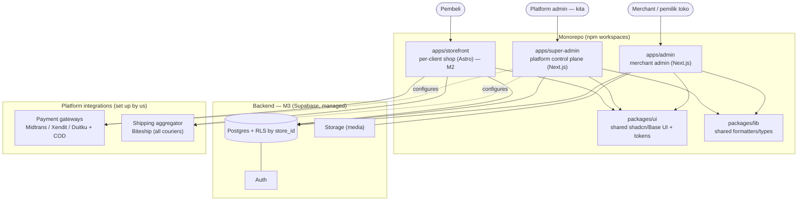
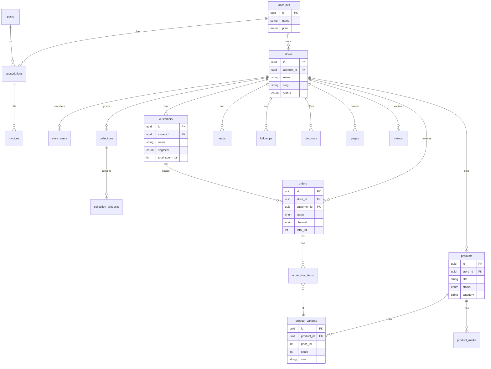
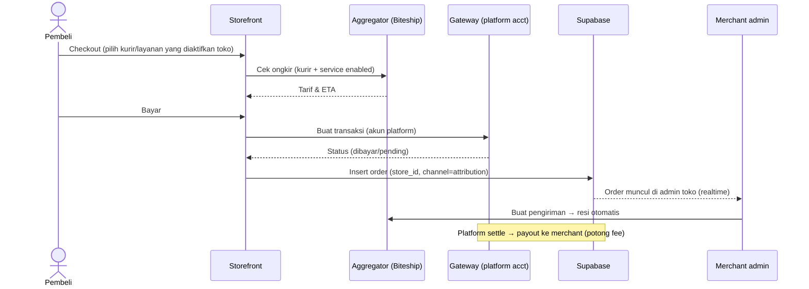
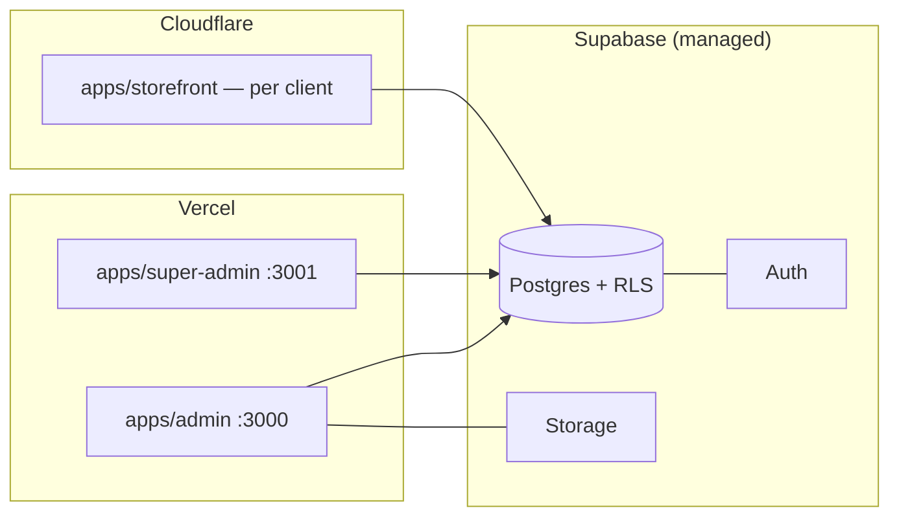
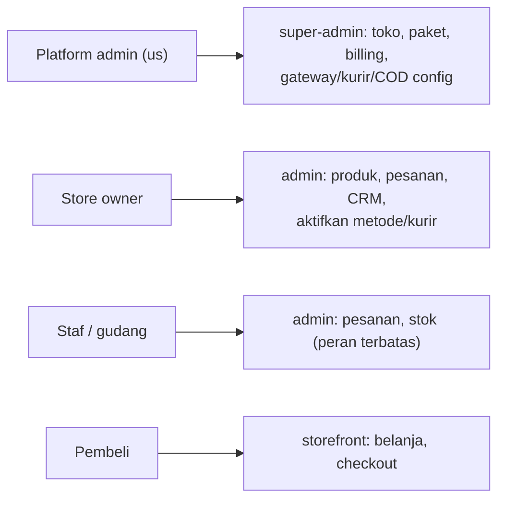

# Indostore — Diagrams (UML / Mermaid)

> Renders on GitHub / any Mermaid viewer. Kept text-based so it lives with the code.
> Companion to `../PRD.md`, `SCHEMA.md`, `CONCEPT.md`. Updated 2026-07-02.

## 1. System context & components (C4-ish)

## 2. Data model (ER — key entities)

> Payments/shipping/COD config is **platform-level** (see `SCHEMA.md`): `shipping_aggregator`, `platform_couriers`, `platform_payment_gateways`, `platform_cod`; per-store keeps only `enabled` flags.

## 3. Checkout + payment + shipping (platform-managed)

## 4. Deployment

## 5. User roles (who touches what)

*Living doc — update diagrams when the architecture moves.*
