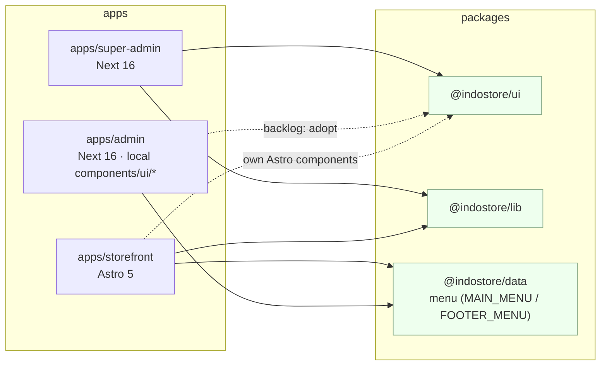
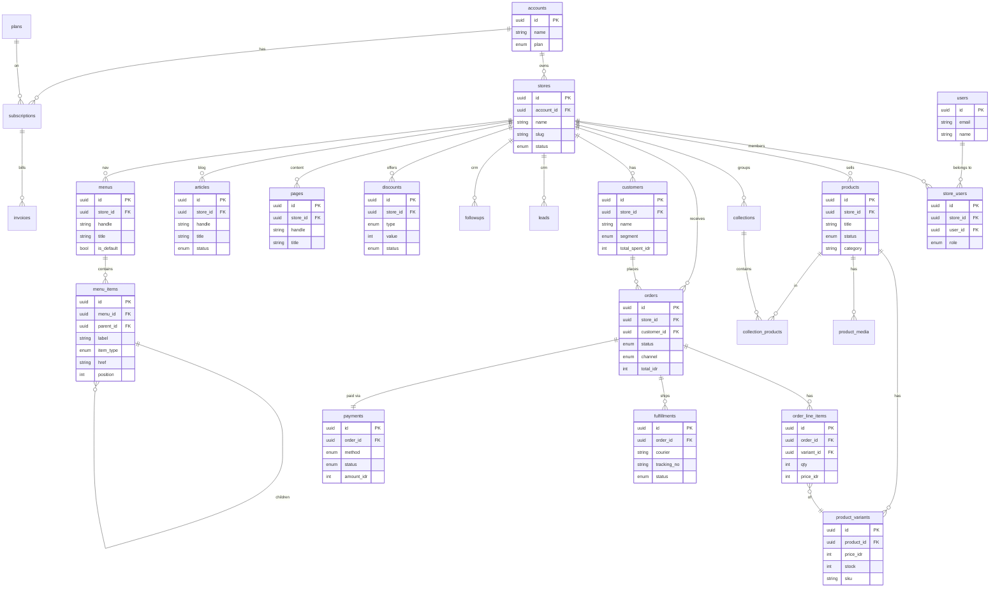
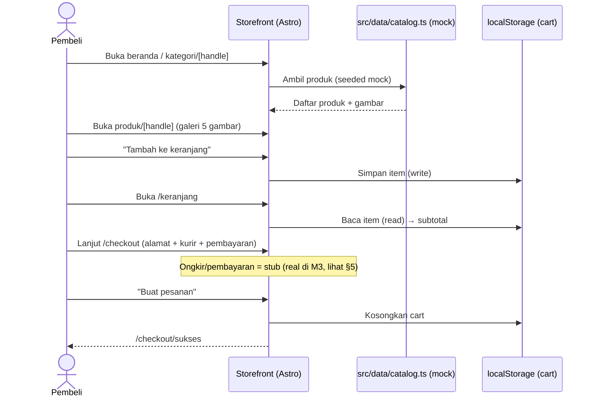
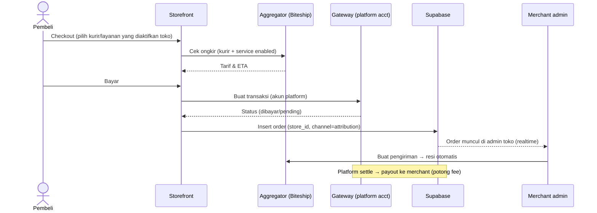
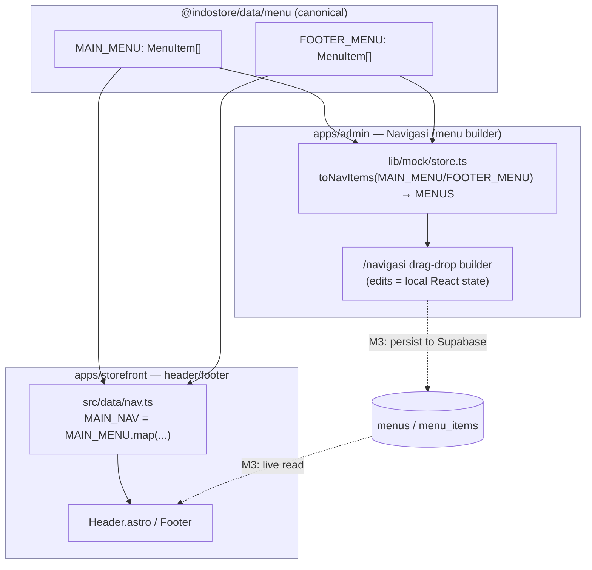
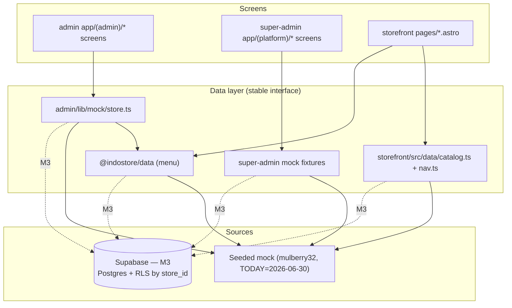
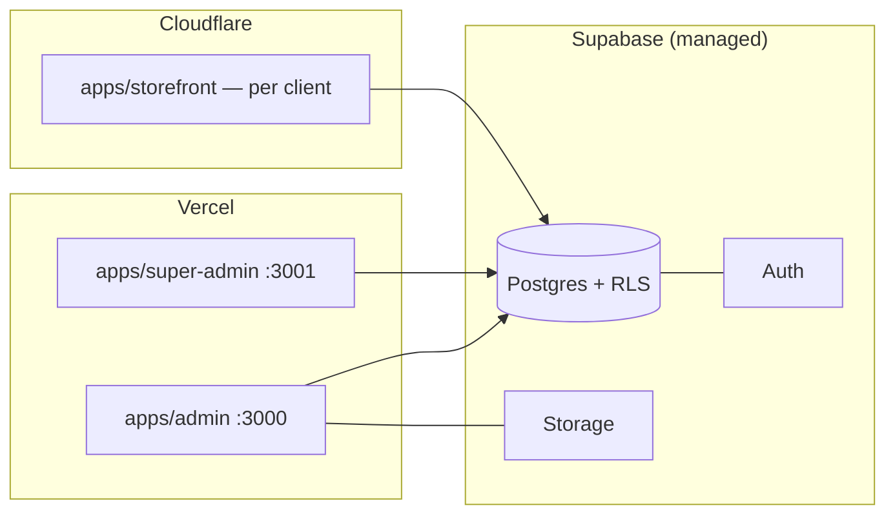
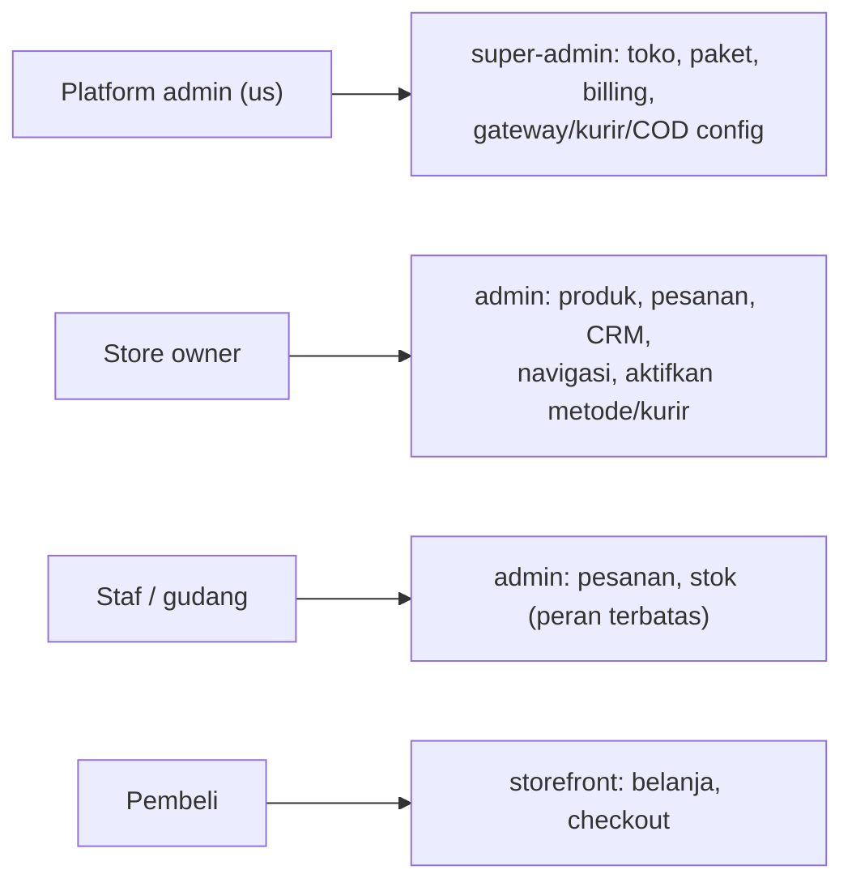
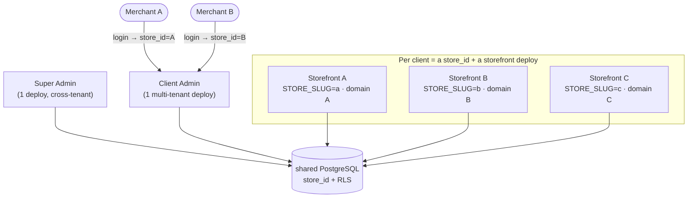
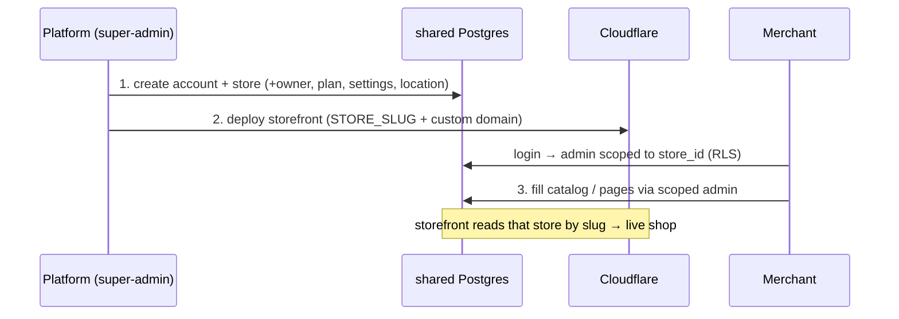

# Indostore — Diagrams (UML / Mermaid)

> Renders on GitHub / any Mermaid viewer. Kept text-based so it lives with the code.
> Companion to `../PRD.md`, `SCHEMA.md`, `CONCEPT.md`. Updated 2026-07-03.
>
> **Current state:** monorepo (npm workspaces) with 3 apps — `apps/admin` (Next 16, :3000, merchant admin), `apps/super-admin` (Next 16, :3001, platform control plane), `apps/storefront` (Astro 5, :4327, shopper shop "Batik Nusantara") — and **4 shared packages**: `@indostore/ui`, `@indostore/lib`, `@indostore/data`, **`@indostore/db`** (Drizzle schema/client + migrations). **Backend is being wired** on **local PostgreSQL 16** (Docker, port 5433) via `@indostore/db`: **super-admin (all 5 pages) + 16 admin modules** + storefront all read the DB (reads done end-to-end); only writes (mutations) still pending. Seeds are deterministic (mulberry32, `TODAY=2026-06-30`). Single-tenant "Batik Nusantara" MVP. Prod target = Supabase (ADR 0007); per-client topology = ADR 0008.

## 1. System context / container (C4-ish)
> Who talks to what: shoppers→storefront, merchants→admin, platform→super-admin; the 3 apps sit on shared packages; Supabase + payment/shipping integrations are platform-managed and land at M3.

## 2. Monorepo components — who imports what
> The 3 apps and 3 packages, with **actual** import edges verified in the repo. `@indostore/data` is the only package shared by *both* admin and storefront (single nav source). Admin still ships its **own local `components/ui/*`** (Base UI) rather than `@indostore/ui` — de-dup is backlog (ADR 0005).

## 3. Data model (ER — key entities)
> Target relational shape for M3. Adds content/nav entities (`pages`, `menus`+`menu_items`, `articles`) alongside catalog, orders, customers, discounts. Payments/shipping config lives at platform level, not here (see note + ADR 0004).

> Payments/shipping/COD config is **platform-level** (see `SCHEMA.md`): `shipping_aggregator`, `platform_couriers`, `platform_payment_gateways`, `platform_cod`; per-store rows keep only `enabled` flags. `menus`/`menu_items` mirror the canonical shapes in `@indostore/data` (see §6).

## 4. Storefront purchase flow (current — mock, no backend)
> Real shopper journey as built today: everything renders from mock catalog and the **cart lives in `localStorage`** (no server). Checkout collects address/shipping/payment then routes to a static success page. The payment/shipping calls are stubs until M3 (§5).

## 5. Checkout + payment + shipping — target (platform-managed, M3)
> Backend flow once Supabase + integrations land: storefront quotes ongkir via the aggregator, charges through the platform PSP account, writes the order (scoped by `store_id`), and it surfaces in the merchant admin in realtime. Platform settles and pays out (ADR 0004).

## 6. Shared nav — single source of truth (`@indostore/data`)
> `@indostore/data/menu` exports canonical `MAIN_MENU` + `FOOTER_MENU`. Both the admin menu builder and the storefront header **derive** from it, so they stay in sync. **Today** this is a build-time sync (edit the file → rebuild both). **M3** persists menus in Supabase so runtime edits in the admin UI go live on the storefront (ADR 0006).

> Sync direction now is **file → both surfaces (build-time)**. The dotted edges are the M3 upgrade: admin UI edits persist to `menus`/`menu_items` and the storefront reads them live.

## 7. Data-layer seam (mock today → Supabase later)
> The core of the mock-first bet (ADR 0001): screens never touch storage directly. They read through a thin data layer — `apps/admin/lib/mock/*`, `apps/storefront/src/data/*`, `@indostore/data` — that returns seeded fixtures today and becomes Supabase queries at M3 with the same shapes.

## 8. Deployment (target)
> Where each app runs at M3: the two Next admins on Vercel, the per-client Astro storefront on Cloudflare, all backed by managed Supabase.

## 9. User roles (who touches what)
> Access map across the three surfaces; RLS by `store_id` enforces tenant isolation at M3 (ADR 0003), super-admin is the cross-tenant platform plane.

## 10. Per-client topology & provisioning (ADR 0008)
> One control plane + one **multi-tenant** admin + a **storefront per client**, all on one shared DB. "Client Admin A/B" = the *same* admin app scoped by `store_id` — not a deploy per client.

**Onboard a client (3 steps, no new admin/DB):**

*Living doc — update diagrams when the architecture moves.*
