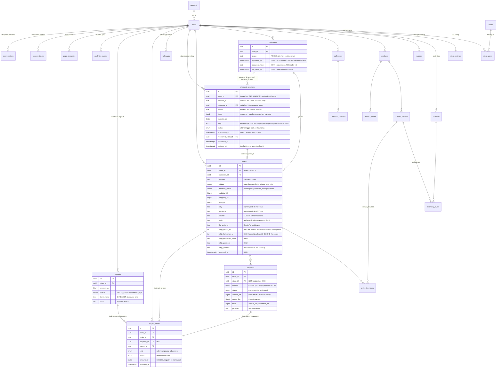
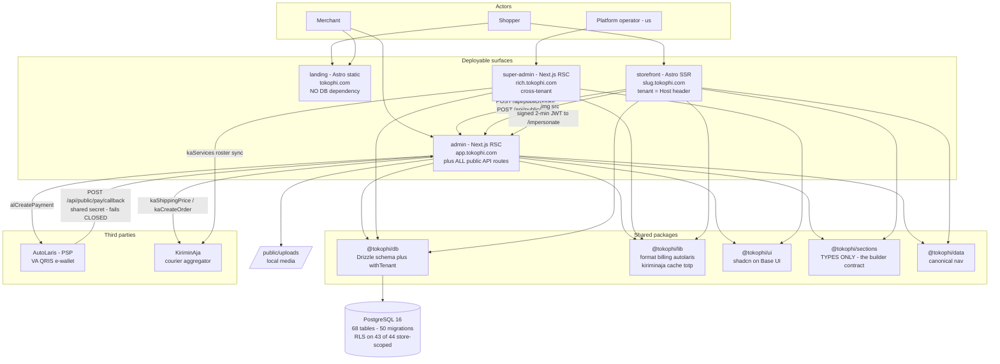
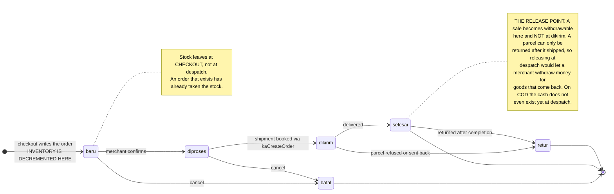
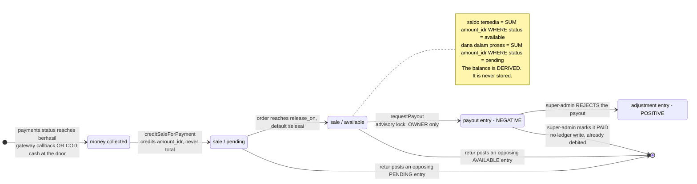
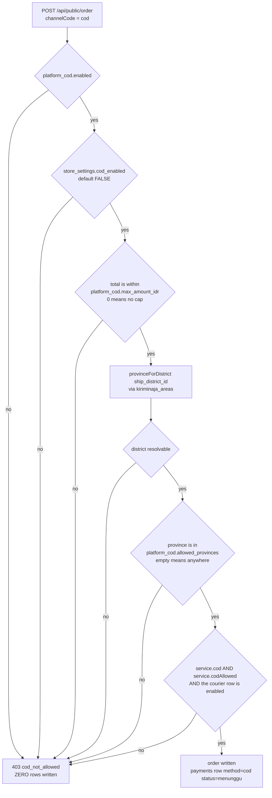
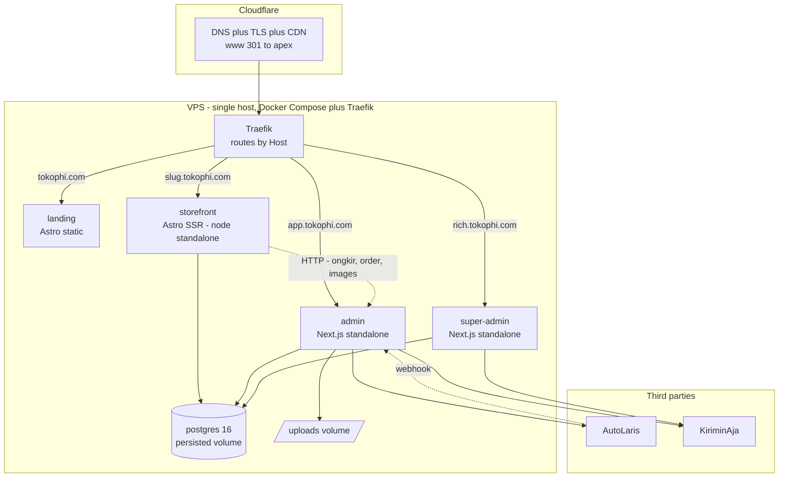
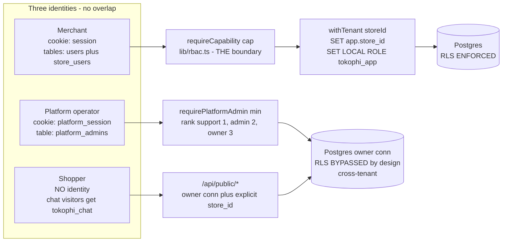
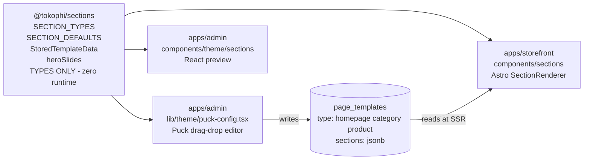
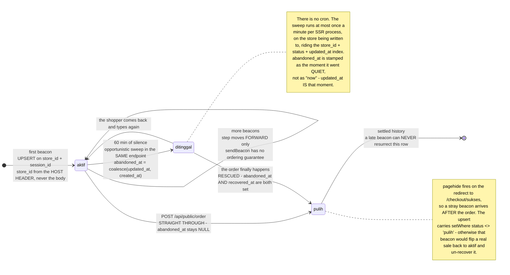

# TokoΦ — UML

> **Rewritten 2026-07-14 from the code and the live database.** The previous version described 55
> tables, migrations `0000–0018`, three surfaces, and drew the admin and storefront as *not yet* on
> Postgres. All four were false.
>
> **Every diagram in this file has been rendered with `@mermaid-js/mermaid-cli` v11.16.0.** A diagram
> that does not render is worse than no diagram: it looks like documentation and communicates nothing.
> A previous pass shipped four broken ones — a `;` inside `sequenceDiagram` message text terminates the
> statement, so the message silently becomes a syntax error.
>
> Companions: [`SYSTEM_MAP.md`](./SYSTEM_MAP.md) (routes → tables) · [`FLOWS.md`](./FLOWS.md)
> (sequence diagrams for the seven critical flows) · [`SCHEMA.md`](./SCHEMA.md) (the catalog) ·
> [`REQUIREMENTS.md`](./REQUIREMENTS.md) (what must be true).

---

## 1. Domain model — ER / class diagram

The load-bearing entities only. Money is `bigint` IDR throughout. 68 tables exist; the rest hang
off these.



**The three relationships that carry the most weight:**

1. `payments.amount_idr` → `ledger_entries.amount_idr`. The ledger credits what the *merchant* is
   owed, never `payments.total` — the gateway's admin fee is the gateway's money and never was the
   merchant's. This single choice is why Dashboard revenue, the Pesanan list and Saldo agree **by
   construction** rather than by coincidence.
2. `orders.ship_district_id` (0042) is the **verified** destination. `orders.province` is what the
   buyer typed. Money decisions read the former. See §5.
2b. `orders.ship_kelurahan_id` (0049) is **KiriminAja's own village id**, verified to belong to
   `ship_district_id` before it is stored. **Kecamatan PRICES the parcel; kelurahan BOOKS it** —
   `shipping_price` ignores village ids, `request_pickup` needs one. The shipment is booked from this
   snapshot, never re-resolved from the free-text city name (which once shipped Surabaya → Lampung).
3. `checkout_sessions.recovered_order_id` → `orders` (0044) is what makes "recovered" a **join** rather
   than a vibe: *this* session became *that* order. Paired with `abandoned_at` (0045) it is also the
   only way to tell a **rescue** from an ordinary sale. See §9.

---

## 2. Component diagram — four surfaces, five packages, one database



**Three facts in this diagram that surprise people:**

- **The admin hosts the entire public HTTP API.** `/api/public/*`, `/api/cron/*`, `/api/uploads/*` all
  live in `apps/admin`. The storefront reaches them over HTTP, like any third party would.
- **`landing` has no `@tokophi/db` dependency and no `DATABASE_URL`.** That is the feature: the front
  door must serve when everything behind it is down.
- **`@tokophi/sections` is types-only, zero runtime.** It is the one contract shared by the admin's
  Puck editor and the storefront's Astro renderer — the thing that stops the two from drifting.

**There are only four cross-surface edges.** Everything else goes through the database. No service
mesh, no internal RPC, no queue.

| Edge | Mechanism |
|---|---|
| storefront → admin | `fetch` to `PUBLIC_ONGKIR_API` / `PUBLIC_ORDER_API` |
| storefront → admin (images) | `ADMIN_BASE` derived from `new URL(PUBLIC_ONGKIR_API).origin` — **a load-bearing coupling**: change the ongkir URL and product images silently move |
| super-admin → admin | 2-minute JWT → `/impersonate` → a real `session` cookie (cookies do not cross subdomains) |
| AutoLaris → admin | webhook `POST /api/public/pay/callback` |

---

## 3. Order lifecycle — state machine

`baru → diproses → dikirim → selesai | batal | retur`. Enum `order_status`; migration **0039** added
`retur`.



### 3.1 What every transition does to inventory and to the ledger

This is the table to read before touching `setOrderStatus`. Source: `apps/admin/lib/actions/orders.ts`
+ `apps/admin/lib/ledger-credit.ts#settleOrderLedger`, both inside **one transaction**, so the book can
never disagree with the order it describes.

| Transition | `inventory_levels` | `payments` | `ledger_entries` |
|---|---|---|---|
| *(checkout)* → `baru` | **− qty** per line (`GREATEST(available − qty, 0)`) | insert `menunggu` (COD) **or** an AutoLaris bill | — |
| `baru → diproses` | — | — | — |
| `diproses → dikirim` | — | — | — |
| **`* → selesai`** | — | COD: `menunggu → berhasil` (`collectCodOnDelivery`) — the honest moment the cash exists | **`sale` booked** if absent (`creditSalesForOrder`), then every `pending` sale on the order → **`available`** |
| **`* → batal`** | **+ qty** restored | any `menunggu` → **`gagal`** | — (a cancelled order is never credited: `creditSaleForPayment` excludes `o.status='batal'`) |
| **`* → retur`** | **+ qty** restored | any `menunggu` → **`gagal`** | **opposing entry** `kind='retur'`, `amount = −sale.amount`, **carrying the same `status` as the sale it reverses** |
| *(gateway callback)* | — | `menunggu → berhasil` | **`sale` booked**: `pending` normally, `available` if the order is already `selesai`/`retur` |

**Four subtleties, each of which was once a bug:**

1. **`retur` restores inventory, exactly like `batal`.** The goods are back on the merchant's shelf in
   both cases. Missing this would have quietly shrunk real stock on every refused COD parcel.
2. **Both restores are guarded on the previous status** (`order.status !== status`), so a repeat click
   cannot double-restore.
3. **The claw-back carries the sale's status.** A parcel can be returned straight from `dikirim`, where
   the sale is still `pending`. Reversing that out of `available` (as the code originally did,
   unconditionally) drives the withdrawable balance **negative** while the held pool still shows the
   money. Reverse a pending sale out of pending, a released one out of available; either way the pair
   nets to zero.
4. **Cancelling fails the pending payment.** For a refused COD parcel this is the whole point: cash
   that was never collected must never become collectable later.

---

## 4. Money — the ledger state machine

`platform_payout.release_on` (default `'selesai'`) decides the release point, and it **is** read
(`settleOrderLedger`). Until `0776e99` it was hardcoded to `selesai` while the super-admin toggle saved
a value that changed nothing — a knob that moves nothing is worse than no knob.



| Invariant | Enforced by |
|---|---|
| The book is **append-only** — nothing is ever edited in place | convention + review. A reversal is always a **new opposing entry** |
| A retried gateway callback cannot credit twice | `ledger_one_sale_per_payment` (partial unique index) |
| A double-clicked "Retur" cannot double-refund | `ledger_one_retur_per_order` (partial unique index) |
| Two concurrent withdrawals cannot both pass the balance check | `pg_advisory_xact_lock(hashtext(store_id))` inside the txn |
| A rejected payout restores **exactly** what left | the adjustment is computed from `Σ ledger_entries WHERE payout_id = ?`, **not** from `payouts.amount_idr` |
| Only a store **owner** can withdraw | `requestPayout` requires `settings:write`, which only `owner` holds |
| Marking a payout PAID writes **no** ledger entry | the merchant was already debited at request time. Re-crediting would double-count |

> **Why an advisory lock and not `FOR UPDATE`?** It *was* `FOR UPDATE`, originally — and
> `select sum(amount_idr) … for update` is rejected outright by Postgres ("FOR UPDATE is not allowed
> with aggregate functions"). **Every withdrawal threw.** The guard against losing money was itself the
> thing that broke the feature, and `tsc` cannot see inside a SQL string. Money paths must be
> *exercised*, not typechecked. The advisory lock is also O(1) in ledger size, where row-locking an
> ever-growing table is not.

---

## 5. COD — the five-condition gate

`apps/admin/lib/cod.ts#getCodPolicy` is the single place that answers "may this be paid on delivery?".
All five conditions must agree, and they are checked **server-side in `/api/public/order` before any
row is written**. Hiding the option at checkout is UX; *this* is the boundary. A script POSTing
`channelCode:"cod"` straight at the API gets a 403 and zero rows — never a silently-downgraded order
that hides a COD request as a "transfer".



**Condition 4 does not read `address.provinsi`.** The buyer types that by hand and a hostile client can
simply lie — "DKI Jakarta", then ship to Papua. The province is resolved from the **KiriminAja district
id the ongkir quote was issued for**, which is what the parcel is actually booked against. If COD is
requested and the district cannot be verified, the request is **refused**. An unverifiable destination
is exactly the case `allowed_provinces` exists to stop, and this is money — "probably fine" is not good
enough.

**Why COD is narrow today (SPX Standard + SPX Economy only).** *Not* because KiriminAja restricts it —
it reports `cod = true` on **14 services across 10 couriers**. The asymmetry that costs money is
**RETURNS**: a refused COD parcel is claimed to ship back free on SPX and to be billed to the merchant
elsewhere. **That claim is UNVERIFIED** — free returns are a *Shopee Seller Center* benefit and we
reach SPX through *KiriminAja*, a different contract with no return field in its API at all. The
narrowing is therefore a per-service boolean an operator can flip
(`platform_couriers.services[].codAllowed`), **not `if (courier === "spx")` welded into the code**.
Widening is a tick box, not a deploy. See [`BACKLOG.md`](./BACKLOG.md).

---

## 6. Deployment

One VPS, Docker Compose behind Traefik, Cloudflare in front. There is no Kubernetes, no queue, no
pub/sub — and the chat transport (short polling, not SSE) was chosen *because* of this box, not in
spite of it.



| Surface | Host | Indexable | DB access |
|---|---|:--:|---|
| `landing` | `tokophi.com` / `www.` → 301 | **yes** | **none** |
| `storefront` | `<slug>.tokophi.com`, `toko.` | **yes** | read-only, owner conn |
| `admin` | `app.tokophi.com` | **no** — `noindex, nofollow` in 3 layers | `withTenant` (RLS) |
| `super-admin` | `rich.tokophi.com` | **no** — `noindex, nofollow` in 3 layers | owner conn (cross-tenant) |

The three noindex layers per panel are `next.config.ts headers()` (covers `/api/*`, static assets,
non-HTML) + the same header re-stamped in `middleware.ts` (a redirect short-circuits before
`headers()` runs) + `metadata.robots` and `app/robots.ts`. All three are needed; the first alone was
not enough, which is how both panels ended up crawlable after the domain cutover.

**`/api/uploads/*` is deliberately carved OUT** (`X-Robots-Tag: all`). Merchant product photos are
served from the admin origin but embedded in public storefronts — a blanket noindex would have removed
every merchant's product photography from Google Images.

`astro build` for the storefront is **DB-free** (verified with `DATABASE_URL` unset). That is what
preserves the zero-downtime deploy: the image builds even when the database is unreachable.

---

## 7. Identity and access

Three **non-overlapping** identities. A merchant login never grants control-plane access, and the
shopper has no identity at all.



### 7.1 Merchant RBAC (`store_users.role`)

`lib/rbac-policy.ts` is the client-safe matrix; `lib/rbac.ts#requireCapability` is the server guard and
**the** security boundary — it is the first statement of every mutating server action, and it throws.
The UI gating (`useCan` / `<Can>`) is convenience only and secures nothing.

| Role | Capabilities |
|---|---|
| `owner` | all |
| `admin` | all **except `settings:write`** |
| `staff` | `products:write`, `discounts:write`, `content:write`, `orders:write`, `customers:write`, `crm:write`, `media:write`, `support:write` |
| `gudang` | `inventory:write`, `purchases:write`, `support:write` |

Two consequences worth naming out loud:

- **`requestPayout` requires `settings:write` → only an `owner` can withdraw money.** Correct, and not
  obvious from the capability name.
- `requireCapability` **also** blocks writes when the subscription is past its grace period
  (`getBilling().readOnly` → `SuspendedError`). `support:write` opts out via `allowSuspended` — a
  suspended store must still be able to contact us about the billing problem that suspended it.

### 7.2 Platform roles (`platform_admins.role`)

Ranked, not a matrix: `requirePlatformAdmin(min)` compares `RANK[session.role] >= RANK[min]`
(`support` 1 < `admin` 2 < `owner` 3). Added in `0776e99` — before that the role was carried in the JWT
and **never read**, so a `support` operator could reject payouts, reset passwords and impersonate.

| Guard | Actions |
|---|---|
| `owner` | `impersonateStore`, `resetOwnerPassword` |
| `admin` (default) | everything else — 28 call sites, including every payout and COD-policy action |
| `support` | **zero call sites** — the role exists and can do nothing, not even the ticket queue its own doc comment says it is for |

⚠️ **Known escalation, tracked in [`BACKLOG.md`](./BACKLOG.md):** `invitePlatformAdmin` is
`admin`-gated, takes `role` **unvalidated**, and is **not audit-logged** — so an `admin` operator can
mint themselves an `owner` and thereby reach the two `owner`-only actions. Enforcement is at the
**action** layer only: the middleware and page guards check for *a* session, not for a role, so a
lower-privileged operator sees every screen and the buttons throw on click.

---

## 8. Store Builder — why the editor and the renderer cannot drift



The admin writes `page_templates.sections`; the storefront reads it at SSR. Both sides import their
shape from `@tokophi/sections`, so a section added on one side and not the other is a **type error**,
not a silently blank slot on a live shop.

The hero carousel (`8fad2f9` → `5016bb3`) is the worked example of what happens when you skip that: it
shipped first as a **fork** of the shared config inside the admin, which meant the storefront could not
render what the merchant built. It was folded back into the shared registry (`heroSlides()`,
`HERO_INTERVAL_MS`) and the fork deleted.

---

## 9. Abandoned checkout — a state machine with no event to listen for

`checkout_sessions` (migration **0044**, `abandoned_at` in **0045**). Every other state machine in this
document is driven by something that *happens*. This one is not: **abandonment is the ABSENCE of an
order.** Nothing fires. So the row is written **as the shopper types** — debounced beacons from
`checkout.astro` into `apps/storefront/src/pages/api/checkout-session.ts`, the table's only writer from
the shop — and it is judged later by what never happened to it.



### 9.1 Why `abandoned_at` exists — the metric would otherwise be a lie

A checkout that **sailed straight through** also ends as `status='pulih'`. Without a column saying
*this one first went quiet*, the two are indistinguishable, and the obvious formula counts every
ordinary sale as a rescue.

| Quantity | Definition | Local data (30 d, `CHECKOUT_TODAY=2026-07-02`) |
|---|---|---|
| abandoned | `status = 'ditinggal'` | **792** |
| orders | `orders` placed in the window (a completed checkout — **including one later cancelled**; the checkout still finished) | **198** |
| **rescued** | `abandoned_at IS NOT NULL AND recovered_at IS NOT NULL` | **100** |
| straight-through | `abandoned_at IS NULL AND recovered_at IS NOT NULL` — an **ordinary sale**, not a save | **90** |
| `abandonRate` | `ditinggal / (ditinggal + orders)` | **80,0%** |
| `recoveryRate` | `rescued / (rescued + ditinggal)` | **11,2%** |

The naive `pulih / (pulih + ditinggal)` would report **19,3%** on exactly this data — it would tell a
shop it "rescued" every ordinary sale it has ever made. **A number that looks real and is wrong is
worse than no number.** `aktif` sessions are excluded from **both** sides of both ratios: the shopper
is still typing and nobody has abandoned anything yet.

**Context, not our measurement:** Indonesia abandons **82–83%** of carts against a ~70% global figure,
and recovery here travels on **WhatsApp**, not email — which is why `phone` is the column this table is
paid for, and why the merchant's action is a `wa.me` deep link.

### 9.2 The recovery link is signed, and that is not decoration

The merchant's WhatsApp message links back into the checkout, and clicking it restores the basket
**plus everything the shopper had typed** — name, phone, address. So the link **cannot** be
`/checkout?sid=<session id>`: session ids are generated in the browser and echoed in every tracking
beacon, and a raw id in a URL is a **bearer credential over a stranger's personal data** the moment the
link is forwarded, screenshotted, or leaks through a `Referer` header. Guessing is not even the main
risk — leakage is.

`apps/storefront/src/lib/recovery.ts` therefore mints an **HS256 JWT `{sid, st}`** (jose), keyed on
`CHECKOUT_RECOVERY_SECRET ?? AUTH_SECRET`:

| Property | Consequence |
|---|---|
| unforgeable | no secret, no token — guessing session ids buys nothing |
| **store-bound** (`st`) | a token minted for store A is rejected on store B's host, so one shared secret across tenants is still safe |
| self-expiring (7 days) | a forwarded link goes dead on its own; a raw id never would |
| stateless | no token column in 0044, and none is needed — the token is derived from the row |

A bad, expired, or other-tenant token renders the **ordinary empty checkout**, never an error. A
session already `pulih` is never re-hydrated: it was already bought, and re-hydrating it would push the
shopper to buy it twice.

---

## Validation

All 9 diagrams above — 1 `erDiagram`, 3 `stateDiagram-v2`, 1 `flowchart`, 4 `graph` — were rendered to
SVG with `@mermaid-js/mermaid-cli` **v11.16.0** on **2026-07-14**. Re-validate after editing:

```bash
printf '{"executablePath":"/usr/bin/google-chrome","args":["--no-sandbox"]}' > /tmp/pp.json
npx @mermaid-js/mermaid-cli -i specs/docs/UML.md -o /tmp/uml-check.md -p /tmp/pp.json
```

**The failure mode to watch for:** a `;` inside `sequenceDiagram` message text terminates the
statement. Write "then", or an em dash — never a semicolon.
