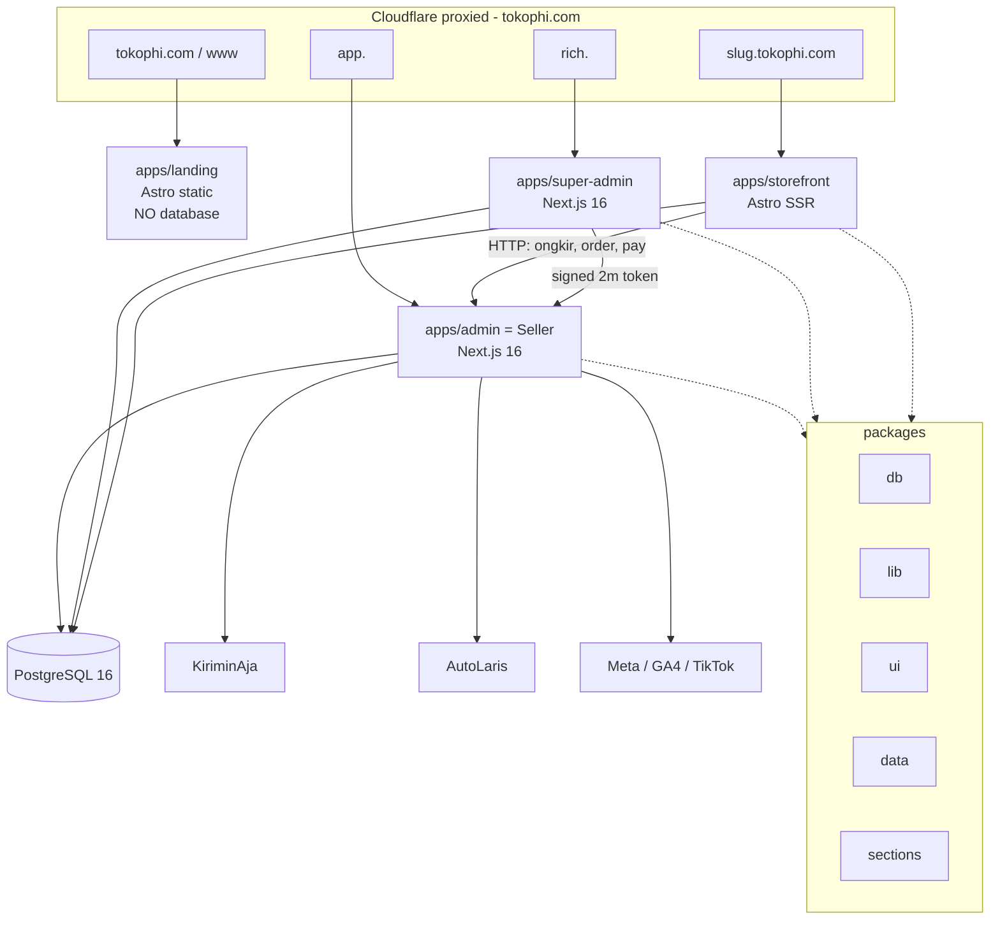
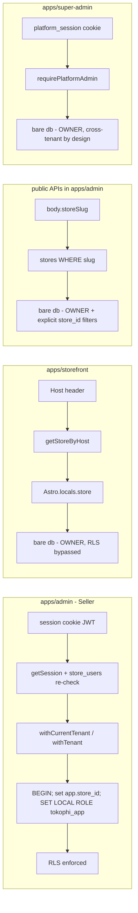
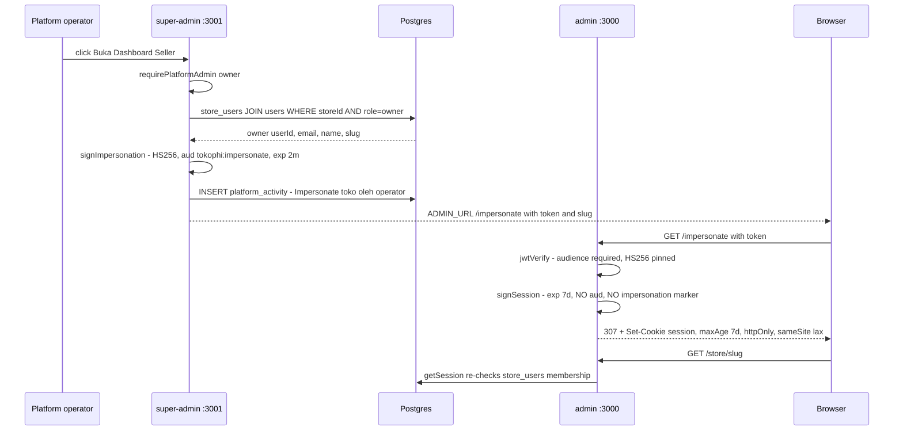
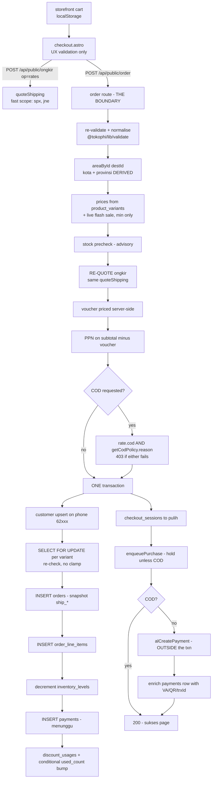
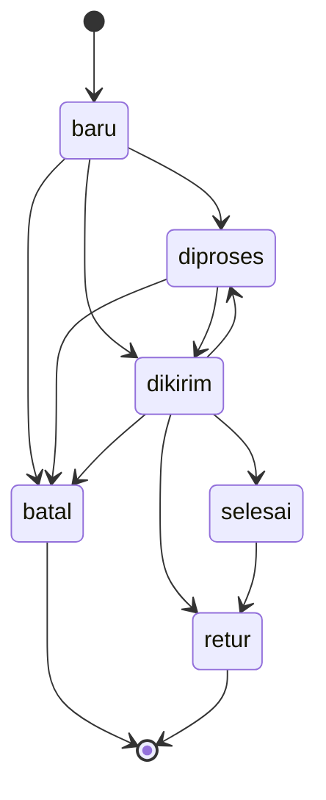
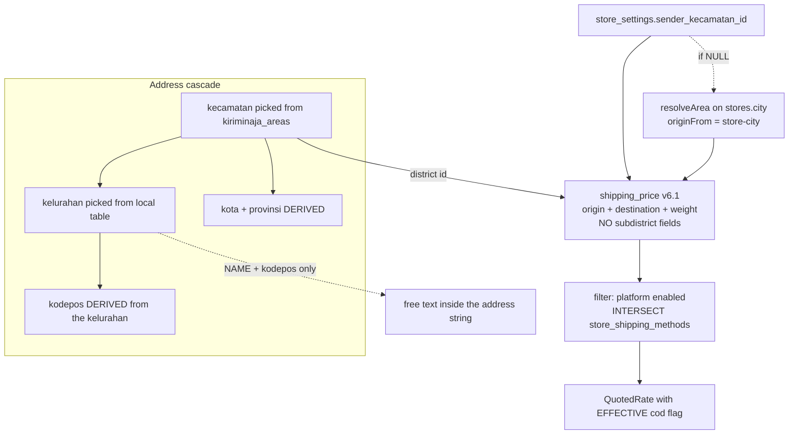
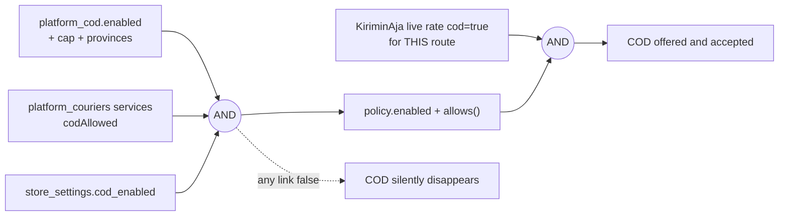
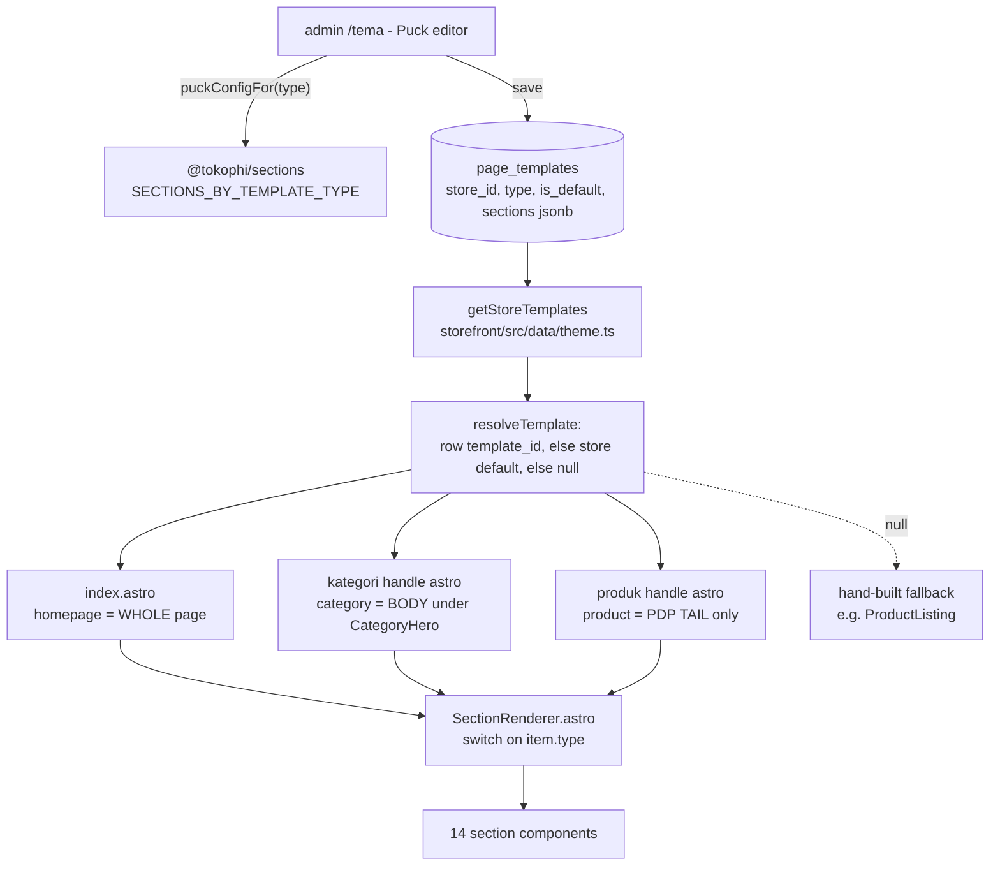
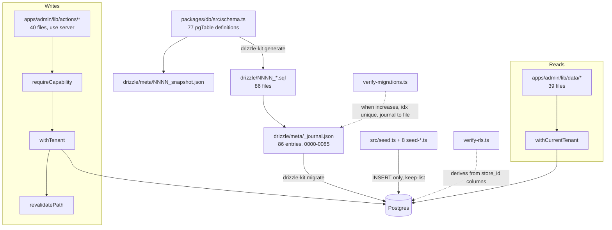

# TokoΦ — Architecture map (audit 2026-08-01)

> Derived from the **code** and the **Postgres catalog**, not from the existing docs. `CODE_MAP.md`,
> `PRD.md` and `AGENTS.md` were used only as hypotheses to check — every one of them carries numbers
> that are now wrong (§8).
>
> **Baseline:** worktree `wt-arch`, branch off `origin/main` @ `86e3ec3`.
> **Database inspected:** the shared dev container `tokophi-db` (localhost:5433), read-only. That
> container is **shared with sibling worktrees and carries their migrations** — where the container and
> the branch disagree, both numbers are given.
>
> **Naming rule observed throughout:** UI copy says **"Seller"** for `apps/admin`; the code keeps
> `admin` everywhere (directory, package `@tokophi/admin`, `(admin)` route group, `ADMIN_URL`,
> `AdminChrome`). Nothing in this document renames a code identifier.

---

## 1. System map — four surfaces, five packages, one database



| Surface | Package | Domain it serves | May talk to | DB connection role |
|---|---|---|---|---|
| `apps/admin` (**"Seller"**) | `@tokophi/admin` | one merchant's shop: catalog, orders, customers, CRM, discounts, content, settings, billing. **Also hosts every public API** the storefront calls. | Postgres · KiriminAja · AutoLaris · Meta/GA4/TikTok CAPI | **both**: tenant reads/writes drop to `tokophi_app` via `withTenant`; auth, billing, public APIs and cron stay **owner** |
| `apps/super-admin` | `@tokophi/super-admin` | the platform control plane: all stores, plans, invoices, payouts, platform couriers/channels/COD, support tickets, operators | Postgres (cross-tenant) · KiriminAja · AutoLaris (connection tests) | **owner only** — zero `withTenant` calls exist in the app (`grep -rn "withTenant" apps/super-admin` → no hits) |
| `apps/storefront` | (Astro app) | every shopper of every store — one container, tenant from the `Host` header | Postgres (read + its own writes) · the admin's `/api/public/*` | **owner only** — every `src/data/*.ts` imports the bare `db` (`apps/storefront/src/data/store.ts:11`, `catalog.ts:10`, `content.ts:12`, `nav.ts:27`, `promo.ts:1`, `theme.ts:3`, `tracking.ts:1`, `landing.ts:1`) |
| `apps/landing` | `@tokophi/landing` | the apex front door | nothing | **none** — `apps/landing/package.json` has no `@tokophi/db` dependency and `grep -rn "@tokophi/db" apps/landing/src` is empty. Deliberate: it must serve when the rest is down. |

**Packages** (`packages/*`): `db` (Drizzle schema + migrations + seed + client + `withTenant`), `lib`
(billing, format, couriers, kiriminaja, autolaris, validate, tracking-ids, secret, totp, like, cache,
colors), `ui` (shadcn on **Base UI**), `data` (menu helpers), `sections` (the Store Builder registry,
consumed by both the admin's Puck editor and the storefront renderer).

**Counted, not quoted:** admin = 55 `page.tsx` + 12 `app/api/**/route.ts` + 39 `lib/data/*` + 40
`lib/actions/*`. Super-admin = 10 `page.tsx` (9 under `(platform)` + `/login`). Storefront = 22 page
routes + **6** API routes. Production compose (`docker-compose.coolify.yml`) declares **13** services:
postgres, migrate, admin, super-admin, storefront, landing, cron, cron-tracking,
cron-tracking-events, backup + 3 volumes.

**What breaks if this is misunderstood.** Two things, both expensive:

1. **`apps/admin` is not only the Seller UI — it is the public API tier.** `/api/public/order`,
   `/api/public/ongkir`, `/api/public/promo`, `/api/public/pay/callback` and `/api/uploads/[name]` all
   live inside it and are excluded from the auth middleware (`apps/admin/middleware.ts:66`). Treating
   `apps/admin` as "the merchant's panel" leads to reasoning about it as a logged-in-only surface; in
   fact the highest-risk unauthenticated code on the platform — the one that writes orders and moves
   money — is a route file inside it. It also means the **admin container must be up for any shopper
   to check out**, on a different origin, which is why every one of those routes carries hand-written
   CORS headers and a try/catch wrapper (`order/route.ts:100-121`, `ongkir/route.ts:25-38`).
2. **`apps/landing` having no database is a design decision, not an oversight.** Adding a DB read to
   it removes the only surface that survives a Postgres outage.

---

## 2. Multi-tenancy & RLS

### The real numbers, counted from the catalog on 2026-08-01

| Metric | On this branch (code) | In the shared container | Evidence |
|---|---|---|---|
| Tables | **77** | **78** | `grep -oP 'pgTable\(...'` over `packages/db/src/schema.ts` = 77; `information_schema.tables` = 78. The extra one is **`color_palettes`**, which exists in the container but in **no** `schema.ts` entry and **no** `.sql` file on this branch — an unmerged sibling branch's migration. |
| Tables with a `store_id` column | **51** | 52 | catalog query; 52 minus `color_palettes` |
| Tables with RLS enabled | **51** | 52 | `pg_class.relrowsecurity`; = 50 store-scoped + `stores` |
| Store-scoped tables **without** RLS | **1** | 1 | **`platform_activity`** — the only `store_id` table with `relrowsecurity=false`. Deliberate: it is the platform's own audit log, written before a tenant session exists. |
| Store-scoped tables with **no `store_id` and no RLS** | **12** | 12 | see the child-table list below |

`stores` is policed by `id`, not `store_id` — `pg_policies` shows
`stores.tenant_isolation ALL (id = app_current_store_id())`, added by migration `0058`. **`verify-rls`
structurally cannot see it**, because that script derives the store-scoped set from `store_id`
columns. This is the documented blind spot, and it is real: `stores` is the one table that identifies
the tenant, and it was invisible to the guard meant to protect it.

The **child-table class** — no `store_id`, no RLS, `tokophi_app` holds full DML — as of today:
`collection_conditions`, `collection_products`, `customer_addresses`, `discount_usages`,
**`flash_sale_items`**, `fulfillments`, `inventory_levels`, `menu_items`, `order_line_items`,
`product_media`, `product_options`, `purchase_order_items`. **That is 12. AGENTS.md lists 11 and omits
`flash_sale_items`**, which has FKs to `flash_sales` (store-scoped, RLS on) and `products` — i.e. it is
squarely in the class the rule was written for.

Roles: `tokophi` is `rolsuper=t, rolbypassrls=t` (the owner the app process connects as);
`tokophi_app` is `f/f`, so policies actually enforce once `set local role` has run.

### How the tenant is resolved on each surface



- **Seller.** `withCurrentTenant(fn)` (`apps/admin/lib/tenant.ts:39-43`) reads the session, falls back to
  the **nil UUID** `00000000-...` when there is none (fails closed, matches no rows), and calls
  `withTenant`. `withTenant` (`packages/db/src/rls.ts:10-16`) opens a transaction, runs
  `select set_config('app.store_id', $1, true)` then `set local role tokophi_app`, and hands the tx to
  the callback. `withCurrentTenant` also hands `storeId` back as a **2nd argument** — because RLS does
  not scope tables that have no `store_id`, and a query against those **must** filter explicitly.
- **Storefront.** `apps/storefront/src/middleware.ts:33-46` normalises the `Host` header, resolves the
  store, and puts `store` + `catalog` on `Astro.locals`. Resolution order in
  `apps/storefront/src/data/store.ts`: custom domain (a seam, not wired) → `<slug>.STOREFRONT_BASE_DOMAIN`
  → first host label → `STORE_SLUG` env. A `RESERVED` set (`www app rich admin api cname toko storefront
  localhost`) stops a platform subdomain resolving as a shop. No match → a clean 404 page, never a 500.
  **The store id is never read from a request body** — `api/search.ts:4` and `api/chat/send.ts:6` both
  say so explicitly.
- **Public APIs.** `/api/public/order` and `/api/public/ongkir` resolve the store from `body.storeSlug`
  and **fail closed on a missing slug** (`order/route.ts:188-195`, `ongkir/route.ts:81-88`) — the old
  `|| "batik-nusantara"` default silently attributed stray orders to the demo shop.

### The deliberate owner paths

Owner (RLS bypassed) is correct in these places, and each one carries the tenant scope in its `WHERE`:

| Path | Why owner | Scope mechanism |
|---|---|---|
| `apps/admin/lib/auth.ts` | reads `users ⋈ store_users` **before a session exists** | `where users.email = ?` |
| `apps/admin/lib/actions/{auth,register,profile,security}.ts` | login / signup / own-account edits | `where users.id = session.userId` |
| `apps/admin/lib/actions/billing.ts` | subscription invoices | `where invoices.store_id = session.storeId` (explicit, not RLS) |
| `apps/admin/lib/actions/{payment-settings,taxonomy}.ts`, `lib/data/areas.ts` | platform/reference tables (`platform_payment_channels`, `product_taxonomy`, `kiriminaja_areas`, `kelurahan`) — not tenant data at all | n/a |
| `apps/admin/app/api/public/**`, `app/api/cron/**` | no session exists | explicit `store.id` on every query |
| `apps/admin/lib/cod.ts`, `lib/shipping-quote.ts` | called from the public API | `where store_settings.store_id = input.storeId` |
| `apps/super-admin/**` | cross-tenant by definition | explicit ids |
| `apps/storefront/src/data/**` | read-only catalog, host-resolved | explicit `store.id` |

Only **two** `lib/data/*` files and **seven** `lib/actions/*` files skip the wrapper, and all nine are
in the table above. That is a tight, auditable exception list.

**What breaks if this is misunderstood.** Three shipped incident classes, all still live as hazards:

1. **"RLS will scope it" on a table RLS does not scope.** `stores` has no `store_id`; before `0058` it
   had no policy at all, and two functions doing `.from(stores).limit(1)` inside `withCurrentTenant`
   returned an **arbitrary store** — a merchant read a stranger's shop name, WhatsApp and subscription
   countdown, and the paired write was correctly scoped, so pressing Simpan would have renamed their
   own shop to the leaked one (`apps/admin/lib/tenant.ts:22-38`). The policy is the net; the `WHERE` is
   the rule.
2. **The child-table class.** A write to any of the 12 tables above lands regardless of tenant, and the
   *parent* write under RLS **silently no-ops** for a foreign id — neither half errors. `verify-rls`
   cannot see this class at all.
3. **`platform_activity` is the only intentional store-scoped gap** — treating it as an oversight and
   "fixing" it would break the super-admin audit log, which is written with no tenant session.

---

## 3. Auth, RBAC, and the super-admin impersonation flow



### The pieces, exactly

| Piece | File:line | What it mints / checks | Expiry |
|---|---|---|---|
| Merchant login | `apps/admin/lib/auth.ts:32-51` (`findLogin`), `:53-55` (`signSession`) | scrypt `salt:hash` verify against `users`, joined to `store_users` and `stores` | JWT **7d**, cookie `SESSION_MAX_AGE` **7d** (`auth.ts:12`) |
| Session read | `apps/admin/lib/auth.ts:75-100` | verifies the JWT, then **re-reads `store_users` on every call** and takes `role` from the row, not the token. No membership → `null`. DB error → `null` (fails closed). | per request |
| Edge gate | `apps/admin/middleware.ts:18-43` | JWT signature only, no DB. Unauthenticated allow-list: `/login`, `/daftar`, `/api/auth/google/*`, **`/impersonate`** | — |
| RBAC matrix | `apps/admin/lib/rbac-policy.ts:65-86` | pure, client-safe | — |
| RBAC enforcement | `apps/admin/lib/rbac.ts:32-43` | `requireCapability(cap)` → `ForbiddenError`; **also** blocks every write when the subscription is past grace (`SuspendedError`), except `allowSuspended` (Bantuan) | — |
| Platform session | `apps/super-admin/lib/platform-auth.ts:15,43-56` | cookie **`platform_session`** — deliberately a different name from the admin's `session`, because on localhost cookies are host-scoped and impersonation mints the admin cookie | JWT **7d** |
| Platform rank | `apps/super-admin/lib/platform-rank.ts` + `platform-auth.ts:83-91` | `support` 1 < `admin` 2 < `owner` 3; unknown role scores 0 (fail closed). Pure module so it is testable. | — |
| Impersonation mint | `apps/super-admin/lib/session.ts:28-31` | `signImpersonation` — HS256, **audience `tokophi:impersonate`**, `exp` **2m** | **2 minutes** |
| Impersonation exchange | `apps/admin/app/impersonate/route.ts:30-47` | `jwtVerify` with `audience` **required** and `algorithms:["HS256"]` **pinned**, then re-signs a full session | **7 days** |
| Gate on the action | `apps/super-admin/lib/actions.ts:42` | `requirePlatformAdmin("owner")` | — |
| Audit | `apps/super-admin/lib/actions.ts:72` | `platform_activity` row, kind `admin`, with `store_id` | — |

### RBAC capability matrix (verified, `rbac-policy.ts`)

Roles are `owner | admin | staff | gudang` — and the DB enum agrees exactly
(`store_user_role = owner, admin, staff, gudang`).

| Capability | owner | admin | staff | gudang |
|---|:--:|:--:|:--:|:--:|
| `products:write` | ✓ | ✓ | ✓ | |
| `products:delete` | ✓ | ✓ | | |
| `discounts:write` | ✓ | ✓ | ✓ | |
| `content:write` | ✓ | ✓ | ✓ | |
| `orders:write` | ✓ | ✓ | ✓ | |
| `inventory:write` | ✓ | ✓ | | ✓ |
| `purchases:write` | ✓ | ✓ | | ✓ |
| `customers:write` | ✓ | ✓ | ✓ | |
| `crm:write` | ✓ | ✓ | ✓ | |
| `media:write` | ✓ | ✓ | ✓ | |
| `support:write` | ✓ | ✓ | ✓ | ✓ |
| `chat:read` / `chat:write` | ✓ | ✓ | ✓ | |
| `theme:write` | ✓ | ✓ | | |
| `settings:write` | ✓ | | | |
| `integrations:write` | ✓ | | | |
| `landing:html` | ✓ | | | |

`admin` is derived by **subtraction** (`ALL_CAPABILITIES.filter(c => c !== "settings:write" && c !==
"integrations:write" && c !== "landing:html")`, `rbac-policy.ts:68-70`) — so a **new owner-only
capability leaks to `admin` by default** unless it is added to that filter. `staff` and `gudang` are
explicit allow-lists and are safe against the same mistake.

**What breaks if this is misunderstood — and why this flow is the open security decision.**

The exchange itself is well-built: the audience claim is what stops a stolen 7-day merchant session
JWT (same `AUTH_SECRET`, no `aud`) being replayed at `/impersonate`, and the algorithm is pinned. But
the **asymmetry is the whole risk**, and it is structural:

- **A 2-minute token buys a 7-day cookie.** `impersonate/route.ts:34-47` re-signs a *full-length*
  session. The short life of the exchange token bounds nothing after the redirect.
- **The minted session is indistinguishable from the merchant's own login.** It carries no `aud`, no
  `imp` claim, no operator id, no shortened expiry. Nothing downstream — `getSession`,
  `requireCapability`, `withTenant`, any audit trail on the merchant's side — can tell an impersonated
  request from a real one. The only record is one `platform_activity` row written at mint time
  (`actions.ts:72`); every action taken *during* the impersonation is logged, if at all, as the
  merchant's own.
- **There is no revocation for it.** `getSession` re-checks `store_users` membership on every call
  (`auth.ts:87-94`), so removing the user from the store ends the session — but the merchant cannot
  remove *themselves*, and a password reset does **not** invalidate an existing JWT (no `jti`, no
  token version). The one thing that ends an impersonation session early is deleting the owner's
  membership.
- **`role` is taken from the store_users row**, so an impersonated session is exactly as powerful as
  the merchant's own owner account — including `settings:write`, `integrations:write` (tenant secrets)
  and `landing:html` (raw markup that executes on the shop's origin).

Separately: `apps/admin/middleware.ts:49-56` rewrites `/store/{slug}/…` to `/{rest}` and passes the
slug as an `x-tokophi-store` header **without validating it against the session's store**. The comment
says RLS enforces regardless, which is true for the 51 RLS'd tables and *not* true for the 12
child tables or for any query that omits its `storeId` filter.

---

## 4. Order → payment → shipment lifecycle



Then, asynchronously:



### The authoritative boundaries

| Fact | Authoritative source | Evidence |
|---|---|---|
| **Item price** | `product_variants.price_idr`, floored by a live flash sale (`Math.min`, never upward) | `order/route.ts:264-309`. `items[].price` prices nothing; it is compared only to detect a stale cart and **409** the request with `repriced[]` so the browser can rewrite localStorage (`:330-382`) |
| **Shipping price** | `quoteShipping()` — one function, called by both `/ongkir` and `/order` | `order/route.ts:433-462`; `body.shipping.cost` is never read. A picked service missing from the fresh quote is **rejected**, never re-couriered (`:458-461`) |
| **Weight** | `Σ product_variants.weight_grams`, min 1 kg billable | `shipping-quote.ts:160` → `lib/shipping-weight.ts` |
| **Origin** | `store_settings.sender_kecamatan_id` (a KiriminAja district id) | `shipping-quote.ts:134-144`. `body.originCity` no longer exists |
| **Province (for COD)** | derived from `areaById(destId)`, never the typed field | `order/route.ts:230-233`; and again from `provinceForDistrict()` at booking time (`actions/shipping.ts:610`) |
| **Stock** | `SELECT … FOR UPDATE` on the **single default-location row**, inside the txn, no `GREATEST` clamp | `order/route.ts:591-606`. The pre-txn check at `:299-304` is explicitly *not* the authority |
| **COD eligibility** | `apps/admin/lib/cod.ts` → `buildCodPolicy` (5 conditions) **and** `rate.cod` from the live quote | `order/route.ts:504-524` — **two** gates, see §5 |
| **Voucher quota** | the conditional `UPDATE … WHERE used_count < usage_limit` inside the txn; 0 rows → `VoucherExhausted` → whole order rolls back, 409 | `order/route.ts:700-713` |
| **Order status** | `applyOrderStatusChange` — the single writer | `apps/admin/lib/order-status.ts:14-113` |
| **"Is this order COD?"** | `payments.method = 'cod'` on the order row, derived at booking; `input.cod` is a claim that is checked, not obeyed | `actions/shipping.ts` — `cod: o.isCod ? (o.total || o.subtotal || 0) : 0` |
| **Money in the ledger** | `settleOrderLedger` / `creditSaleForPayment`, guarded by three partial unique indexes; balance is **derived**, never stored | `order-status.ts:112`, `lib/ledger-credit.ts` |

`applyOrderStatusChange` holds three guards, all load-bearing: same-status no-op, `batal`/`retur`
terminal, and an explicit `ALLOWED` table (`order-status.ts:40-55`). `selesai → retur` is the **only**
legal exit from `selesai`. `dikirim → diproses` exists so a voided shipment can be re-booked.

**What breaks if this is misunderstood.** "The form validated it" is the single most expensive wrong
belief in this codebase. `checkout.astro` re-implements the validation rules and the COD hint purely so
the shopper sees an error early; a direct `POST` bypasses all of it. Every historical hole here came
from a client claim being treated as a fact: `price: 0` bought goods for nothing, `shipping.cost: 0`
bought free shipping out of the merchant's margin, `originCity` from the browser priced a Surabaya
merchant at Yogyakarta rates, and a typed `provinsi` pushed COD outside the allow-listed provinces.
The second-order rule matters too: **the API must echo its own numbers back** (`subtotal`, `lines`,
`shipping`, `tax`, `discount`, `total` — `order/route.ts:785,833-838`), because the success page would
otherwise render a stale localStorage subtotal beside a server-computed total, and on COD that is the
cash a courier will ask for.

---

## 5. Shipping & COD





### The rules, verified

- **Kecamatan prices, kelurahan books — half of that is true today.**
  `kaShippingPrice` (`packages/lib/src/kiriminaja.ts:71-78`) posts **only**
  `origin, destination, weight, item_value, insurance, courier` to `/api/mitra/v6.1/shipping_price` —
  no `subdistrict_origin`, no `subdistrict_destination`. Correct, and the rule holds.
  **But nothing books a destination kelurahan.** `kaCreateOrder` *supports*
  `destKelurahanId → destination_kelurahan_id` (`kiriminaja.ts:95,118`), and `createShipment` never
  passes it. `orders.ship_kelurahan_id` and `ship_kelurahan_name` exist in the catalog and are
  **`0 / 842` filled** — `/api/public/order` writes `shipRecipient, shipPhone, shipAddress,
  shipPostcode, shipDistrictId` and nothing else (`order/route.ts:647-651`), and `checkout.astro:404`
  states outright: *"The order API ignores `kelurahan` entirely"*. The `sender` side is no better:
  `sender_kelurahan_id` is `0 / 7` filled, because `sender-address-card.tsx:76` deliberately saves
  only the NAME — the local `kelurahan` table holds BPS/Kemendagri codes, which are **not bookable**.
  So the kelurahan travels as **free text inside the address string** (`composePickupAddress`) plus a
  kodepos, in both directions. `ship_kelurahan_id` / `ship_kelurahan_name` are **dead columns**.
- **Origin.** `store_settings.sender_kecamatan_id` is `1 / 7` filled — **six of seven stores** fall to
  the `resolveArea(store.city)` fuzzy fallback and are quoted with `originFrom: "store-city"`. The
  fallback is at least visible in the response, by design.
- **Two-stage quote.** `/ongkir` quotes `FAST_COURIERS = ["spx","jne"]` on first paint and everything
  on `all: true` (`ongkir/route.ts:103-110`) — measured 0.5–0.65 s vs 5.45–5.5 s. `/order` re-quotes
  scoped to **the courier the shopper picked** (`order/route.ts:453`), which is load-bearing in both
  directions: the fast default would reject every SiCepat order, and unscoped would pay 5.5 s after
  the shopper presses Bayar.
- **Merchant selection is per SERVICE**, keyed `"<courier>:<service_type>"`
  (`shipping-quote.ts:149-153`); zero rows falls back to the courier-level `store_settings.couriers`
  column rather than rendering a checkout with no shipping options.

### The COD chain, as it actually stands in the database today

| Link | Live value | Query |
|---|---|---|
| `platform_cod` | `enabled=t`, cap **Rp2.000.000**, provinces `["DI Yogyakarta","Jawa Tengah","Jawa Barat","DKI Jakarta","Banten","Jawa Timur"]` | `select * from platform_cod` |
| `platform_couriers[].codAllowed` | **`spx` only**, service types **`1` and `3`**. Every other enabled courier (jne, jnt, lion, sap, sicepat, anteraja, ninja) has **zero** cod-allowed services | `jsonb_array_elements(services) where codAllowed` |
| `store_settings.cod_enabled` | **1 of 7** stores | `count(*) filter (where cod_enabled)` |

Then, at request time, a **fourth** gate that `cod-policy.ts` cannot express: `order/route.ts:513-518`
refuses when `rate.cod` is false — KiriminAja's live answer for *this* route. `buildCodPolicy` is built
purely from stored config, so it cannot know the courier refuses COD to that district.

**What breaks if this is misunderstood.** The chain is an **AND of four independent switches owned by
four different parties** — the platform (super-admin), the courier roster (super-admin), the merchant
(Pengaturan → Pengiriman), and KiriminAja's live per-route answer. Break any one and COD simply is not
offered, with no error anywhere: no exception, no log line, no red badge — the option is absent from
the checkout and the merchant reports "COD is broken". The mitigation shipped is `#cod-hint` in
`checkout.astro`, which names the single unmet condition. That is **UX**;
`/api/public/order` is the boundary and rejects a forged `channelCode:"cod"` with a 403 before any row
is written. The second trap is the direction of the flag: `rate.cod` on a quoted rate is the
**effective** flag (KiriminAja × platform `codAllowed` × store switch, `shipping-quote.ts:183`), never
the raw courier capability — and `createShipment` derives the cash-collection amount from
`payments.method`, not from the caller, because a caller passing the *service capability* once told the
courier to collect cash again from 67 already-paid buyers.

---

## 6. Store Builder / storefront rendering



`page_templates.type ∈ {homepage, category, product}` and the three are **not interchangeable**.
`getStoreTemplates` (`storefront/src/data/theme.ts:48-71`) treats a template with **zero sections as
absent** (`withContent`) so an empty save cannot blank a page, and `resolveTemplate` (`:79-83`) walks
row `template_id` → store default → `null` → hand-built fallback. In the container right now there are
exactly **2** templates: one `homepage` default and one `product` default — the category path is on the
fallback everywhere.

**`CategoryHero` is rendered unconditionally**, *before* the `{TEMPLATE ? … : …}` branch
(`kategori/[handle].astro:125-143`), so a category template can never cost the page its `<h1>`,
breadcrumb or cover.

The **14** section types (`packages/sections/src/registry.ts:356-372`): `hero`, `product-listing`,
`image-text`, `multicolumn`, `product-grid`, `category-nav`, `collection-bento`, `lookbook`,
`banner-promo`, `marquee`, `testimoni`, `blog`, `rich-text`, `faq`. `SectionRenderer.astro:65-94`
switches on all 14, with no `default` branch.

The palette is **narrower** than the renderer, per type (`registry.ts:577-584`):
homepage = 13 (all but `product-listing`), category = 10, product = 9.

**What breaks if the exhaustiveness is misunderstood.** The palette and the renderer are deliberately
different sets, and the direction matters: **narrow the PALETTE, never the RENDERER.** `sections` is
`jsonb` — a template saved months ago can hold a section type no longer offered for its type, and if
the switch stops handling it the section silently vanishes from a **published, live** storefront with
no error and no migration to point at. There is no `default:` arm and no exhaustiveness assertion, so
a type added to `SectionConfigMap` and forgotten here compiles and renders **nothing**. The other trap
is `product-listing` vs `product-grid`: the first is the real catalogue (server sort, 12-per-page
pagination, empty state), the second a flat slice capped at `limit`. Offering only the second on a
category template silently truncates a merchant's catalogue and drops sort and paging. Finally,
`SectionRenderer` applies `mediaUrl()` **once**, centrally (`:48-59`), because merchant uploads live at
`/api/uploads/*` on the **admin's** origin — six copies of that call would be six chances for the next
section to forget it, and forgetting it 404s every image the merchant uploaded.

---

## 7. Data layer



- **`packages/db` exports exactly three things** (`src/index.ts`): the schema, `{db, schema, client}`,
  and `withTenant`. `withCurrentTenant` lives in **each app's** `lib/tenant.ts`, not here — because it
  reads a session, which the db package must not know about.
- **One pool**, `max: 10`, cached on `globalThis` across HMR (`src/client.ts:12-14`). Every surface
  connects as the **owner**; `tokophi_app` is reached only per-transaction via `set local role`.
- **The read/write split is a convention, enforced by review, not by types.** `lib/data/*` reads under
  `withCurrentTenant`; `lib/actions/*` are `"use server"` and go `requireCapability` → `withTenant` →
  `revalidatePath`. Nothing mechanically stops a `lib/data/` file importing the bare `db` — the nine
  files that do are all legitimate exceptions (§2), but that is a fact about today, not a guarantee.
- **Delete = archive** where history references the row (products ← `order_line_items`); hard delete
  otherwise, with archived rows filtered in the read layer.

### The migration/journal machinery, and why self-consistency is not enough

`npm run verify-migrations -w @tokophi/db` is **green** on this branch:

```
Journal: 86 entri, terakhir 0085_payment_lookup_indexes
✓ Journal waras: stempel naik, idx unik & berurutan, journal ↔ berkas cocok.
```

Independently confirmed: 86 journal entries, 86 `.sql` files, tags `0000`–`0085`, **no duplicate
numeric prefixes, no gaps**. The container has **92** rows in `drizzle.__drizzle_migrations` — six more
than this branch has entries, because it is shared with sibling worktrees carrying their own
migrations. *Count files on your branch, not rows in the container.*

**And the journal can still have lost entries — proved, not asserted.** Replaying all 79 historical
revisions of `_journal.json` yields **88** tags ever recorded, against **86** today. Two are gone:

| Tag | Fate | Consequence at the time |
|---|---|---|
| `0046_good_dust` | journal entry whose `.sql` was **never committed** — it exists in no revision of the tree | every fresh `drizzle-kit migrate` died with `No file ./drizzle/0046_good_dust.sql found`; **production never created the `kelurahan` table** and `/api/public/ongkir op=kelurahan` 500'd on every checkout. Fixed in `f6898d0` by regenerating from the schema. |
| `0064_store_public_email` | **renumbered** to `0070_store_public_email` after a two-branch number collision | content survived intact (`stores.email` exists in the catalog); nothing was lost, but the journal now shows no trace that `0064` ever meant something else |

Both are *resolved*, and both prove the point: `verify-migrations` checks the journal against **itself
and the files beside it**. It cannot see an entry that was removed, renumbered, or never written —
because a journal missing an entry is perfectly self-consistent.

**What breaks if this is misunderstood.** Three failure modes, all silent:

1. **Drizzle applies the whole pending batch in ONE transaction.** A single "already exists" rolls back
   every migration behind it and prints nothing. On 2026-07-30 that left 16 migrations unapplied on the
   shared dev DB. Hence: **every migration must be idempotent** (`add column if not exists`,
   `create index if not exists`, `do $$ … exception when duplicate_object then null; end $$` for enums).
2. **A `when` that does not increase makes drizzle SKIP a migration while reporting success.** That is
   check #1 in `verify-migrations.ts:49-59`, and `--db` compares against the target database's highest
   stamp — the only way to answer "will the next deploy actually run my migration?"
3. **The seed is not a migration.** `seed.ts` runs on every deploy but does not overwrite data an
   existing store already has, so a seed change reaches **new** stores only. A change that assumes
   otherwise ships a regression that is invisible on the dev DB and live in production.

---

## 8. Map vs docs — where the docs disagree with the code

The code wins. Each row below is a doc bug.

| # | Doc claim | Where | Reality | Evidence |
|---|---|---|---|---|
| 1 | "Three surfaces" | `CODE_MAP.md` §1, §2 table | **Four** — `apps/landing` is a real deployed service | `docker-compose.coolify.yml:176`; `apps/landing/package.json` |
| 2 | schema has **68 tables** | `CODE_MAP.md` §3, §7 | **77** in `schema.ts`, 78 in the shared container (the extra is `color_palettes`, from an unmerged branch) | `pgTable(` count; `information_schema.tables` |
| 3 | "**54 tables**" | `AGENTS.md` (Database §) | 77 | as above |
| 4 | migrations **0000–0083, 84 files**, head 0083 | `CODE_MAP.md` §3, §11 | **0000–0085, 86 files**, head `0085_payment_lookup_indexes` | `_journal.json`; `ls drizzle/*.sql` |
| 5 | "RLS on **44** store-scoped tables" | `CODE_MAP.md` §7 | RLS on **51** tables (50 store-scoped + `stores` by `id`); 51 tables carry `store_id`, of which exactly one lacks RLS | `pg_class.relrowsecurity`, `information_schema.columns` |
| 6 | "**45 of the 46** store-scoped tables" | `AGENTS.md` (Database §) | 50 of 51 | as above |
| 7 | "RLS scopes the **36** tables that have a `store_id`" **and** "`stores` … has `relrowsecurity = false`" | `apps/admin/lib/tenant.ts:23-25` — a **code comment** | 51 tables; and `stores` **does** have RLS since `0058` | `pg_policies`: `stores.tenant_isolation ALL (id = app_current_store_id())` |
| 8 | "isolates the store-scoped tables by `store_id` (**36/39**)" | `AGENTS.md`, Auth paragraph — inside the same file that warns this exact sentence was stale | 50/51 | as above |
| 9 | The **11** store-scoped tables with no `store_id` and no RLS | `AGENTS.md`, child-table rule | **12** — `flash_sale_items` is missing from the list | catalog; `flash_sale_items` FK → `flash_sales(store_id, RLS on)` |
| 10 | "The order SNAPSHOTS the destination — `ship_kelurahan_id`/`ship_kelurahan_name` (0042+0049) — and `createShipment` books with **those exact ids**" | `AGENTS.md`, Shipping § | **Never written and never read.** `0 / 842` orders have either. `/api/public/order` writes 5 `ship_*` fields, not 7; `createShipment` passes no `destKelurahanId` although `kaCreateOrder` supports it | `order/route.ts:647-651`; `kiriminaja.ts:95,118`; `select count(ship_kelurahan_id) from orders` = 0; `checkout.astro:404` |
| 11 | "`kaCreateOrder` already sends `kelurahan_id` when we have one … the FORM never asked for it" | `apps/admin/lib/actions/shipping.ts:209-212` | Still true, and the form **still** does not: `sender-address-card.tsx:76` saves the NAME only, deliberately. `sender_kelurahan_id` = `0 / 7` | `select count(sender_kelurahan_id) from store_settings` = 0 |
| 12 | "Its own **two** API routes — the storefront's only writes" | `CODE_MAP.md` §6 | **Six** API routes; `api/chat/send.ts` writes `chat_visitors`, `conversations`, `conversation_messages` | `find apps/storefront/src/pages/api`; `chat/send.ts:61,82` |
| 13 | Storefront routes include `/akun` | `CODE_MAP.md` §6 | No `akun` route exists. Undocumented ones that do: `/cari`, `/promo`, `/promo/[handle]`, `/lp/[slug]`, `/thanks`, `/kategori`, `/feed/{google,tiktok}.xml`, `/sitemap.xml`, `/robots.txt`, `/404` | `find apps/storefront/src/pages` |
| 14 | admin = "**39** routes, **22** action files, **22** data files" | `CODE_MAP.md` §2 | **55** `page.tsx`, **40** actions, **39** data | `find`/`ls` counts |
| 15 | super-admin = "**8** routes"; §5 table lists 7 | `CODE_MAP.md` §2, §5 | **10** `page.tsx`; `/pencairan` (payouts) is missing from the table entirely | `find apps/super-admin/app -name page.tsx` |
| 16 | "Live: Vultr Singapore `45.76.146.40` … domains `admin.`/`super.`/`toko.<ip>.sslip.io`" | `CODE_MAP.md` §11 | `AGENTS.md` says live on `tokophi.com` with `app.`/`rich.`/`toko.` since 2026-07-13. The two docs contradict each other; **unverified** which is current — I did not touch production | — |
| 17 | Compose = "Postgres + migrate + 3 apps + billing cron" / "+ backup" | `CODE_MAP.md` §2, §11 | **10 services**: postgres, migrate, admin, super-admin, storefront, **landing**, cron, **cron-tracking**, **cron-tracking-events**, backup | `docker-compose.coolify.yml` |
| 18 | "`page_templates` … `SECTIONS_BY_TEMPLATE_TYPE`" without a count; PRD/ADR 0009 lists example sections incl. **Countdown** | `specs/decisions/0009` §2 | **14** section types, and there is no `countdown` type | `registry.ts:356-372` |
| 19 | ADR 0009: "one active `homepage` per store", category via `collections.template_id`, product via `products.template_id` | `0009` §3 | Implemented as described, but with an extra rule the ADR does not state: a template with **zero sections is treated as absent** and the hand-built page renders instead | `theme.ts:42-45` |
| 20 | `STATUS.md` header: "72 tables, 64 migrations (0000–0063), RLS on 46" | `STATUS.md:3-5` | 77 / 86 (0000–0085) / 51 | as above. `STATUS.md` dates itself 2026-07-21 and says so — least misleading of the three |

---

## 9. What I could **not** verify

Stated plainly, because a confident wrong entry is worse than a gap.

1. **Which deployment target is live.** `CODE_MAP.md` §11 (Vultr `45.76.146.40`, `*.sslip.io`) and
   `AGENTS.md` (`tokophi.com` with `app.`/`rich.`/`toko.`) contradict each other. I did not SSH to any
   VPS, query production, or touch DNS. Row 16 above is a contradiction *between docs*, not a resolved
   fact.
2. **Whether RLS actually blocks a cross-tenant read at runtime.** I confirmed the mechanism statically
   (policies exist, `tokophi_app` has `rolbypassrls=f`, `withTenant` issues `set local role`) but did
   **not** run `verify-rls` / `verify-rls-app` — both connect and could interfere with sibling agents,
   and `verify-rls-app` in particular exercises writes. The "11/11 green" claim in `AGENTS.md` is
   **unverified by me**.
3. **The COD-on-SPX return-leg belief.** `AGENTS.md` says a refused parcel is *believed* to return free
   on SPX and flags it unverified. It remains unverified; it is a commercial fact about KiriminAja, not
   something in the code.
4. **KiriminAja / AutoLaris live behaviour.** No provider call was made. `KIRIMINAJA_ENV` defaults to
   `sandbox` — whether production has it set is unverified.
5. **`accounts` tenancy.** `accounts` has no `store_id` and no RLS. I did not establish whether it is a
   platform-level table (like `plans`) or a store-scoped parent, so it is **not** counted in the
   12-table child class. Someone should settle it.
6. **The `impersonate` route in production.** The flow is fully mapped from source, but I did not
   exercise it end-to-end in a browser, and cookie behaviour across real subdomains
   (`rich.` → `app.`) is asserted by the code comments, not measured.
7. **Whether the 12 child tables are all reached only through correctly-scoped parents today.** I
   verified the *class* and the rule; auditing all 40 action files' call sites against it is a separate
   piece of work and was not done here.
8. **Runtime behaviour of anything.** No dev server was started, no page was rendered, no browser was
   driven. Everything above is source + catalog. The repo's own standing warning applies: `astro check`,
   `next build` and lint all stay green on bugs inside a client `<script>`.
