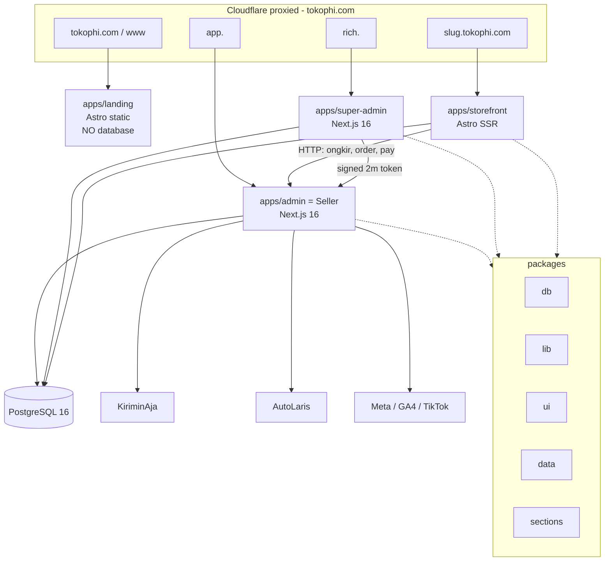
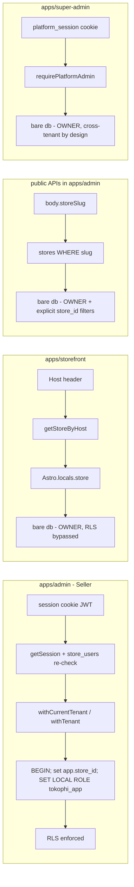
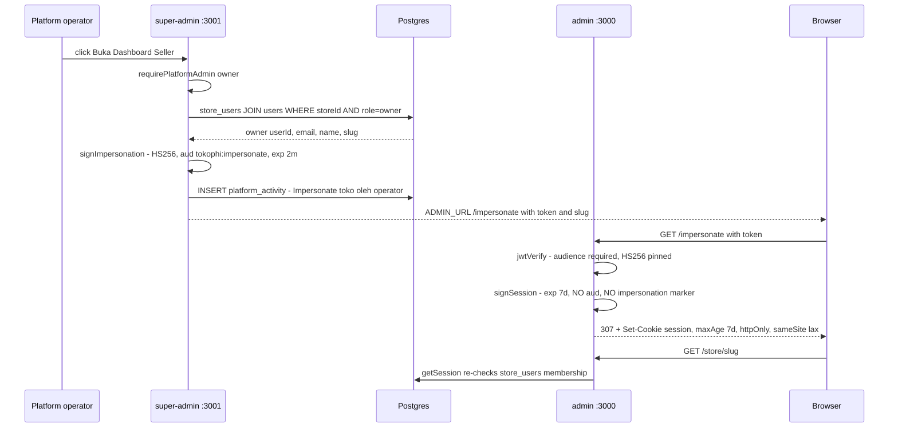
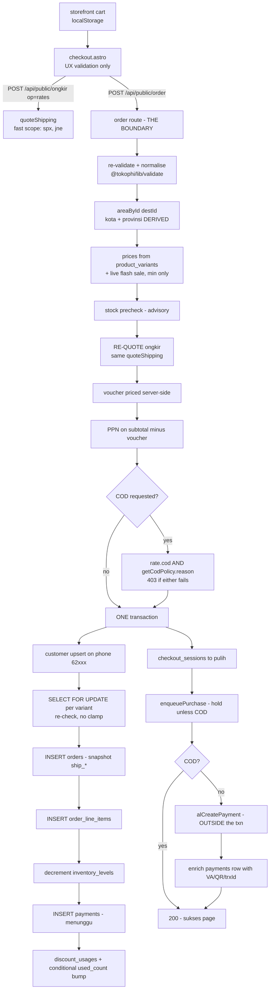
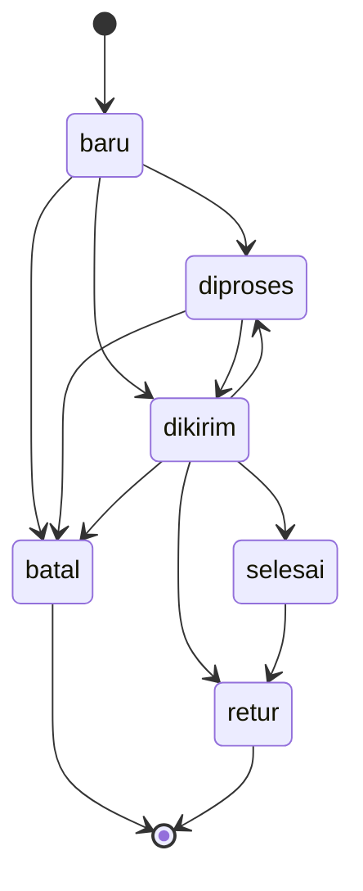
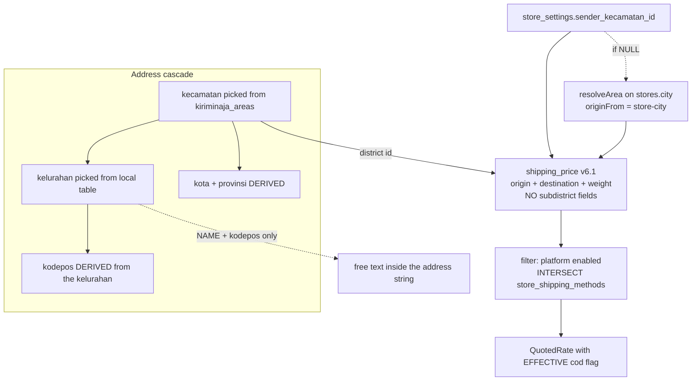
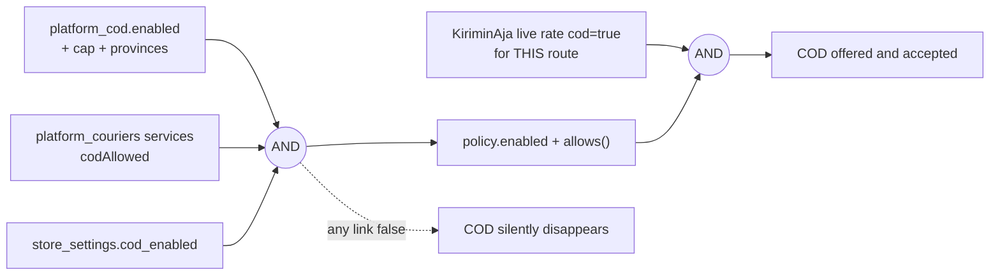
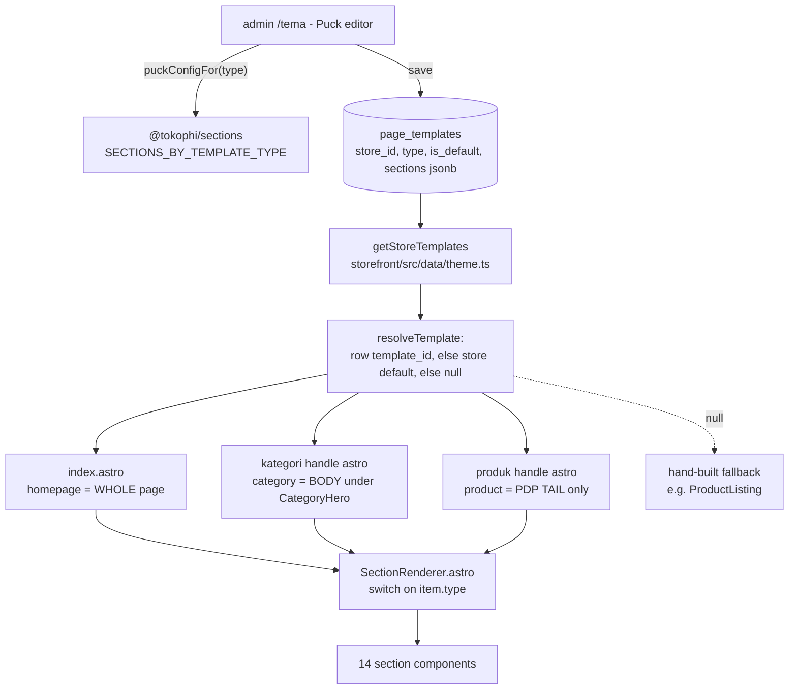
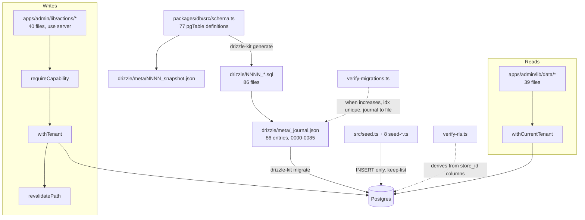

# TokoΦ — Audit & Work Session Report · 2026-08-01

**Baseline:** `origin/main` @ `86e3ec3` ("docs: NEXT.md — the follow-up queue, ordered and sized (#126)").
**Method:** ten agents in parallel, each in its own git worktree branched from that commit.
**State of the work:** **nothing is committed.** Six change sets sit uncommitted in worktrees under
`.claude/worktrees/`.

> **The rule applied throughout is this repo's own, from `STATUS.md`: _verify, or say you did not._**
> Every number in this report was produced by running something. Claims that could not be checked are
> marked UNVERIFIED and stay marked. Where two source documents disagree, §11 says so rather than
> quietly picking one.

**Sources.** This report is derived from four documents in this directory:
`FINDINGS-SOURCE.md` (the consolidated session record, and the authority on every number),
`ARCHITECTURE.md`, `CODE-HEALTH.md`, `CROSS-VALIDATION.md`. A small number of claims were re-checked
directly against the tree while writing; those are marked *(re-verified for this report)*.

---

## 1. Executive summary

**A blocking credential defect was found and fixed: every store created from Super Admin was given the
owner password `tokophi123` — a string published in this repository — and the fix is written but not
yet merged.** Anyone who knew a merchant's email address could sign in at `app.tokophi.com` as that
store's **owner**.

**Nothing has been committed.** All six change sets are uncommitted working-tree state. Merging them is
the owner's call, in a **required order** (§7), and one of the two merge conflicts, resolved carelessly,
puts the published password back.

What else the session produced:

| | |
|---|---|
| Errors confirmed | **15** (E1–E15): 1 blocking, 5 serious, 5 moderate, 4 minor |
| Fixed in a worktree | **4** — E1 (`wt-sec`), E4 (`wt-fix2`), E5 (`wt-order-actions`), E10 (`wt-fix2`) |
| Not fixed, needs an owner decision | **E2, E6** — plus D1–D9 in §6 |
| Not fixed, deliberately | **E3** — wiring it is a four-step job; the four docs that claimed it worked were corrected instead |
| Change sets | 6, all uncommitted, all branched from `86e3ec3`; they compose, with one hand-resolution |
| Composed-tree gates | builds ✓ · `tsc` clean on both Next apps ✓ · **21 files / 180 tests** ✓ · ESLint unchanged ✓ · `astro check` 0 errors ✓ |
| Doc/code disagreements tabulated | **20** — the most dangerous is a *code comment* in the file that defines the tenant boundary |
| Task-list entries found wrong | **8 of `NEXT.md`'s items, plus one item filed as "closed" that was not** (§4.8) |

The three things worth internalising beyond any individual bug:

1. **Three of the six streams correctly refused the task they were given** (§4.5, §4.6, §4.7). Two of the
   refusals were backed by measurements proving the proposed work would have had a **zero-byte** effect;
   the third would have written confidently wrong data into 65 production rows. Those refusals are the
   most valuable output of the session.
2. **The validation chain has three tools and only one is habitually run.** Demonstrated three separate
   times this session: `next build` does not run ESLint; ESLint and `next build` do not typecheck test
   files; and `tsc` + ESLint + `astro check` + build are all green on this repo's documented live
   outages. Nothing runs ESLint automatically, which is how it rotted to 19 errors.
3. **Several serious findings are latent — 0 rows affected today.** E5 and E6 in particular. That
   changes their priority, and this report says so where it is true rather than inflating them.

---

## 2. The one thing to act on first — E1

**`apps/super-admin/lib/actions.ts:27,107`** *(re-verified for this report at `86e3ec3`)*

```ts
const DEV_PASSWORD = "tokophi123"; // default local password for provisioned owners/admins
...
const [u] = await tx.insert(schema.users).values({ email, name: ownerName,
  passwordHash: hashPassword(DEV_PASSWORD) }).returning();
```

**The exploit path, stated plainly.** A platform operator uses Super Admin → Tambah Toko to onboard
`budi@tokosaya.com`. `createStore` writes a `users` row and a `store_users` row with role **`owner`**.
That account's password is the literal string `tokophi123` — which is in this repository, in
`AGENTS.md`, and in the README as the demo login. Anyone who knows the merchant's email address signs
in at `app.tokophi.com` as **store owner** and reaches:

- every order — buyer name, WhatsApp number, full delivery address;
- the entire customer table;
- Pengaturan, and via `settings:write` → `saveBankAccount` + `requestPayout`, i.e. **change the payout
  destination and withdraw the balance**.

Nothing forces a change and nothing expires it. `createStore` also never *returned* the password, so it
was never handed to the merchant either: the account was unusable to its owner and usable to anyone who
guessed.

**Why this is credible rather than theoretical.** The identical bug had already been found and fixed
**250 lines below in the same file**, in `invitePlatformAdmin` (random `tempPassword()`, revealed once)
— and that fix's own comment asserted the other account-creation paths were already correct. Two of the
three paths were fixed; `createStore` was missed. Verified clean: `apps/admin/lib/actions/register.ts:39`
(self-registration takes the user's own password) and `apps/admin/lib/provision.ts:106` (takes
`passwordHash` from its caller).

**STATUS: FIXED in `wt-sec`, not merged.** `createStore` now mints a random password and returns it; the
operator sees it once in a persistent toast. (A dialog was rejected on evidence: the handler
`router.push`es immediately and would unmount it; `<Toaster>` lives in the root layout and survives the
navigation.) Proven on `tokophi_test` inside a rolled-back transaction: `verify('tokophi123') = false`,
`verify(minted) = true`. A **class-level** test, `no-fixed-password.test.ts`, scans the action module and
fails if any `hashPassword()` call receives anything but a freshly minted value, if a minting action
fails to return it, or if any write is anchored to a frozen date — proven red (3/5) before green, and
independently re-proven red (2/5) by the cross-validator's negative control.

**Two follow-ups the fix does not cover — both for the owner:**

1. **Check production for existing owners still holding `tokophi123`, and rotate them.** Whether E1 has
   already been exploited is **UNVERIFIED** — it would need production `users` rows and login logs.
2. **`tempPassword()` in super-admin is `randomBytes(3)` = 24 bits**, against `randomBytes(4)` = 32 bits
   in the admin's copy — the weaker of two definitions of the same helper, on the control plane, with
   **no login rate-limit found**. Unchanged by this session (`resetOwnerPassword` already used it). See
   **D9**.

---

## 3. Errors, ranked

| # | Severity | What | Status |
|---|---|---|---|
| E1 | 🔴 blocking | Every Super-Admin-created store owner got `tokophi123` | **FIXED** — `wt-sec` |
| E2 | 🟠 serious | Login pages publish working control-plane credentials | NOT FIXED — **owner decision (D3)** |
| E3 | 🟠 serious | Abandoned-cart recovery link is never minted; 4 docs said it worked | NOT WIRED, deliberately — docs corrected |
| E4 | 🟠 serious | Frozen seed anchors in 12 live sites, 2 of them WRITES | **FIXED** — `wt-fix2` (all 12) |
| E5 | 🟠 serious | `desc()` emits bare `DESC` = NULLS FIRST; list and detail disagree | **FIXED** — `wt-order-actions` · latent today |
| E6 | 🟠 serious | `tokophi_app` holds full DML on platform tables with RLS off | NOT FIXED — **design decision (D4)** |
| E7 | 🟡 moderate | The public API tier lives inside the merchant's panel | Architectural fact, undocumented until now |
| E8 | 🟡 moderate | `SectionRenderer` has no `default:` arm, no exhaustiveness assertion | NOT FIXED |
| E9 | 🟡 moderate | The `admin` role is derived by subtraction — owner-only caps leak by default | NOT FIXED (pinned by one test) |
| E10 | 🟡 moderate | `markLabelsPrinted`'s caller ignored the honest count | **FIXED** — `wt-fix2` |
| E11 | 🟡 moderate | 22 money tests never run by default | NOT FIXED |
| E12 | 🟢 minor | `check-pixel-defer.mjs` can never pass locally — an alarm that always fires | NOT FIXED |
| E13 | 🟢 minor | Browser checks unrunnable as written on this machine | see §11 |
| E14 | 🟢 minor | Dead code: 3 tables, ~9 columns, ~20 exports incl. 2 whole modules | NOT FIXED |
| E15 | 🟢 minor | `apps/admin` ESLint: 19 errors / 23 warnings, pre-existing | NOT FIXED |

### 🔴 Blocking

**E1** — §2 above.

### 🟠 Serious

**E2 — Login pages publish working control-plane credentials.**
`apps/super-admin/app/login/page.tsx:30` prints `admin@tokophi.id / tokophi123`; the admin login has its
equivalent. The seed genuinely creates those rows on deploy, so on `rich.tokophi.com` **the control
plane advertises a working credential on its own login screen**.
**NOT FIXED — owner decision (D3):** delete the hint, or rotate the seeded password. Either touches the
seed and both apps.

**E3 — The abandoned-cart recovery link is never minted.**
`signRecoveryToken` (`apps/storefront/src/lib/recovery.ts:43`) has **zero callers** — confirmed
independently three times, and *(re-verified for this report)*: a whole-repo grep over `.ts`/`.tsx`/
`.astro` returns exactly one hit, its own declaration. None of the 6 `wa_templates` rows contains a link
placeholder or a URL; `cartMessage` fills only `{nama, produk, toko}`.

*The concrete failure:* the merchant opens `/pelanggan/keranjang`, clicks the WhatsApp button on an
abandoned cart, and sends the shopper a message **containing no link**. The shopper has no way back to
the checkout they half-filled. Roughly 50 lines of storefront code — `verifyRecoveryToken`, the
*"Selamat datang kembali"* banner (`checkout.astro:254`), the cart restore (`:884`), the field pre-fill
(`:975`), the kecamatan restore (`:1924`) — are unreachable.

*Why it matters beyond the feature:* four documents recorded it as done — `REQUIREMENTS.md` SEC-13
**MET**, `UI_INVENTORY.md:60` **"✅ real DB"**, `CODE_MAP.md:113` *"mints/verifies"*, `STATUS.md:162`
*"Recovery links are signed, not guessable"*. **This is the exact failure mode `STATUS.md`'s own opening
rule describes.**

**STATUS: NOT WIRED, DELIBERATELY — the docs were corrected instead.** Wiring it is not small, and the
reasoning is worth keeping: the signer lives in `apps/storefront/src/lib`, which the admin cannot import
(needs a move to `packages/lib`); the read layer does not fetch the store slug; the template needs a
`{{link}}` no existing row has, **and the seed is not a migration**, so a template change reaches new
stores only; and the restore path **has never been run in a browser**. SEC-13 now reads
`VACUOUSLY MET — NO LINK IS EVER MINTED`, which separates what is true (no raw-id path exists; the
verifier is correct and store-bound) from what is not. `BACKLOG.md` P1 records the four concrete steps
and restates the required security shape: signed, store-bound, 7-day `jose` token, **never a raw session
id**.

**E4 — Frozen seed anchors in 12 live sites, 2 of them WRITES.**

The two writes are the damaging ones:

- `apps/admin/lib/actions/articles.ts:8,34` wrote `publishedAt = 2026-06-30`, and because `fields()` is
  a **full field replace** applied by `updateArticle` too, **re-saving a published article walked its
  date backwards** — mechanically identical to the documented voucher bug that made every
  merchant-created voucher born already expired.
- `apps/super-admin/lib/actions.ts` `createStore` stamped `accounts.created_at`, `stores.created_at`,
  `store_users.accepted_at` and `store_stats.updated_at` with `2026-07-02` while computing `trialEndsAt`
  from the real clock — **one row, two clocks**. A store was born ~30 days old with a 3-day trial and
  **dropped out of `newSignups30d` permanently on day one**.

The 10 read sites print nonsense rather than corrupt data, but they are user-visible: *"Pelanggan sejak
−32 hari lalu"* (`customer-detail.tsx:460`); a CRM follow-up due today computing **+32** so the overdue
filter `f.dueDays <= 0` (`crm/page.tsx:102`) **never fires** and the "telat" list is empty forever; an
order placed five minutes ago computing ≈ **−43 000 minutes**; and every live abandoned cart reading
"baru saja" because the clamp `Math.max(0, …)` hides the sign flip — which collapses the ranking
`subtotal / (1 + minutesAgo/1440)` into value-only.

**STATUS: FIXED in `wt-fix2` — all 12; the seed and mock anchors correctly left frozen.** Proven on
`tokophi_test`: three consecutive saves under the old code held `2026-06-30`; under the new code the
true date `2026-07-20 08:30` is unchanged across three saves, and a draft's first publish stamps today.
*(Re-verified for this report:* a grep for `new Date("2026-0` over `apps/` + `packages/`, excluding
seeds and tests, returns **12** hits at baseline and **1** in `wt-fix2` — `lib/mock/store.ts:7`, the
mock's own frame, correctly untouched.)*

**E5 — `desc()` in drizzle emits bare `DESC`, which is NULLS FIRST in Postgres.**
`data/order-detail.ts:306` used `desc(payments.paidAt)` while `data/orders.ts:234` used
`paid_at desc nulls last`. **Both files carried comments asserting they matched.**

*The concrete failure:* on an order with one unpaid and one paid payment row, the **list** names the
paid method and the **detail** names the unpaid one. Reproduced against real Postgres before the fix:
`list -> cod, detail -> va, DISAGREE`.

*Latent, not live:* 827 payments, 46 with `paid_at IS NULL`, but **0 orders** currently have more than
one payment row, so nothing today triggers it. It is reachable — `createOrderPayment` refuses a second
bill only while one is `menunggu`, so a `gagal` VA followed by a retry produces two rows, as does a COD
order later given a gateway payment.

⚠️ **Two sources disagree on the blast radius, and the code settles it.** `FINDINGS-SOURCE.md` says the
courier's cash-collection instruction (COD vs VA) derives from this fact, *citing those comments*.
`CODE-HEALTH.md` verified the code instead and found `createShipment` derives COD from
`exists (select 1 from payments p where … p.method = 'cod')` (`actions/shipping.ts:512`) — **not** from
this ordering. *(Re-verified for this report: `shipping.ts:512` is exactly that `exists` subquery.)*
**Resolution: today this is a display divergence on two screens, not a money instruction — and the
comments in both data files, which claim otherwise, are themselves a doc-in-code bug.**

*It was also filed as done when it was not:* this item sat under **"✅ Closed this session — do not
redo"** in `NEXT.md`. It was not closed.

**STATUS: FIXED in `wt-order-actions`** via one exported `latestPaymentFirst()` used by both paths, with
a real-Postgres test proven red then green. The cross-validator rendered both emitted SQL shapes and
confirmed `paid_at desc nulls last, id desc` in each.

*Same class, lower stakes, **not fixed**:* `data/articles.ts:57` sorts **every draft above every
published post** in the seller's Blog list. (The storefront is safe — `content.ts:85` filters
`status='terbit'` first.) A third site, `data/crm.ts:14` `asc(leads.lastContactAt)`, sinks
never-contacted leads to the bottom of a list sorted "least recently contacted first"; the intent could
not be established, so it is logged as a smell, not an error.

**E6 — `tokophi_app` holds full DML on platform tables with RLS off.**
Verified read-only against the container: `platform_cod`, `platform_couriers`, `platform_payout`,
`platform_payment_channels`, `plans` all show `DELETE,INSERT,SELECT,UPDATE` for `tokophi_app` with
`rowsecurity = f`. These five tables carry the COD cap and province allow-list, `codAllowed` per
service, the minimum payout, the enabled payment channels, and plan pricing. Additionally the `stores`
policy from `0058` is `FOR ALL` with the same expression as `USING` and `WITH CHECK`, so the tenant role
may **UPDATE its own `stores` row** — including `comped`, `status`, `trial_ends_at`, `plan`,
`current_period_end`.

**Latent today**, because the only SQL running under `tokophi_app` is SQL we wrote and none of it
touches those tables. **It stops being latent the moment PostgREST goes live** — the stated production
architecture is *"PostgREST connecting as `tokophi_app` with the JWT `store_id` claim feeding the GUC"*,
at which point a merchant's own JWT reaches a role that can `UPDATE platform_cod SET max = …` or
`UPDATE stores SET comped = true`. `verify-rls` structurally cannot see this: it derives coverage from
`store_id` columns and these tables have none.
**NOT FIXED — design decision required before the VPS cutover (D4).** The shape suggested by the scan:
`REVOKE INSERT, UPDATE, DELETE ON platform_* FROM tokophi_app`, plus column-level grants on `stores`.

### 🟡 Moderate

**E7 — The public API tier lives inside the merchant's panel.**
`/api/public/order`, `/api/public/ongkir`, `/api/public/promo`, `/api/public/pay/callback` and
`/api/uploads/[name]` are route files **inside `apps/admin`**, excluded from its auth middleware
*(re-verified: `apps/admin/middleware.ts` matcher excludes `api/public/`, `api/cron/`, `api/uploads/`,
`products/`, `robots.txt`)*. Two consequences that appear in **no existing document**:

1. The highest-risk unauthenticated code on the platform — the code that writes orders and moves money —
   sits inside the app named "the merchant's panel", which invites reasoning about it as a
   logged-in-only surface.
2. **The admin container must be up for any shopper to check out.** That is an availability coupling
   between the merchant back-office and every storefront's checkout.

Not a defect in itself. It is an architectural fact with real blast-radius consequences, and it should
be written down.

**E8 — `SectionRenderer` has no `default:` arm and no exhaustiveness assertion.**
*(Re-verified: `apps/storefront/src/components/sections/SectionRenderer.astro` has 14 `case "` arms and
no `default:`.)* A section type added to `SectionConfigMap` and forgotten here compiles and renders
**nothing** on a live storefront — `sections` is `jsonb`, so a template saved months ago can hold a type
the renderer no longer handles, and it vanishes silently with no error and no migration to point at.
The palette is deliberately narrower than the renderer (homepage 13, category 10, product 9 of 14); the
rule is **narrow the PALETTE, never the RENDERER**, and an exhaustiveness assertion is what would make
that rule mechanical.

**E9 — The `admin` role is derived by subtraction.**
*(Re-verified: `rbac-policy.ts:68-70` is
`ALL_CAPABILITIES.filter(c => c !== "settings:write" && c !== "integrations:write" && c !== "landing:html")`.)*
A **new owner-only capability leaks to `admin` by default** unless explicitly added to that filter.
`staff` and `gudang` are explicit allow-lists and are immune to the same mistake.
`apps/admin/lib/rbac-landing.test.ts` pins the current state but not the general rule.

**E10 — `markLabelsPrinted`'s caller ignored the honest count.**
The action was fixed in #117 to report `.returning()` rows precisely so the count would be honest;
`pesanan/massal/massal-client.tsx:120` still toasted `printedNumbers.length` — the number **requested**,
not the number **written**. Under RLS a number belonging to another store filters out with no error, so
the merchant was told 50 labels were stamped when 47 were.
**STATUS: FIXED in `wt-fix2`** — the caller now destructures `{ done }`, and the copy **branches** when
the two numbers differ instead of lying in the other direction.

**E11 — 22 money tests never run.**
`apps/admin/lib/ledger-credit.test.ts` skips without `TEST_DATABASE_URL`. The ledger — which decides
when a sale becomes withdrawable — is guarded by tests that are **off by default**. `tokophi_test`
exists and is now migrated to head; nothing wires it into the default run. Worth knowing: the
cross-validator's baseline run *with* `TEST_DATABASE_URL` set reports **17 files / 167 tests** against
the default run's **16 files / 145 tests** — a difference of exactly one file and 22 tests. **The money
tests pass when they are wired; they are simply not wired.**

### 🟢 Minor / hygiene

- **E12 — `check-pixel-defer.mjs` can never pass locally.** It asserts all three vendor pixels load; the
  seeded store has only the `meta` channel enabled, so `gtag`/`ttq` are undefined. It fails **identically
  on clean `origin/main` and on all six change sets** — a tenant-data failure, not a regression. The
  deferral itself is proven correct: 0 vendor `<script src>` in the served HTML, 0 vendor requests
  without interaction, the `fbq` queue buffers 3 events, vendors load on click. This is the same family
  as the documented `verify-rls` incident, where a verifier sat red for weeks and two cross-tenant leaks
  shipped past it. **An alarm that always fires is an alarm that is off.**
- **E13 — Playwright browsers.** `FINDINGS-SOURCE.md` records that Playwright browsers were **not
  installed on this machine at all**, so both repo browser checks were unrunnable as written. Other
  agents did run them (see §11 for the contradiction and its resolution). Either way the principle
  holds: **a check nobody can run is not a check.**
- **E14 — Dead code.** 3 dead tables (`stock_transfers`, `wa_messages`, `notification_templates`),
  ~9 dead columns, ~20 dead exports including **two entirely dead modules**:
  `packages/lib/src/payment-fees.ts` — which `AGENTS.md` describes as *"only used for display"*; it is
  used **nowhere** — and `apps/admin/lib/data/payments.ts`. Dead UI: the `#area-derived` writer in
  `checkout.astro:1443` — the element is confirmed absent from the rendered DOM, so `showArea()` always
  no-ops, with no user-visible failure.
- **E15 — `apps/admin` ESLint: 19 errors / 23 warnings**, pre-existing and already in BACKLOG (down from
  28 on 2026-07-31). The honest breakdown matters more than the count: **12** are "component created
  during render" where both sites are stateless presentational closures (cosmetic — the rule's famous
  cost needs state or a focusable field, and neither has one); **5** are the ordinary
  reset-state-when-a-dialog-opens pattern; and **2 are false positives** — `async` **server** components
  deliberately calling `Date.now()`, which the React Compiler rule cannot know.

---

## 4. Work delivered, per stream

Six change sets plus a read-only measurement stream and an architecture map. All numbers below were
re-derived by an independent cross-validator except where marked otherwise.

### 4.0 Baseline gates on clean `origin/main` @ `86e3ec3`

| Gate | Result |
|---|---|
| `npx vitest run` | PASS — 16 files, 145 tests · **1 file / 22 tests SKIPPED** |
| `npm run build:admin` | PASS |
| `npm run build:super` | **FAIL — environmental, not code** |
| storefront build (`astro build`) | PASS |
| landing build | PASS |
| `astro check` storefront / landing | 0 errors / 0 errors |
| `tsc --noEmit` × 7 packages | PASS 7/7 |
| `npm run lint -w @tokophi/admin` | **FAIL — 19 errors, 23 warnings** (pre-existing, in BACKLOG) |
| `npm run lint -w @tokophi/super-admin` | PASS |
| `verify-migrations` | PASS — 86 entries, last `0085` |
| `verify-rls` | PASS — RLS 51/52 |
| `check-hero-srcset.mjs` | PASS |
| `check-pixel-defer.mjs` | **FAIL** — tenant-data cause, unrelated to any change |

**`build:super` explained** — and this matters, because "build:super is broken" will otherwise be
re-reported forever: `apps/super-admin/` has no `.env.local` (the admin has one, gitignored), so Next
never receives `DATABASE_URL` and page-data collection fails. Exporting the root `.env` makes it build
clean, all 13 routes emitted.

### 4.1 `wt-order-actions` — tenant scoping + payment ordering

**What it changed.** `apps/admin/app/api/public/order/route.ts`, `lib/actions/{inventory,products,purchases}.ts`,
`lib/data/{order-detail,orders}.ts`, `lib/order-status.ts`, `AGENTS.md`, `NEXT.md`; new
`lib/default-location.ts` + test and `lib/data/order-payment.ts` + test.

**N9 — the default-location expression.** `NEXT.md` said there were **7** hand-written copies across 4
files. **There were 8.** The eighth is `apps/admin/app/api/public/order/route.ts`, which had **no
`store_id`** and runs as the **owner with RLS off** — and `inventory_levels` is keyed
`(variant_id, location_id)` with two independent FKs, so nothing structurally forces a variant's
inventory row to sit at a location of its own store.

Extracted to `lib/default-location.ts` with `storeId` as a **required positional parameter** — forgetting
the tenant is now a compile error. Verified: 8 `defaultLocationRow(…)` call sites plus 2
`defaultLocationId(db, sid)`, every one passing a store id; no hand-written `is_default desc` inventory
subquery survives under `apps/admin`; the emitted SQL carries `loc.store_id = $2`.

⚠️ **Correction to `NEXT.md`'s framing.** Its claim that *"only the last one carries the tenant filter"*
is false — `products.ts:91` and `:135` carry it too, and the 4 join-based admin copies run inside
`withTenant` where `locations` is RLS'd. **The genuinely exposed sites were 2**: `order-status.ts`
(reached by `ka-tracking.ts` on the owner connection) and the public order route. Treat N9 as a
duplication task with two real security sites, not seven.

**N10 — stale, nothing to do.** `promo.ts` and `landing.ts` contain **zero** `throw` statements and have
returned `{ ok, error }` since they were written; both callers already `toast.error`. The actions that
genuinely still throw merchant-facing strings are `customers.ts` (×3), `crm.ts` (×3), `checkout.ts` (×2)
and `cancelPurchaseOrder` — **recorded, not touched**, which is the right call: converting a throwing
action to `{ ok, error }` is a two-file change and doing it blind produces callers that report success
over a save that never happened.

**E5** fixed, as described above.

**Verification.** `build:admin` ✓ · vitest 17 files / 150 tests ✓ · `tsc` clean ✓ · ESLint clean on
touched files ✓ · plus a **mutation check**: the tenant filter was deleted from the helper, the test went
red, the filter was restored. Independently: the tightened filter is a **no-op on all 106 current
`inventory_levels` rows** (every store has one location, all `is_default`; 0 mismatched rows) — so it
closes a hole without changing today's data.

### 4.2 `wt-seo` — headings, sitemap, image bytes

**N11 — confirmed, and worse than stated.** A builder homepage **without** a Hero rendered **zero**
`<h1>`; a homepage **with** a Hero rendered **three**, because the carousel emitted one per slide.
Fixed: slide 1 keeps its `<h1>`, slides 2..n become `<p>`; a Hero-less homepage gets
`<h1 class="sr-only">` carrying **the store name from the DB**, never invented copy. `SectionRenderer`
was left untouched — it still switches on all 14 types, so nothing published can stop rendering.
Verified across 13 pages / 5 stores, **all `h1=1`**; the cross-validator independently reproduced both
3→1 and 0→1.

**N13 — confirmed, but its stated data source does not exist.** `products.updated_at` is **not** in
`schema.ts` and **not** in `information_schema`; `collections` has neither timestamp (verified — 9 tables
in the DB carry `updated_at`, and neither of those two is among them). The stream chose to emit
`<lastmod>` **only where a defensible timestamp genuinely exists**: `pages.updated_at` is real and
stamped on every save, so `/halaman/*` got one — which N13 did not even ask for. Products and categories
deliberately get none.

The rejection of `created_at` is worth keeping verbatim: a product created in March and re-priced today
would advertise **March** — the page most needing a re-crawl marked as the stalest — and Google
discounts `lastmod` **site-wide** once it finds it inaccurate, which would take the honest blog and page
dates down with it. Result: **55 URLs, 21 with `<lastmod>`** (from 15), all `YYYY-MM-DD`, none
future-dated, every value reconciled against SQL.

**PDP thumbnails had no `srcset` at all** — found by the measurement stream, on nobody's task list. The
`` inside `<button data-thumb>` rendered a bare `src` into a **66 px** box.

| | before | after | delta |
|---|---|---|---|
| DPR 1 | 153 940 B | 32 198 B | **−121 742 B (−79%)** |
| DPR 2 | 151 552 B | 42 646 B | **−108 906 B (−72%)** |
| DPR 3 | 156 926 B | 49 436 B | **−107 490 B (−69%)** |

The `sizes` derivation is the interesting part: it was derived from container padding + `gap-3` +
thumbnail count, **not** from the `max-w-[7rem]` cap — because `max-w` only *caps* a `flex-1 basis-0`
tile and the measured box is 66 px, so `sizes="112px"` would over-claim by 1.7× and cost a whole rung,
worth **21 668 B** at DPR 2. The cross-validator confirmed the resulting
`sizes="(min-width: 640px) 80px, calc((100vw - 80px) / 5)"` and that the browser picks the 200 w
candidate for a 66 px box at DPR 2.

**Width ladder** now reaches 2000 in both `catalog.ts` `WIDTHS` and the admin `?w=` allow-list
(previously capped at 1200 with no original offered, unlike the static branch which deliberately appends
the source). The never-upscale guard was verified twice: by calling the route handler directly against
fixtures, **and** by removing the guard to confirm `sharp.resize({fit:"inside"})` really does enlarge
without it. All 11 `imageSrcSet` consumers were checked for a missing `sizes` — a missing one defaults to
`100vw` and would now pull 2000 w — and none is missing.

**Left open deliberately, with a reason worth adopting as policy:** `Header.astro` has three more bare
`` sites which render on **every page**, in a different file with three separate `sizes`
derivations. The new check **prints** them without failing, on the stated reasoning that *a check red for
work nobody in this change can land is a check everyone learns to ignore.*

### 4.3 `wt-perf` — bundle and DOM

**N6: closed, zero code change, and the hypothesis was wrong.** The client build target is already
`esnext` (Astro hard-codes it; `astro.config.mjs` sets no `build` key; there is no browserslist in the
repo — confirmed). There is also **no bundle to trim**: `dist/client` contains **zero `.js` files**; all
first-party JS is inline. The 44 KiB `unused-javascript` and 12 KiB `legacy-javascript` are **Meta's
`fbevents.js`** — 188.8 KB unused of 394.5 KB (47.9%), bundling **core-js v3.32.2**, which is the exact
signature the `legacy-javascript` audit detects. **A build-target change would have had a measured delta
of 0 bytes.**

**N5: both candidates in `NEXT.md` were dead ends, with numbers.** Deferring carousel slides buys ~30
elements of a 106-element hero and costs the crawler/no-JS copy. Cutting what the default template seeds
is **zero delta by construction** — the seed is not a migration and reaches new stores only.

The real cost was `Stars.astro`: each rating drew two layers of five separate `<svg>` elements = 26
elements, twelve times per homepage. Rewritten as one `<svg>` with five `<path>`s per layer.

| | before | after |
|---|---|---|
| Homepage DOM elements | 1023 | **915** (−10.6%) |
| `/` HTML | 213 192 B | 210 252 B (**−2 940 B**) |
| `dist/client` | — | **0 delta** |

Verified by **pixel A/B** over the rating widgets, then re-run independently: DPR 1 **36/36
byte-identical**, DPR 2 **36/36 byte-identical**, DPR 3 differing by ~1 pixel / 3 subpixel channels per
widget, max channel delta **5/255**, on the fractional-fill clip edge. (The two runs report different
counts of *which* widgets differ at DPR 3 — see §11.) The geometry is provably faithful: item *i* sits at
`x = i·(PX+GAP)` width `PX` in both the old flex row and the new `translate()/scale()`, total width
unchanged, and the percentage→pixel mapping is identical (`4.0`→62.39 px, `4.3`→67.08 px, `4.7`→73.31 px
in both).

⚠️ **One characterisation was overstated and has been corrected.** The claim *"393 of 1023 elements were
`<svg>`+`<path>` and 312 of those were stars"* conflates two denominators: 393 is the **whole SVG
namespace**; `<svg>`+`<path>` strictly is **383**; and 312 is the widget's **total element count**, not
its SVG share, which is **240**. It reads as 79% where the truth is **61%**. The headline numbers are
exact; the sentence was headed into `AGENTS.md` and was fixed before it landed.

**Honest limit, stated by the stream itself:** 915 is under Lighthouse's 1400 median but over its 800
p10 — **the audit improves without passing.**

### 4.4 `wt-sec` — E1

Covered in §2. Files: `apps/super-admin/lib/actions.ts`, `toko-client.tsx`, `pengaturan-client.tsx`,
`AGENTS.md`; new `lib/temp-password.ts` and `lib/no-fixed-password.test.ts`. Both dialogs' hard-coded
"Password awal: `tokophi123`" strings are replaced with "acak … hanya ditampilkan sekali". Lint clean,
`tsc` rc=0, build ok, 18 files / 172 tests.

Note the incidental cleanup: `wt-sec` also removes the frozen `ANCHOR` from this file and switches the
trial to `BILLING.TRIAL_DAYS`, which is **3** — identical behaviour, now sharing the constant with
`apps/admin/lib/provision.ts:95`, the self-serve twin. This is why `wt-sec` is a strict functional
superset of `wt-fix2` **for this one file**, and why the merge order in §7 is what it is.

### 4.5 `wt-fix2` — E4 + E10 + four doc corrections

Files: `massal-client.tsx`, `lib/actions/articles.ts`, nine `lib/data/*.ts`, `lib/provision.ts`,
`apps/super-admin/lib/actions.ts`, and `specs/docs/{BACKLOG,CODE_MAP,REQUIREMENTS,STATUS,UI_INVENTORY}.md`;
new `lib/publish-date.ts` + test. `provision.ts` is a **comment-only** change *(re-verified)* — it
corrects a comment that described the super-admin's anchor as deliberate.

Independently verified: lint is unchanged from baseline in substance — both report
`✖ 42 problems (19 errors, 23 warnings)` over the same 51 files with a byte-identical rule-id multiset;
only line numbers shift. `publish-date.test.ts` 4/4. 18 files / 171 tests.

**A visible demo regression that is correct, and the owner should decide it rather than discover it.**
Un-anchoring `data/checkout.ts` drops the Keranjang Ditinggal screen from **796 → 6** abandoned carts
and **340 → 143** orders on `batik-nusantara` — verified exactly. The old behaviour was **not a 30-day
window at all**: `WINDOW_START` was a frozen `2026-06-02` with no upper bound, i.e. **60 days on 1
Agustus and growing by a day every day**, under a label that said 30. The cause of the drop is **data,
not code** — the seed's newest `ditinggal` row is 2026-07-15 and `seed:recent` inserts no
`checkout_sessions` at all. **The fix is seeding. Do not re-anchor the app to make the demo look busy**
(**D8**).

### 4.6 `wt-db` — N8 backfill: correctly refused

**This stream's entire output is a docs change, and that is the right output.**

`NEXT.md` said "77 rows on production". That was the **dev** count. Production has **75 orders total**
and **65 nulls**, and **not one** has a `ship_postcode`. Every derivation named in the task resolves
**zero rows** there.

Two structural discoveries behind the refusal:

1. **The id spaces cannot be joined.** `orders.ship_kelurahan_id` is an integer (a KiriminAja village
   id); `kelurahan.id` is a text BPS/Kemendagri code (`34.02.13.2004`). Village → district is not
   derivable locally at all.
2. **Two migrations were lost to number collisions.** `ship_kelurahan_id` / `ship_kelurahan_name` exist
   on the shared dev DB but **in no migration and not in `schema.ts`**; slots `0034` / `0049` now belong
   to another branch. `verify-migrations` is green because **the journal is self-consistent** — which is
   precisely why the loss was never flagged. Consequence: **`seed:recent` cannot run against
   production** (it selects a column production does not have) and is green on dev only because of
   `push` drift.

**The trap avoided.** The 62 dev postcodes are **fabricated by the seed** (`POST_OF[city]` + 3 random
digits); 59 do not exist in `kelurahan` at all. Backfilling from them would have written a confident
wrong kecamatan **and silenced `destinationGuessed` (#117)** — strictly worse than NULL. Rows stay NULL
and stay flagged. The logic was still validated on synthetic fixtures inside a rolled-back transaction:
unique pair → backfilled · 3-district postcode → left NULL · already-set → not overwritten · second run
→ 0 rows.

### 4.7 Measurement stream — production, read-only

**N3 — the question was wrong, not the answer.** 15 desktop Lighthouse runs: **median 99, range 55–100,
TBT = 0 in all fifteen**. Bytes and request count **identical every run** (26 requests, 302 KB).
Pearson **r(score, network-RTT) = −0.866**; runs ≥95 averaged 64 ms RTT, runs <95 averaged 632 ms. The
score is a proxy for the measuring machine's link quality. The stream **refused to compare 99 against
the old 84** — different machine, different day, incomparable populations. **Recommendation: drop desktop
as a KPI or pin it to a fixed measurement host (D5).**

**N4 — cause found: the hero carousel's autoplay.** Speed Index scores every frame against the *last*
frame; an autoplaying carousel guarantees the last frame differs, so the page is scored as never
visually complete. Controlled A/B, one Chrome flag, everything else identical:

| | SI median | Perf | LCP |
|---|---|---|---|
| autoplay ON | **7.96 s** | 67 / 90 / 88 | 1.81–2.09 |
| autoplay OFF | **1.87 s** | **98 / 97 / 97** | 1.82–1.89 |

Alternatives were ruled out **with evidence**, not assumption: marketing pixels load at 10 780 ms,
*after* the 10 114 ms visual change, and the frame pair during which all three vendor bundles execute
shows **0.00% pixel change**; CLS 0.000 across all 21 runs; font swap is 167 ms; there are no client
islands on the homepage. **Recommendation: do nothing, record it (D6).** The page is genuinely complete
at 1.8 s; chasing the number means delaying the cross-fade past the audit window, buying score with a
carousel that feels dead on arrival. `prefers-reduced-motion` was used as an **instrument**, not a
proposal.

**N12 — the claim was wrong; a real bug sat behind it.** Uploads **do** get width variants (`?w=`
returns genuinely different bytes: 3 578 B @200 → 61 074 B full), the route sets `immutable` itself and
goes `cf-cache-status: HIT`, and `app.`/`toko.` share anycast IPs, one wildcard cert and HTTP/3 so
Chrome coalesces — Lighthouse offers **zero** preconnect savings. The real finding was the PDP
thumbnails (§4.2). A full read-only sweep of all 276 text/jsonb columns found `page_templates.sections`
contains **zero** `/api/uploads` references — **no store currently uses an uploaded hero**, so the ladder
gap was pre-emptive rather than live.

### 4.8 Corrections made to the task list and to each other

A task list that was wrong in this many places is itself a finding about how work is tracked here.

| Task-list item | What it said | What was true |
|---|---|---|
| N5 | two DOM-reduction candidates | both dead ends; the real cost was `Stars.astro` |
| N6 | build target / bundle trim | already `esnext`, **zero `.js` in `dist/client`**; the audits are `fbevents.js`. 0-byte delta |
| N8 | "77 rows on production" | that was the **dev** count; production has 75 orders / 65 nulls / 0 postcodes; task refused |
| N9 | 7 copies, "only the last carries the tenant filter" | **8** copies; the "only the last" framing is false; **2** genuinely exposed sites |
| N10 | `promo.ts`/`landing.ts` still throw | stale — zero `throw`s; the real offenders are 4 other files |
| N11 | homepage h1 problem | worse — 0 `<h1>` without a Hero, **3** with one |
| N12 | uploads lack width variants; add preconnect | wrong on both counts; a different real bug behind it |
| N13 | use `products.updated_at` | that column **does not exist**, and `collections` has no timestamp at all |
| "✅ Closed — do not redo" | listed E5 as closed | **it was not closed** |

Agents also corrected each other: the cross-validator **refuted** `wt-perf`'s SVG denominators (§4.3),
found the **second, unflagged collision** in `apps/admin/lib/data/orders.ts` (§7), found
`check-pdp-srcset.mjs` to be **~50% flaky**, and found `check-h1-floor.mjs` **writes to the shared dev
database** at a fixed UUID — a hazard the other five agents had no way to know about.

---

## 5. Architecture

Nine diagrams, reproduced unchanged from `ARCHITECTURE.md`, which derived every non-obvious claim from
the **code** and the **Postgres catalog** rather than from the existing docs.

**The numbers, counted rather than quoted.**

| Metric | On this branch (code) | In the shared container |
|---|---|---|
| Tables | **77** (`pgTable(` in `schema.ts`) | **78** — the extra is `color_palettes`, in no `schema.ts` entry and no `.sql` on this branch (an unmerged sibling branch) |
| Tables with a `store_id` column | **51** | 52 |
| Tables with RLS enabled | **51** (= 50 store-scoped + `stores`) | 52 |
| Store-scoped tables **without** RLS | **1** — `platform_activity`, deliberate | 1 |
| Store-scoped tables with **no `store_id` and no RLS** | **12** | 12 |

Counted surfaces: admin = 55 `page.tsx` + 12 API routes + 39 `lib/data/*` + 40 `lib/actions/*`;
super-admin = 10 `page.tsx`; storefront = 22 page routes + 6 API routes; production compose declares
**10 services** (postgres, migrate, admin, super-admin, storefront, landing, cron, cron-tracking,
cron-tracking-events, backup) — see §11 for a phrasing inconsistency in the source on this figure.

**The child-table class is 12, not 11.** `AGENTS.md` omits `flash_sale_items`, which has FKs to
`flash_sales` (store-scoped, RLS on) and `products` — squarely in the class the rule was written for.
**That class has produced five shipped cross-tenant bugs.** The full list: `collection_conditions`,
`collection_products`, `customer_addresses`, `discount_usages`, **`flash_sale_items`**, `fulfillments`,
`inventory_levels`, `menu_items`, `order_line_items`, `product_media`, `product_options`,
`purchase_order_items`.

### 5.1 System map — four surfaces, five packages, one database



Two facts this diagram is carrying:

1. **`apps/admin` is not only the Seller UI — it is the public API tier** (E7).
2. **`apps/landing` having no database is a design decision, not an oversight** — it is the only surface
   that survives a Postgres outage. `apps/landing/package.json` has no `@tokophi/db` dependency and
   `grep -rn "@tokophi/db" apps/landing/src` is empty.

`apps/super-admin` has **zero** `withTenant` calls — it is cross-tenant by definition and runs entirely
on the owner connection. The storefront likewise: every `src/data/*.ts` imports the bare `db`.

### 5.2 How the tenant is resolved on each surface



`withCurrentTenant` falls back to the **nil UUID** when there is no session — fails closed, matches no
rows. Only **two** `lib/data/*` files and **seven** `lib/actions/*` files skip the wrapper, and all nine
are on a documented exception list (auth, own-account edits, billing, platform/reference tables, public
APIs, cron, `cod.ts`, `shipping-quote.ts`). That is a tight, auditable exception set.

Three hazards this map makes concrete: **"RLS will scope it" on a table RLS does not scope** (`stores`
is keyed by `id`; before `0058` two functions doing `.from(stores).limit(1)` inside `withCurrentTenant`
returned an arbitrary store); **the child-table class**, where the parent write silently no-ops under
RLS for a foreign id while the child write lands anyway, neither half erroring; and
**`platform_activity` being the only intentional gap** — "fixing" it would break the super-admin audit
log, which is written with no tenant session.

Separately: `apps/admin/middleware.ts:49-56` rewrites `/store/{slug}/…` and passes the slug as an
`x-tokophi-store` header **without validating it against the session's store**. The comment says RLS
enforces regardless — true for the 51 RLS'd tables, **not** true for the 12 child tables or for any query
that omits its `storeId` filter.

### 5.3 Auth, RBAC, and the super-admin impersonation flow



**The exchange itself is well-built** — the `aud` claim is what stops a stolen 7-day merchant session JWT
(same `AUTH_SECRET`, no `aud`) being replayed at `/impersonate`, and the algorithm is pinned. **The
asymmetry is the risk, and it is structural:**

- **A 2-minute token buys a 7-day cookie** (`impersonate/route.ts:34-47` re-signs a full-length session).
- **The minted session carries no impersonation marker at all** — no `aud`, no operator id, no shortened
  expiry — so nothing downstream can distinguish it from the merchant's own login, and **every action
  taken during it is attributed to the merchant**. Only the mint is audited (`actions.ts:72`).
- **There is no revocation** — no `jti`, no token version, and **a password reset does not kill it**. The
  only kill switch is deleting the owner's `store_users` row, which the merchant cannot do to themselves.
- `role` comes from the `store_users` row, so an impersonated session is exactly as powerful as the
  merchant's own owner account — `settings:write`, `integrations:write` (tenant secrets), and
  `landing:html` (raw markup that **executes** on the shop's origin).

That is **D1**.

The RBAC matrix (owner / admin / staff / gudang) is verified against `rbac-policy.ts` and the DB enum
agrees exactly. The derivation-by-subtraction hazard is **E9**.

### 5.4 Order → payment → shipment lifecycle





`applyOrderStatusChange` is the single writer of `orders.status` and holds three load-bearing guards:
same-status no-op, `batal`/`retur` terminal, and an explicit `ALLOWED` table. `selesai → retur` is the
**only** legal exit from `selesai`; `dikirim → diproses` exists so a voided shipment can be re-booked.

The money and stock paths were read line by line and **hold** — reported here because "we checked and it
was fine" is worth as much as a finding: the `FOR UPDATE` lock reads the same row the decrement writes,
quantities are aggregated by variant before locking, variants are locked in sorted id order, and there
is no `GREATEST(…,0)` clamp; the payout path uses `pg_advisory_xact_lock` (the legal replacement for the
`sum() … FOR UPDATE` Postgres rejects); the ledger's double-credit impossibility is enforced by three
partial unique indexes plus `on conflict do nothing`; LIKE escaping is used at all three sites.

Two money-shaped smells, neither an error: `bulk-shipping.ts:109` and `bulk-labels.ts:22` cast
`o.total_idr::int`, and int4 tops out at **Rp 2.147.483.647** — unreachable for fashion retail, reachable
for a wholesale merchant, one-word fix; and `data/search.ts:16` loads **every** product and **every**
customer (name + email) into the ⌘K index on **every admin page render** — correct at 24 customers, a
multi-megabyte RSC payload carrying the full customer PII list at 20k.

### 5.5 Shipping & COD





**"Kecamatan PRICES, Kelurahan BOOKS" is only half implemented.** The pricing half is correct —
`kaShippingPrice` posts no subdistrict fields. **But nothing books a destination kelurahan.**
`kaCreateOrder` *supports* `destination_kelurahan_id`; `createShipment` never passes it.
`orders.ship_kelurahan_id` and `ship_kelurahan_name` are **empty in 842 of 842 rows**, and
`checkout.astro:404` states outright: *"The order API ignores kelurahan entirely."* The sender side is
the same — `sender_kelurahan_id` is empty in 7 of 7 stores, because the form deliberately saves only the
NAME (the local `kelurahan` table holds BPS/Kemendagri codes, which are **not bookable**). Those two
columns are **dead**, and `AGENTS.md` claims the opposite.

**6 of 7 stores have no `sender_kecamatan_id`**, so every quote for them falls back to a fuzzy
`resolveArea(stores.city)` match. It is flagged in the response by design — but it is the **default
state, not the exception.**

The COD chain is an **AND of four independent switches owned by four different parties**: the platform,
the courier roster, the merchant, and KiriminAja's live per-route answer. Break any one and COD is simply
not offered — no exception, no log line, no red badge. Live values today: `platform_cod` enabled, cap
**Rp2.000.000**, 6 provinces; `codAllowed` on **`spx` only**, service types **1 and 3**;
`store_settings.cod_enabled` on **1 of 7** stores.

### 5.6 Store Builder / storefront rendering



A template with **zero sections is treated as absent**, so an empty save cannot blank a page — an
implemented rule that ADR 0009 does not state. In the container right now there are exactly **2**
templates (one `homepage` default, one `product` default), so the category path is on the hand-built
fallback everywhere. The exhaustiveness gap is **E8**.

### 5.7 Data layer, migrations, and why self-consistency is not enough



**Journal archaeology — the most quietly important finding in the map.** Replaying all **79 historical
revisions** of `_journal.json` yields **88 tags ever recorded**, against **86** today. The two lost:

| Tag | Fate | Consequence at the time |
|---|---|---|
| `0046_good_dust` | journal entry whose `.sql` was **never committed** | every fresh `drizzle-kit migrate` died; **production never created the `kelurahan` table** and `/api/public/ongkir` 500'd on every checkout |
| `0064_store_public_email` | **renumbered** to `0070` after a two-branch collision | content survived; the journal shows no trace that `0064` ever meant something else |

Both are resolved, and both prove the same thing: **`verify-migrations` checks the journal against
itself and the files beside it. A journal missing an entry is perfectly self-consistent.** The container
also holds 92 rows in `drizzle.__drizzle_migrations` — six more than this branch has entries, because it
is shared. *Count files on your branch, not rows in the container.*

Three silent failure modes remain, all documented: drizzle applies the whole pending batch in **one
transaction** (a single "already exists" rolls back everything behind it — that is what left 16
migrations unapplied on 2026-07-30, hence: **write every migration idempotent**); a `when` that does not
increase makes drizzle **skip** a migration while reporting success; and **the seed is not a migration**.

---

## 6. Decisions for the owner

These are not ours to take. Each row carries enough context to decide without re-reading the rest.

| # | Decision | Context and options |
|---|---|---|
| **D1** | **Impersonation token** (N1) | Three defects compound, **all three verified present**: replayable inside its 2-minute window (`session.ts:30`), travels in a **query string** — so it lands in logs, `Referer` and browser history (`impersonate/route.ts:22`) — and mints a **7-day** session outliving the operator's own (`:46`). Plus §5.3: no impersonation marker, no revocation, survives a password reset, and every action during it is attributed to the merchant. **Options:** single-use token · POST body instead of query string · bind the minted session's expiry to `platform_session` · all three. |
| **D2** | **Two Cloudflare zone settings** (N2) | Already approved 2026-08-01, procedure written in `specs/docs/CLOUDFLARE-PERF.md`, **not executed** — wrangler auth is expired and these are zone settings, not Workers. Email Obfuscation injects a render-blocking `email-decode.min.js`, measured **1 621 ms**, the single largest blocker on the page. ⚠️ The static-asset Cache Rule **must not** mark `/products/*.webp` `immutable` — a merchant replacing a photo keeps the filename. |
| **D3** | **Login pages publishing seeded credentials** (E2) | Delete the hint, or rotate the seeded password. Touches the seed and both apps. Note the interaction with E1: `tokophi123` is printed on the control-plane login screen **and** was the password of every provisioned owner. |
| **D4** | **`tokophi_app` DML on platform tables** (E6) | A design decision **before** the PostgREST cutover, not a patch. Latent today; live the moment a merchant JWT drives that role. Suggested shape: `REVOKE INSERT, UPDATE, DELETE ON platform_* FROM tokophi_app` + column-level grants on `stores`. |
| **D5** | **Desktop PageSpeed as a KPI** (N3) | The measurement says the number tracks the tester's connection (r = −0.866 with RTT), not the build. **Drop it, or pin it to a fixed measurement host.** |
| **D6** | **Speed Index / carousel autoplay** (N4) | Recommendation is to **record it and stop tracking it**. The page is complete at 1.8 s; the alternative buys score with a carousel that feels dead on arrival. |
| **D7** | **Mobile score stability** (N7) | Removing `scroll` from the pixel trigger list stabilises the score, at the cost of not tracking a reader who scrolls the whole page and never taps. `NEXT.md` itself says not to do this for the score alone. |
| **D8** | **Abandoned-cart demo data** | Un-anchoring `checkout.ts` is correct, and it drops the Keranjang Ditinggal screen from **796 → 6** on dev because `seed:recent` inserts no `checkout_sessions`. **The fix is seeding, not code. Do not re-anchor the app to make the demo look busy.** |
| **D9** | **`tempPassword()` entropy** | 24 bits (`randomBytes(3)`) in super-admin vs 32 bits in the admin's copy, and **no login rate-limit was found**. Unchanged by this session (`resetOwnerPassword` already used it), but widening it plus throttling is a real follow-up — and it is now on the path that hands a merchant their first credential. |

---

## 7. Merge plan

Six change sets, all uncommitted, all branched from `86e3ec3`.

**Composition is verified.** A scratch tree with all six diffs applied builds, `tsc` is clean on both
Next apps, **21 files / 180 tests** pass, ESLint is unchanged in both apps, `astro check` reports 0
errors, and `check-h1-floor` + `check-hero-srcset` pass. Storefront output is **byte-identical** to the
four-way tree, as it should be — neither fix worktree touches the storefront. The effects are additive:
212 202 B = 215 142 (seo) − 2 940 (the exact perf saving), and the combined build has **915 elements and
1 `<h1>`** simultaneously.

**Zero collisions among the original four.** Two appeared once the fix worktrees were added:

1. 🔴 **`apps/super-admin/lib/actions.ts` — `wt-sec` ∩ `wt-fix2`.** A real textual conflict, 2 hunks.
   **`wt-sec` must win both** — it is a strict functional superset for that file. **The four timestamp
   edits are byte-identical in both worktrees**, so git merges them silently; the conflict is only over
   the constants block and `hashPassword(pw)` + `BILLING.TRIAL_DAYS` versus
   `hashPassword(DEV_PASSWORD)` + `3 *`. Taking `wt-sec`'s file verbatim loses nothing functional — only
   `wt-fix2`'s comment prose, which carries one fact worth grafting in by hand: that an anchored store
   drops out of `newSignups30d`.
   **Negative control:** resolving it the wrong way fails `no-fixed-password.test.ts` 2/5 with messages
   naming `createStore` — **but the guard only exists once `wt-sec` has landed.**
2. ⚠️ **`apps/admin/lib/data/orders.ts` — `wt-order-actions` ∩ `wt-fix2`.** Merges clean 3-way and the
   merged result was verified correct — but **that is luck, not design**: `wt-fix2` replaced the line
   immediately below `wt-order-actions`' new import. One line either way and this would have been a
   second conflict. Neither author knew about it.

**Recommended order — the first constraint is a safety property, not a preference:**

```
perf → seo → sec → fix2 → db → order-actions
```

**`wt-sec` MUST precede `wt-fix2`.** Either order yields exactly one conflict in the same file, but they
are not equally safe:

- **sec first (correct):** `wt-fix2`'s author opens the conflict and finds their entire change to that
  file *already present*. The resolution is "drop my hunk", which is obvious and hard to get wrong — and
  the guard is already in the tree, so a wrong resolution fails immediately.
- **fix2 first (dangerous):** `wt-sec`'s author must **delete a colleague's fresh comment block**, which
  looks like reverting someone's work, while the guard that would catch a half-resolution arrives **in
  the same PR being resolved**. A "keep both" resolution silently restores `hashPassword(DEV_PASSWORD)`.
  That is E1, back.

⚠️ **`wt-db` before `wt-order-actions`** is a softer preference: their `NEXT.md` hunks share context
lines (N8's body is order-actions' leading context for N9). Both merge clean; the second to land
inherits the adjacency, and order-actions' author owns N9 and can also fix a dangling "the count above
was seven" sentence.

The rest is risk ordering: perf is the smallest surface and inherits nothing; seo is the largest
storefront change and was validated on top of perf; **order-actions is the only set touching stock and
money write paths, so it deploys last and alone, making a rollback unambiguous.**

`AGENTS.md` has 4 writers and `NEXT.md` 4; both merge clean 3-way with 0 markers. **Merges are
serialised here** — each triggers a Coolify build — so merge one, watch the deploy land, then release
the next.

### What to re-run after each merge

| After | Run | Expect |
|---|---|---|
| **1. `wt-perf`** | storefront build + serve; `check-hero-srcset.mjs` | build rc=0, PASS, homepage DOM **915** |
| **2. `wt-seo`** | storefront build + serve; `check-h1-floor.mjs`; `check-hero-srcset.mjs`; `tsc -p apps/admin` (it edits an admin route) | h1-floor 4/4, hero PASS, rc=0, sitemap **21/55** |
| **3. `wt-sec`** | `lint -w @tokophi/super-admin`; `tsc -p apps/super-admin`; `vitest run apps/super-admin`; `build -w @tokophi/super-admin` | lint clean, rc=0, **8 tests**, build ok |
| **4. `wt-fix2`** | **resolve `apps/super-admin/lib/actions.ts` by keeping the post-`wt-sec` version verbatim**, then `vitest run apps/super-admin/lib/no-fixed-password.test.ts` ← **the guard**; `tsc -p apps/admin`; `eslint`; `build -w @tokophi/admin` | guard **5/5**, rc=0, eslint **42 problems (19 errors, 23 warnings)** — no more, no fewer; build ok |
| **5. `wt-db`** | nothing — docs only | — |
| **6. `wt-order-actions`** | `tsc -p apps/admin`; `TEST_DATABASE_URL=…/tokophi_test vitest run`; `build -w @tokophi/admin` | rc=0, **21 files / 180 tests**, build ok |

**Do not** re-apply saved plain diffs onto a moved base — that is the one path where `NEXT.md` collides
unnecessarily.

### Two new check scripts need attention before they are trusted

- **`check-pdp-srcset.mjs` is ~50% flaky.** Four consecutive runs against the same build and unchanged
  database: PASS, PASS, FAIL, FAIL — the same 2-of-4 split on the six-way tree, and **not caused by
  `wt-perf`**. Cause: thumbnail #1 and the main gallery image share a URL and srcset; the main image
  legitimately fetches the 800 w candidate, and whether Chromium then reuses that cached file for the
  66 px thumbnail is a timing race. When it does, the check reads a 6.1× oversize where **zero extra
  bytes were transferred**. The structural assertion (every thumbnail `` has `srcset` + `sizes`)
  passed 4/4 every time and is sound. **Fix: exempt an `` whose `currentSrc` was already requested
  by another element, or assert on transferred bytes.** Shipping it as-is puts a coin-flip red check into
  the runbook — exactly how `check-pixel-defer` and `verify-rls` became noise.
- **`check-h1-floor.mjs` writes to the shared dev database** and is not concurrency-safe: it inserts a
  `page_templates` row at a **fixed UUID** and deletes it in `finally`. It cleaned up correctly here, but
  the fixed id means two concurrent runs delete each other's row, `finally` does not run on `SIGKILL`,
  and while it runs a real store has a homepage it never built, visible to any concurrent reader.
  **Gate it behind an explicit env var.**

**One convention question worth deciding deliberately:** only `wt-seo` updated `CHANGELOG.md`. `wt-perf`
ships a rendering change, `wt-order-actions` changes stock and payment reads, `wt-sec` closes a
credential vulnerability, `wt-fix2` changes twelve date computations — none added an entry, while
`AGENTS.md` says to record a contract-affecting change there. There is no merge risk today *because* the
convention was not followed; had all five followed it, it would have been a five-writer collision.

---

## 8. What the docs got wrong

The code wins; each row is a doc bug. **20 disagreements** were tabulated. The full table is in
`ARCHITECTURE.md` §8; the ones that change behaviour or belief are below.

| Doc claim | Where | Reality |
|---|---|---|
| **"RLS scopes the 36 tables that have a `store_id`"** and **"`stores` … has `relrowsecurity = false`"** | `apps/admin/lib/tenant.ts:23-25` — **a code comment** | 51 tables; and `stores` **does** have RLS since migration `0058`. *(Re-verified: the comment still reads exactly this.)* |
| The order snapshots `ship_kelurahan_id`/`ship_kelurahan_name` and `createShipment` books "those exact ids" | `AGENTS.md`, Shipping § | **Never written and never read** — `0 / 842`. The order API writes 5 `ship_*` fields, not 7 |
| Recovery links are minted and signed | `REQUIREMENTS.md` SEC-13 (MET) · `UI_INVENTORY.md:60` (✅ real DB) · `CODE_MAP.md:113` ("mints/verifies") · `STATUS.md:162` | `signRecoveryToken` has **zero callers** (E3). All four corrected this session |
| **"Every `jwtVerify` pins `algorithms` — ❌ NOT TRUE, do not believe this"** | `STATUS.md:147` | **Both named files now pin `HS256`.** The document misleads in the *opposite* direction to when it was written — warning about a hole that has been closed |
| The 11 store-scoped tables with no `store_id` and no RLS | `AGENTS.md`, child-table rule | **12** — `flash_sale_items` is missing |
| `@tokophi/lib/payment-fees` is "only used for display" | `AGENTS.md` | Used **nowhere**; the entire module is dead |
| "Three surfaces" | `CODE_MAP.md` §1, §2 | **Four** — `apps/landing` is a real deployed service |
| 68 tables / 54 tables / 72 tables | `CODE_MAP.md` · `AGENTS.md` · `STATUS.md` | **77** in `schema.ts` (78 in the shared container) |
| migrations 0000–0083, 84 files / 64 migrations | `CODE_MAP.md` · `STATUS.md` | **0000–0085, 86 files** |
| storefront has "two API routes" | `CODE_MAP.md` §6 | **Six**; `api/chat/send.ts` writes three tables |
| admin = 39 routes / 22 actions / 22 data files | `CODE_MAP.md` §2 | **55** `page.tsx`, **40** actions, **39** data |
| super-admin = 8 routes | `CODE_MAP.md` §2, §5 | **10**; `/pencairan` (payouts) is missing from the table entirely |
| compose = "Postgres + migrate + 3 apps + billing cron" | `CODE_MAP.md` | **10 services**, including `landing`, `cron-tracking`, `cron-tracking-events` |
| Live on Vultr `45.76.146.40` / `*.sslip.io` | `CODE_MAP.md` §11 | `AGENTS.md` says `tokophi.com` since 2026-07-13. **The two docs contradict each other and neither was verified** — production was not touched |

**`STATUS.md` needs a refresh, with one caveat for whoever does it.** It was last edited 2026-07-31 yet
claims "Refreshed 2026-07-21", and ten of its numbers are wrong (72→78 tables, 64→86 migrations,
685→827 payments, …). **The distinction that matters:** some numbers are stale because **the code
changed** (fix them) and others because **the shared dev DB moved on** as other agents seeded
(re-stamping those just chases a moving target).

Corrected this session: `REQUIREMENTS.md` SEC-13, `UI_INVENTORY.md:60`, `CODE_MAP.md:113`,
`STATUS.md:162`, `NEXT.md` items N5/N6/N8/N9/N10/N11/N12/N13 and its false "closed" entry, plus
`AGENTS.md` (child-table count, default-location helper, payment ordering, three storefront performance
rules, the fixed-password instance).

---

## 9. What was NOT verified

Carried forward in substance from `FINDINGS-SOURCE.md` §7, plus the architecture map's own gaps. A
confident wrong entry is worse than a gap.

- **All production measurements** — byte figures, prod row counts, Lighthouse runs — were taken by the
  agents that ran them; the cross-validator had **no production access** and could not re-check them.
  Nothing contradicts them.
- **`verify-rls` was not re-run by the architecture mapper.** The "green" result comes from the baseline
  and code-health runs. The mapper confirmed the *mechanism* statically (policies exist,
  `tokophi_app` has `rolbypassrls=f`, `withTenant` issues `set local role`) but deliberately did not run
  the verifier, because it connects and `verify-rls-app` exercises writes.
- **No browser run for the admin/super-admin changes** (frozen dates, password reveal, toast copy) —
  `next build` + `tsc` + vitest is the extent. **The repo's own rule is that money and checkout paths
  must be *exercised*.** That was done for the storefront checkout (Playwright, `en-US`, 0 pageerrors,
  Rp110 000 + Rp15 700 = Rp125 700) but **not** for these admin screens.
- **The recovery restore path has never been run in a browser.** That is the finding, not a gap.
- **Whether the 86 migration `.sql` bodies are idempotent** — `verify-migrations` only proves the journal
  is sane, and non-idempotency is what stranded 16 migrations for everyone on 2026-07-30.
- **Whether E1 has been exploited in production.**
- **Which deploy target is actually live** — `CODE_MAP.md` (Vultr / sslip.io) and `AGENTS.md`
  (tokophi.com) contradict each other, and production was not touched.
- **`accounts` tenancy** — no `store_id`, no RLS; could not be settled as platform-level or store-scoped,
  so it is excluded from the child-table count of 12. **Someone should settle it.**
- **The SPX free-return-leg belief** underpinning COD policy — `AGENTS.md` already marks it UNVERIFIED.
- **`KIRIMINAJA_ENV` in production.** It defaults to `sandbox`; an unset env in production silently talks
  to the sandbox.
- **Whether the 12 child tables are all reached only through correctly-scoped parents today.** The class
  and the rule were verified; auditing all 40 action files' call sites against it is separate work.
- **The `impersonate` route end to end in a browser**, including cookie behaviour across real subdomains
  (`rich.` → `app.`) — asserted by code comments, not measured.
- **`check-pixel-defer` against a store with all three channels**, and whether it also fails in
  production.
- **`audit:responsive`** (admin + storefront) — the scripts hard-code ports the scan was not scoped to.
- **`getSearchIndex` payload size at scale** — invisible at 24 customers.
- **The intent behind `asc(leads.lastContactAt)`** — no spec states which end of the list is urgent.
  **Ask the owner.**

---

## 10. Recommendations

Split deliberately into work and decisions. Sizes are relative effort, not hours.

### Do this

| # | Action | Size | Why now |
|---|---|---|---|
| 1 | **Merge the six change sets in the stated order** (§7), watching each Coolify deploy land before releasing the next | M | E1 is fixed but not shipped. Everything else is downstream of this |
| 2 | **Check production for owners whose `password_hash` verifies against `tokophi123`, and rotate them** | S | The code fix does not repair accounts already provisioned. This is the only step that closes the *existing* exposure |
| 3 | **Wire `TEST_DATABASE_URL` into the default test run** (E11) | S | 22 money tests exist and **pass**; they are simply not run. The ledger decides when a sale becomes withdrawable. Highest value-per-line in this report |
| 4 | **Run ESLint before every PR — and make something run it automatically** (E15, §4.0) | S | ESLint was the *only* gate that caught a backtick that had silently terminated a SQL string. Nothing runs it, which is how it rotted to 19 errors |
| 5 | **Fix `check-pdp-srcset.mjs`'s flake and gate `check-h1-floor.mjs` behind an env var** before either enters the runbook | S | A coin-flip red check trains everyone to ignore checks — the documented cause of two shipped cross-tenant leaks |
| 6 | **Make `check-pixel-defer.mjs` assert only the channels the tenant has enabled** (E12) | S | Same argument. It currently cannot pass locally, ever |
| 7 | **Add a `default:` arm or exhaustiveness assertion to `SectionRenderer`** (E8) | S | A forgotten section type silently blanks part of a live storefront, with no error and no migration to point at |
| 8 | **Refresh `STATUS.md`**, distinguishing code-stale numbers from DB-moved ones, and fix the `tenant.ts:23-25` comment | S | The comment is wrong twice, in the file that defines the tenant boundary. `STATUS.md:147` warns about a hole that is already closed |
| 9 | **Fix `data/articles.ts:57`** — drafts sorting above published posts, the surviving half of E5's class | S | One line; the same NULLS-FIRST mistake |
| 10 | **Write E7 down** — that the public API tier lives inside `apps/admin`, with its availability coupling | S | It appears in no document, and it changes how anyone reasons about that container |
| 11 | **Teach `seed:recent` to insert `checkout_sessions`** (D8's remedy) | M | Makes the correct un-anchoring survivable on the demo without re-anchoring the app |
| 12 | **Wire the recovery link** (E3) — move the signer to `packages/lib`, fetch the slug, add `{{link}}` to the template **with a data fix for existing stores**, then drive the restore path in a browser | M–L | It is P1 in BACKLOG with the four steps written out. Do not ship it without the browser run — that path has never been executed |
| 13 | **Sweep the 86 migration bodies for non-idempotent DDL** | M | The exact failure that stranded 16 migrations for everyone on 2026-07-30 |
| 14 | **Add a class-level test for the `admin`-by-subtraction rule** (E9) | S | One test that fails when a new owner-only capability is not excluded |
| 15 | **Delete the dead code inventory** (E14) — 3 tables, ~9 columns, ~20 exports, 2 whole modules | M | Optional, but `payment-fees.ts` is actively misdescribed in `AGENTS.md`, which is how it gets "revived" by someone who trusts the doc |

### Decide this

| # | Decision | The question in one line |
|---|---|---|
| **D1** | Impersonation token | Single-use, POST body, bound expiry — or all three? And should an impersonated session be *marked*? |
| **D2** | Cloudflare zone settings | Approved, unexecuted; needs wrangler auth. Worth **1 621 ms** on every page |
| **D3** | Seeded credentials on login screens | Delete the hint, or rotate the password? |
| **D4** | `tokophi_app` DML on platform tables | Must be settled **before** the PostgREST cutover, not after |
| **D5** | Desktop PageSpeed as a KPI | Drop it, or pin the measurement host? |
| **D6** | Speed Index / carousel autoplay | Record and stop tracking — or spend UX for score? |
| **D7** | Mobile score stability | Trade a real reader signal for a stabler number? |
| **D8** | Abandoned-cart demo data | Confirm: fix the seed, never re-anchor the app |
| **D9** | `tempPassword()` entropy + login rate-limit | 24 bits and no throttle, on the path that hands a merchant their first credential |
| — | `asc(leads.lastContactAt)` | Should never-contacted leads sort first or last? No spec says |
| — | `CHANGELOG.md` convention | Every contract-affecting change, or only some? Five agents skipped it |

---

## 11. Where the sources disagreed, and how it was resolved

Recorded rather than smoothed over, because a report that hides its seams is the failure mode this
project keeps writing incident notes about.

| # | Disagreement | Resolution |
|---|---|---|
| 1 | **E5's blast radius.** `FINDINGS-SOURCE.md` says `createShipment` derives the courier's cash-collection instruction from the payment ordering (citing the code comments); `CODE-HEALTH.md` verified `createShipment` uses `exists (… method='cod')` at `actions/shipping.ts:512` instead. | **Code wins.** Re-verified: `shipping.ts:512` is that `exists` subquery. E5 is a **display divergence on two screens**, not a money instruction — reported that way in §3, with the note that both data files' comments claim otherwise and are themselves wrong. |
| 2 | **`build:super` at baseline.** `FINDINGS-SOURCE.md` §1: FAIL. `CODE-HEALTH.md` §1: PASS. | Not a contradiction once explained: the scan worktree had `apps/super-admin/.env.local` copied in. Both are reported in §4.0 with the cause. |
| 3 | **Baseline test counts.** `FINDINGS-SOURCE.md`: 16 files / 145 tests (1 file / 22 skipped). `CROSS-VALIDATION.md`: baseline 17 files / 167 tests. | The difference is exactly **1 file and 22 tests** — the cross-validator ran with `TEST_DATABASE_URL` pointed at `tokophi_test`. Both figures are correct for their environment, **and it establishes that the 22 money tests pass when wired** (§3, E11). |
| 4 | **RLS denominators.** "51/52" (baseline `verify-rls`) vs "50 of 51" (`FINDINGS-SOURCE` §3.6) vs the architecture table. | Container vs branch. On the **branch**: 51 tables carry `store_id`, 50 of them have RLS (`platform_activity` excepted), and 51 tables have RLS in total (the 50 plus `stores`, policed by `id`). The container adds `color_palettes` from an unmerged branch, giving 52. Both denominators are stated in §5. |
| 5 | **Pixel A/B at DPR 3.** The perf agent reported **8 of 40** widgets differing; the cross-validator reported **34 of 36** differing, but by ~1 pixel / 3 subpixel channels each, max delta 5/255. `FINDINGS-SOURCE` summarises this as "if anything the original claim was pessimistic", which is true of DPR 1 and 2 (36/36 identical in both runs) but **not** of DPR 3. | **Reported as a disagreement** in §4.3. The two runs agree on magnitude (sub-pixel, on the fractional-fill clip edge) and disagree on how many widgets show it. Neither run found a visible defect. |
| 6 | **Frozen-anchor site count.** `FINDINGS-SOURCE`: 12 live sites. `CODE-HEALTH` §3.1 is headed "13 sites" over a 12-row table including the mock. | Reconciled **by re-running the grep**: 12 anchor constants outside the mock/seed/tests at baseline, 1 (the mock) after `wt-fix2`. `CODE-HEALTH`'s 13 counts `customers.ts`'s two constants separately and includes the mock. |
| 7 | **Dead columns: 9 or 11?** `FINDINGS-SOURCE` E14 says 9; `CODE-HEALTH` §4 tabulates 11 column entries. | The two reconcile if the two columns `AGENTS.md` **already** documents as deliberately-kept dead (`store_settings.payment_channels`, `payment_fee_bearer`) are excluded. **Neither source states this**, so §3 says "~9". |
| 8 | **Compose service count.** `ARCHITECTURE.md` §1 says "declares **13** services: [10 named] + 3 volumes"; §8 row 17 says "**10 services**" and enumerates them. | Internal inconsistency in one source: **10 services + 3 volumes**. §5 reports 10 and names them. |
| 9 | **Playwright browsers (E13).** `FINDINGS-SOURCE` says they were "not installed on this machine at all, so both repo browser checks were unrunnable as written"; `CODE-HEALTH` and `CROSS-VALIDATION` both report **running** those checks and driving a real browser. | Reported as-is in §3. *(Re-verified: `~/.cache/ms-playwright` does contain `chromium-1228`.)* The most likely reading is that one agent hit a missing browser and others used a workaround or a system channel; **this was not established**, so E13 stays recorded with the contradiction visible. |
| 10 | **PDP byte figures.** `CROSS-VALIDATION.md` claim 16 lists production numbers "58 728 B / 114 073 B / 151 552→42 646 B" as UNVERIFIABLE; only the third appears in `FINDINGS-SOURCE`'s table. | §4.2 reproduces **only** `FINDINGS-SOURCE`'s table. The two extra figures are noted here rather than promoted into the report, since no source states what they measure. |

---

## Appendix — provenance

- `FINDINGS-SOURCE.md` — the consolidated session record; the authority on every number in this report.
- `ARCHITECTURE.md` — 9 mermaid diagrams + structural map, every non-obvious claim carrying `file:line`
  or a SQL result. All nine diagrams are reproduced unchanged in §5.
- `CODE-HEALTH.md` — the error inventory with per-error failure scenarios and the dead-code sweep.
- `CROSS-VALIDATION.md` — independent verification of the six change sets: **31 claims verified, 1
  refuted, 6 unverifiable** (all production measurements).

Claims marked *(re-verified for this report)* were checked directly against the tree at `86e3ec3` while
writing: E1's two lines, E3's zero callers, E4's 12 → 1 anchor count, E5's two comments and
`shipping.ts:512`, E7's middleware matcher, E8's 14 cases with no `default:`, E9's subtraction filter,
the `tenant.ts:23-25` comment, and `wt-fix2`'s `provision.ts` being comment-only. No file was modified
and no worktree state was changed.
