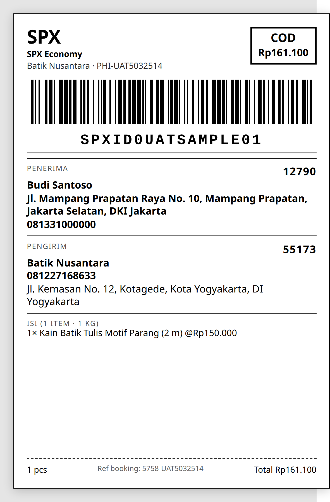

**UAT — MitraAPI**

User Acceptance Test — KiriminAja

| Ketentuan upload: pdf, maksimal 10 MB. Jangan tampilkan secret/API key penuh. Label pengiriman wajib mengikuti dokumentasi KiriminAja dan dilampirkan screenshot jika digunakan. |
| :---- |

Dokumen ini tidak memuat API key. **Revisi 2 (14 September 2026)** — menindaklanjuti review KiriminAja atas revisi 1: *"endpoint sudah v6.2 namun struktur payload masih v6.1"*. Seluruh 8 skenario dijalankan ulang pada 14/09 dengan payload v6.2 lengkap (`kelurahan_id`, `zipcode`, `latitude`/`longitude`, `items[]` + `metadata`, `note` — contoh request body di §3 no. 4). Semua OID di bawah adalah hasil run tersebut.

&nbsp;

**1\. Informasi Dokumen**

| Field | Nilai |
| :---- | :---- |
| Nama Brand / Merchant | TokoΦ — platform commerce SaaS (tokophi.com); merchant uji: Batik Nusantara (toko demo) |
| Nama PIC | Ongki A. Febriananda ("Mas Ongkie") — Owner / integrator |
| Email PIC | billing@tokophi.id |
| Nomor HP PIC | 081227168633 |
| Environment UAT | Sandbox MitraAPI — https://tdev.kiriminaja.com · prefix akun 5758 (OID di bawah) · dipanggil dari IP egress produksi 45.77.33.112 (allow-list aktif) |
| Tanggal UAT | 14 September 2026 (run ulang v6.2); run pertama 24 Agustus 2026 |
| Versi Dokumen | V 1.0 — revisi 2 (payload v6.2) |

&nbsp;

**2\. Scope UAT**

Centang fitur yang diuji dan beri catatan jika tidak digunakan.

| Fitur Core | Status | Catatan |
| :---- | :---- | :---- |
| Authentication / API Key Sandbox | ☑ Diuji ☐ N/A | Bearer API key sandbox; `province` 200 "Data Loaded" (37 provinsi). Kunci tidak dicantumkan di dokumen ini. |
| Coverage / Courier Service | ☑ Diuji ☐ N/A | `courier_services` → 20 layanan / 10 kurir; `kelurahan` (kecamatan\_id → id kelurahan KiriminAja) dipakai untuk mengisi `kelurahan_id` / `destination_kelurahan_id` |
| Pricing | ☑ Diuji ☐ N/A | `v6.1/shipping_price` dengan berat + dimensi; volumetrik terbukti (§3 no. 3). Harga quote dipakai apa adanya sebagai `shipping_cost` booking |
| Create Paket Non-COD | ☑ Diuji ☐ N/A | 4 booking v6.2 (aktual/volumetrik × ±asuransi), AnterAja REG — OID §3 no. 4–7 |
| Create Paket COD | ☑ Diuji ☐ N/A | Declare COD Value: `cod` = nilai barang + ongkir = Rp161.100; 4 booking SPX Economy — OID §3 no. 8–11 |
| Create Paket Insurance | ☑ Diuji ☐ N/A | Declare insurance amount/type: `insurance_amount: 150000` pada booking, `insurance: 1` pada quote (4 skenario) |
| Create Paket KA Credit | ☐ Diuji ☑ N/A | Declare payment method KA Credit: tidak dipakai. `GET v6.2/credit/balance` menjawab "Unable to find your endpoint target" (3× pada 11–12/09, kontrol `province` sukses) — akun tampaknya Term-of-Payment; `payment_method`/`pin` tidak dikirim |
| Label Pengiriman | ☑ Diuji ☐ N/A | Dirender aplikasi member (100×150 mm, Code 128) — screenshot §4 |
| Tracking | ☑ Diuji ☐ N/A | `POST /api/mitra/tracking` dipoll otomatis tiap 15 menit + pemetaan status → order |
| Webhook / Callback | ☑ Diuji ☐ N/A | Jika digunakan: receiver LIVE di produksi, Bearer fail-closed (401 diuji); URL didaftarkan via `set_callback` (2026-09-09) |
| Cancel / Void | ☐ Diuji ☑ N/A | Jika digunakan: diimplementasi (`v3/cancel_shipment`, kirim AWB bukan OID) — belum dapat dieksekusi karena sandbox tidak menerbitkan AWB untuk OID UAT |

&nbsp;

**3\. Hasil Pengujian**

Isi ringkas hasil pengujian. Evidence dapat berupa screenshot, response log, order ID, AWB, atau catatan validasi. Semua OID/pickup number di bawah dapat diverifikasi pada akun sandbox 5758 (dibuat 14 September 2026, 10:41–10:42 WIB; jadwal pickup 2026-09-15 10:00:00).

| No | Fitur | Skenario Minimal | Expected Result | Actual / Evidence Screenshot UI Apps | Wajib Implementasi | Status |
| :---- | :---- | :---- | :---- | :---- | :---- | :---- |
| 1 | Authentication | Request API Key Sandbox valid | Authorized / sukses | `POST /api/mitra/province` → 200 `status:true` "Data Loaded", 37 provinsi (diukur 2026-09-09, 12, 14). Kunci salah → "Unauthorized." — pemisahan auth vs IP allow-list terverifikasi. | Wajib | ☑ Pass ☐ Fail ☐ N/A |
| 2 | Coverage / Service | Cek area/courier service | Service/area tersedia | `courier_services`: 20 layanan / 10 kurir. Rute uji: origin kecamatan 6138 (Gubeng, Kota Surabaya) → dest 2107 (Mampang Prapatan, Jakarta Selatan); kelurahan via `POST /api/mitra/kelurahan`: Gubeng id 69243 (60281), Mampang Prapatan id 17554 (12790). `shipping_price` mengembalikan daftar layanan lengkap. | Wajib | ☑ Pass ☐ Fail ☐ N/A |
| 3 | Pricing | Cek ongkir data valid | Harga/layanan muncul | SPX, rute yang sama, 14/09: 5.000 g / 10×10×10 cm (aktual dominan) → Rp124.546; 1.000 g / 40×30×20 cm (volumetrik 4.000 g dominan) → Rp99.637 = tarif 4 kg. Quote dan booking membawa berat + dimensi yang SAMA. Temuan v6.2 (diukur 4 probe booking, lihat no. 6): validator booking menghitung berat volumetrik dari **Σ `items[].(w×l×h)×qty`** — sistem member kini menurunkan dimensi paket quote dari jumlah volume item yang sama, supaya quote ≡ booking. | Wajib | ☑ Pass ☐ Fail ☐ N/A |
| 4 | Create Non-COD | Create shipment Non-COD dengaan kriteria berat barang lebih tinggi daripada berat volume | Order ID/AWB terbentuk | 1.000 g / 10×10×10 cm, nilai Rp150.000, AnterAja REG Rp7.000 → **OID 5758-UAT1041324 · pickup EPR-6346838037** (`request_pickup` v6.2 `status:true`; AWB terbit setelah kurir menerima — sandbox belum menerbitkan). **Request body v6.2 yang dikirim (utuh):** `{"name":"UAT TokoPhi","phone":"6281227168633","address":"Jl. Raya Gubeng No. 42, Gubeng, Gubeng, Kota Surabaya 60281","kecamatan_id":6138,"kelurahan_id":69243,"latitude":-7.2729,"longitude":112.749495,"zipcode":"60281","platform_name":"mitra","schedule":"2026-09-15 10:00:00","packages":[{"order_id":"5758-UAT1041324","destination_name":"Penerima UAT","destination_phone":"6281234567890","destination_address":"Jl. Melati No. 12 RT 03 RW 05, Mampang Prapatan, Jakarta Selatan 12790","destination_kecamatan_id":2107,"destination_kelurahan_id":17554,"destination_latitude":-6.242758,"destination_longitude":106.828637,"weight":1000,"width":10,"length":10,"height":10,"qty":1,"item_value":150000,"item_name":"UAT skenario 1","service":"anteraja","service_type":"REG","shipping_cost":7000,"cod":0,"package_type_id":7,"drop":false,"destination_zipcode":"12790","note":"UAT MitraAPI v6.2 — simulasi, jangan diproses","items":[{"name":"Kain Batik Tulis Motif Parang","price":100000,"weight":600,"qty":1,"width":10,"length":10,"height":5,"metadata":{"sku":"BTK-PRG-001","variant_label":"Merah / 2 m"}},{"name":"Selendang Batik Cap","price":25000,"weight":200,"qty":2,"width":10,"length":10,"height":2,"metadata":{"sku":"SLD-CAP-002","variant_label":"Biru"}}]}]}` | Wajib | ☑ Pass ☐ Fail ☐ N/A |
| 5 | Create Non-COD dan menggunakan asuransi | Create shipment Non-COD dengan kriteria berat barang lebih tinggi dari pada berat volume dan menggunakan asuransi | Order ID/AWB terbentuk | idem + `insurance_amount: 150000` → **OID 5758-UAT3041327 · EPR-9712898248** | Tidak Wajib (ketentuan asuransi per kurir/package type dipatuhi) | ☑ Pass ☐ Fail ☐ N/A |
| 6 | Create Non-COD | Create shipment Non-COD dengan kriteria berat volume lebih tinggi dari pada berat barang | Order ID/AWB terbentuk | 400 g / 15×15×24 cm (volumetrik 900 g dominan), AnterAja REG Rp7.000, `items` 15×15×12 ×1 + 15×15×6 ×2 (Σ volume = boks) → **OID 5758-UAT2041326 · EPR-8910566130**. **Bukti aturan Σ volume item** (4 probe, paket & harga identik): items 1×1×1 → OK 5758-PRB11159 (EPR-7255480971); satu baris = boks + sisanya 1×1×1 → OK 5758-PRB21159 (EPR-4575682183); satu baris = boks → OK 5758-PRB31200 (EPR-4056033441); DUA baris masing-masing = boks (2× volume) → **"Ongkir tidak sesuai"** (5758-PRB41201, tidak terbentuk). Run pertama 14/09 dengan items 3× volume ditolak sama: 5758-UAT2040947/4040949/6040950/8040951. | Wajib | ☑ Pass ☐ Fail ☐ N/A |
| 7 | Create Non-COD menggunakan asuransi | Create shipment Non-COD dengan kriteria berat volume lebih tinggi dari pada berat barang dan menggunakan asuransi | Order ID/AWB terbentuk | idem + asuransi Rp150.000 → **OID 5758-UAT4041329 · EPR-8140126988** | Tidak Wajib (ketentuan asuransi per kurir/package type dipatuhi) | ☑ Pass ☐ Fail ☐ N/A |
| 8 | Create COD | Create shipment COD dengan kriteria berat barang lebih tinggi daripada berat volume | COD tercatat di response & label | 1.000 g / 10×10×10, SPX Economy Rp11.100, `cod: 161100` (barang + ongkir) → **OID 5758-UAT5041330 · EPR-4794919569**; COD tampil di label (§4). | Tidak Wajib | ☑ Pass ☐ Fail ☐ N/A |
| 9 | Create COD menggunakan asuransi | Create shipment COD dengan kriteria berat barang lebih tinggi daripada berat volume dan menggunakan asuransi | COD tercatat di response & label | idem + asuransi → **OID 5758-UAT7041332 · EPR-4179217916** | Tidak Wajib (ketentuan asuransi per kurir/package type dipatuhi) | ☑ Pass ☐ Fail ☐ N/A |
| 10 | Create COD | Create shipment COD dengan kriteria berat volume lebih tinggi daripada berat barang | COD tercatat di response & label | 400 g / 15×15×24, SPX Economy Rp11.100, `cod: 161100` → **OID 5758-UAT6041331 · EPR-8026043252** | Tidak Wajib ( Wajib jika menggunakan COD ) | ☑ Pass ☐ Fail ☐ N/A |
| 11 | Create COD menggunakan asuransi | Create shipment COD dengan kriteria berat volume lebih tinggi daripada berat barang menggunakan asuransi | COD tercatat di response & label | idem + asuransi → **OID 5758-UAT8041333 · EPR-6802561965** | Tidak Wajib (ketentuan asuransi per kurir/package type dipatuhi) | ☑ Pass ☐ Fail ☐ N/A |
| 12 | Create KA Credit | Create shipment payment KA Credit | Payment tervalidasi / error handling jelas | Tidak digunakan. Bukti: `GET /api/mitra/v6.2/credit/balance` (path persis OpenAPI) → `{"status":false,"text":"Unable to find your endpoint target"}` pada 3 ronde, dengan kontrol `province` sukses di ronde yang sama — bukan throttle. Mohon konfirmasi akun ini Term-of-Payment (KA Credit tidak berlaku). | Tidak Wajib | ☐ Pass ☐ Fail ☑ N/A |
| 13 | Label Pengiriman | Generate/ambil label | Label tampil & field wajib lengkap | Label 100×150 mm dirender sistem member dari data order (Section 4). Barcode Code 128 asli. Screenshot §4 — dirender 12/09 untuk OID COD run pertama (5758-UAT5032514, masih ada di akun 5758); modul dan tata letaknya tidak berubah sejak. | Wajib | ☑ Pass ☐ Fail ☐ N/A |
| 14 | Tracking | Tracking order/AWB | Status tampil | `POST /api/mitra/tracking` dipoll otomatis tiap 15 menit; status kurir dipetakan ke status order (booked → shipped → delivered/returned/canceled, forward-only). Pada 8 OID UAT sandbox menjawab "Tracking tidak tersedia" karena AWB belum terbit — ditangani sebagai "menunggu", bukan error. | Wajib | ☑ Pass ☐ Fail ☐ N/A |
| 15 | Webhook | Terima callback jika digunakan | Payload diterima benar | Receiver: `POST https://app.tokophi.com/api/public/kiriminaja/webhook` — LIVE; auth `Authorization: Bearer {api_key}` fail-closed (tanpa/salah bearer → 401, diuji di produksi); payload dipakai sebagai HINT lalu diverifikasi lewat tracking pull; idempoten pada (`awb`, `order_id`). Didaftarkan via `set_callback` (2026-09-09). Belum ada event nyata — sandbox tidak menerbitkan AWB. | Tidak Wajib | ☑ Pass ☐ Fail ☐ N/A |
| 16 | Cancel / Void | Cancel/void jika digunakan | Response sesuai aturan | Diimplementasi sesuai kontrak: kirim AWB, bukan order id; booking tanpa AWB ditolak sebelum memanggil API. Belum dapat dieksekusi: target 5758-UAT1041324 belum punya AWB setelah 60 detik polling tracking. Mohon terbitkan AWB sandbox agar skenario ini bisa dijalankan. | Tidak Wajib | ☐ Pass ☐ Fail ☑ N/A |

&nbsp;

**4\. Evidence Label Pengiriman**

Wajib diisi jika fitur Label Pengiriman digunakan. Member dapat menempelkan screenshot label pengiriman dari sistem mereka / dashboard / hasil integrasi API.

Acuan field label mengikuti dokumentasi KiriminAja: [https://developer.kiriminaja.com/docs/important-notes/shipping-label](https://developer.kiriminaja.com/docs/important-notes/shipping-label)

| Field | Nilai |
| :---- | :---- |
| Order ID / Reference ID | PHI-UAT5032514 (order member) · ref booking 5758-UAT5032514 (skenario COD run pertama, 24/08 — modul label tidak berubah) |
| AWB / Tracking Number | SPXID0UATSAMPLE01 — CONTOH: sandbox belum menerbitkan waybill untuk OID UAT; sistem hanya mencetak label setelah AWB asli terbit (ref booking tidak pernah dipakai sebagai resi) |
| Courier / Service | SPX · SPX Economy |
| Shipping Type | ☑ COD ☐ Non-COD |
| COD Value | Rp161.100 (nilai barang Rp150.000 + ongkir Rp11.100) |
| Insurance Information | Tidak ditampilkan pada label — lihat catatan validasi (gap yang diketahui) |
| Sumber Label | ☐ Dashboard KiriminAja ☐ API ☑ Sistem Member |
| Screenshot Label Pengiriman |  |
| Catatan Validasi Label | Dirender oleh modul label sistem member (Code 128 asli; 100×150 mm). Field yang BELUM dicetak dan menunggu masukan KiriminAja: Sorting Code (nilai per kurir, khususnya SPX 2 kolom — mohon dikirimkan / hadir di webhook `processed_packages`), Insurance Information, dan logo kurir (saat ini nama kurir). Simbologi: Code 128-B (dokumentasi menyebut 128A; keduanya decode ke string yang sama untuk AWB alfanumerik kapital). |

&nbsp;

**Checklist Wajib Label Pengiriman**

| Field Label | Wajib? | Catatan |
| :---- | :---- | :---- |
| Logistic Logo / Label | Ya | Sebagian — nama kurir tercetak besar; logo grafis kurir belum — mohon aset/ketentuan |
| Service Type / Service Label | Ya | ☑ REG/Economy/dll tercetak di bawah nama kurir |
| AWB Barcode | Ya | ☑ Code 128 asli (varian B); decode identik dengan 128A untuk AWB |
| AWB Label | Ya | ☑ AWB tertulis di bawah barcode, monospace |
| Shipping Type | Ya | ☑ COD/Non-COD; jika COD, kotak COD + nilai |
| Sorting Code | Ya | ☐ Belum — menunggu nilai sorting/routing per kurir dari PIC KiriminAja |
| Sender & Recipient Details | Ya | ☑ Nama, HP, alamat lengkap, kode pos di slot terpisah |
| Shipment Weight | Ya | ☑ Berat tertagih dalam gram/kg |
| Item Quantity | Ya | ☑ Jumlah item + pcs |
| Insurance Information | Jika digunakan | ☐ Belum — tidak dicetak; akan ditambahkan bila asuransi dipakai |
| Origin & Destination City | Ya | ☑ Kota asal & tujuan di baris alamat |
| Item Information | Ya | ☑ Nama, varian, qty, harga |
| Order Ref Label | Ya | ☑ Nomor order member + ref booking (kecil, berlabel) |

&nbsp;

**Catatan Khusus Label**

1. Label dicetak jelas 100×150 mm (thermal) dan ditempel aman pada paket.
2. Barcode AWB dapat discan (Code 128 asli); order reference dicetak sebagai teks, bukan barcode.
3. JNE Drop-Off (CASHLESS COD/Non-COD) belum berlaku — integrasi hanya memakai pickup request (`drop: false`).
4. SPX / J&T Cargo: sorting/routing code akan ditambahkan begitu nilainya diterima dari PIC KiriminAja.

&nbsp;

**Permintaan ke KiriminAja (action items)**

1. **Konfirmasi aturan berat volumetrik v6.2**: validator booking tampak menghitung dari Σ `items[].(width×length×height)×qty` (bukti no. 6: 3 booking diterima, 1 ditolak "Ongkir tidak sesuai" hanya karena volume item 2× boks pada paket & harga yang identik). Mohon konfirmasi produksi berperilaku sama, dan apakah `packages[].width/length/height` masih dipakai untuk pricing.
2. **Konfirmasi koordinat**: `latitude`/`longitude` dan `destination_latitude`/`destination_longitude` dikirim sebagai **centroid kelurahan** (fallback centroid kecamatan) dari dataset batas wilayah Kemendagri — pembeli hanya mengisi alamat, WA, kecamatan, kelurahan/kode pos. Mohon konfirmasi ini memadai untuk layanan reguler (`use_geolocation: false`), dan layanan mana (Lion/Pos?) yang memerlukan titik presisi.
3. Penerbitan AWB sandbox untuk OID di atas agar skenario Tracking (riwayat) dan Cancel/Void dapat dieksekusi.
4. Nilai sorting code per kurir (khususnya SPX 2 kolom) dan ketentuan logo kurir pada label.
5. Kontrak autentikasi webhook: dokumentasi mendeklarasikan event tanpa security scheme; receiver kami memerlukan `Authorization: Bearer {api_key}`. Mohon konfirmasi header yang dikirim.
6. Konfirmasi status akun terkait KA Credit (endpoint `credit/balance` tidak dilayani untuk akun ini).

&nbsp;

TokoΦ × KiriminAja · UAT MitraAPI V1 · revisi 2, 14 Sep 2026 (run ulang payload v6.2) · PIC Ongki (Mas Ongkie) · billing@tokophi.id · 081227168633
