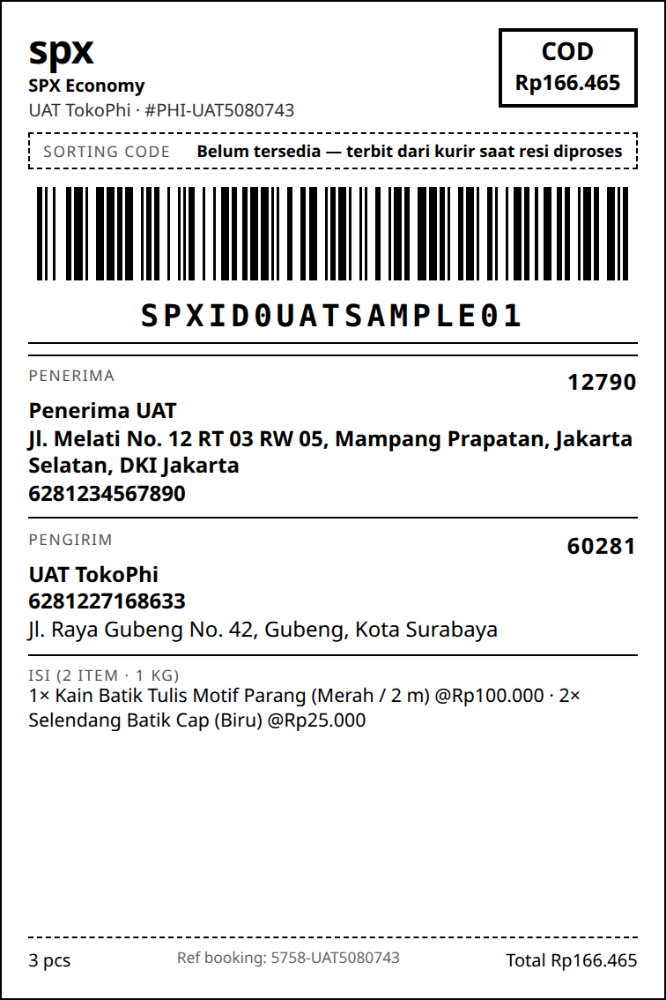
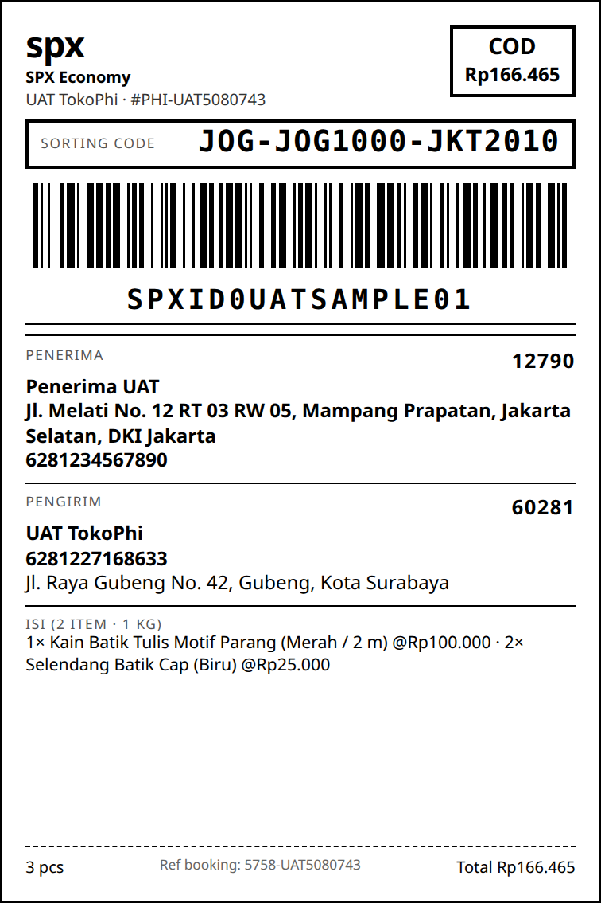

**UAT — MitraAPI**

User Acceptance Test — KiriminAja

| Ketentuan upload: pdf, maksimal 10 MB. Jangan tampilkan secret/API key penuh. Label pengiriman wajib mengikuti dokumentasi KiriminAja dan dilampirkan screenshot jika digunakan. |
| :---- |

Dokumen ini tidak memuat API key. **Revisi 4 (14 September 2026)** — review ketiga (order sudah sesuai; label wajib sorting code untuk SPX, ID Express, J&T, J&T Cargo) ditindaklanjuti: field sorting code disiapkan end-to-end, lihat §4. Riwayat revisi 3 — menindaklanjuti dua review KiriminAja di hari yang sama. Review 1: *"endpoint sudah v6.2 namun struktur payload masih v6.1"* → payload v6.2 lengkap (`kelurahan_id`, `zipcode`, `latitude`/`longitude`, `items[]` + `metadata`, `note`). Review 2 (per OID revisi 2) → empat aturan diterapkan di kode: paket tanpa asuransi hanya pada layanan `force_insurance: false`; `insurance_amount` = nilai `insurance` dari get pricing; `qty` paket = Σ `qty` dalam `items`; COD value sesuai S&K §5 (fee COD = (barang + ongkir + asuransi) × 3% + PPN 11%, min Rp2.500); skenario volumetrik dibooking ulang dengan volume 4 kg. Seluruh 8 skenario dijalankan ulang (run 3, 15:07 WIB) — semua OID di bawah adalah hasil run tersebut; contoh request body di §3 no. 4.

&nbsp;

**1\. Informasi Dokumen**

| Field | Nilai |
| :---- | :---- |
| Nama Brand / Merchant | TokoΦ — platform commerce SaaS (tokophi.com); merchant uji: Batik Nusantara (toko demo) |
| Nama PIC | Ongki A. Febriananda ("Mas Ongkie") — Owner / integrator |
| Email PIC | billing@tokophi.id |
| Nomor HP PIC | 081227168633 |
| Environment UAT | Sandbox MitraAPI — https://tdev.kiriminaja.com · prefix akun 5758 (OID di bawah) · dipanggil dari IP egress produksi 45.77.33.112 (allow-list aktif) |
| Tanggal UAT | 14 September 2026 (run 3, payload v6.2 + aturan review kedua); run pertama 24 Agustus 2026 |
| Versi Dokumen | V 1.0 — revisi 4 (sorting code label, review ketiga) |

&nbsp;

**2\. Scope UAT**

Centang fitur yang diuji dan beri catatan jika tidak digunakan.

| Fitur Core | Status | Catatan |
| :---- | :---- | :---- |
| Authentication / API Key Sandbox | ☑ Diuji ☐ N/A | Bearer API key sandbox; `province` 200 "Data Loaded" (37 provinsi). Kunci tidak dicantumkan di dokumen ini. |
| Coverage / Courier Service | ☑ Diuji ☐ N/A | `courier_services` → 20 layanan / 10 kurir; `kelurahan` (kecamatan\_id → id kelurahan KiriminAja) dipakai untuk mengisi `kelurahan_id` / `destination_kelurahan_id` |
| Pricing | ☑ Diuji ☐ N/A | `v6.1/shipping_price` dengan berat + dimensi, `insurance: 1` untuk skenario asuransi; volumetrik terbukti (§3 no. 3). `cost` quote dipakai apa adanya sebagai `shipping_cost`, `insurance` quote sebagai `insurance_amount` |
| Create Paket Non-COD | ☑ Diuji ☐ N/A | 4 booking v6.2 (aktual/volumetrik × ±asuransi). Tanpa asuransi: layanan termurah dengan `force_insurance: false` (SPX Economy, NCS NRS); dengan asuransi: AnterAja REG (`force_insurance: true`) — OID §3 no. 4–7 |
| Create Paket COD | ☑ Diuji ☐ N/A | Declare COD Value sesuai S&K §5: `cod` = barang + ongkir + asuransi (jika ada) + fee COD, fee = max(Rp2.500, (barang + ongkir + asuransi) × 3%) + PPN 11% — mis. Rp150.000 + Rp11.100 → fee Rp5.365 → `cod: 166465`; 4 booking SPX Economy (`force_insurance: false`) — OID §3 no. 8–11 |
| Create Paket Insurance | ☑ Diuji ☐ N/A | Declare insurance amount/type: `insurance: 1` pada quote → `insurance_amount` booking = nilai `insurance` hasil pricing (SPX Rp300, AnterAja Rp300, JNE Rp2.500, J&T Cargo Rp5.000 pada 1 kg — diukur 14/09), bukan nilai barang (4 skenario) |
| Create Paket KA Credit | ☐ Diuji ☑ N/A | Declare payment method KA Credit: tidak dipakai. `GET v6.2/credit/balance` menjawab "Unable to find your endpoint target" (3× pada 11–12/09, kontrol `province` sukses) — akun tampaknya Term-of-Payment; `payment_method`/`pin` tidak dikirim |
| Label Pengiriman | ☑ Diuji ☐ N/A | Dirender aplikasi member (100×150 mm, Code 128) — screenshot §4 |
| Tracking | ☑ Diuji ☐ N/A | `POST /api/mitra/tracking` dipoll otomatis tiap 15 menit; `details.awb`, `details.sorting_code` dan `status_code` paket dibaca dan dipetakan ke order |
| Webhook / Callback | ☑ Diuji ☐ N/A | Jika digunakan: receiver LIVE di produksi, Bearer fail-closed (401 diuji); URL didaftarkan via `set_callback` (2026-09-09) |
| Cancel / Void | ☐ Diuji ☑ N/A | Jika digunakan: diimplementasi (`v3/cancel_shipment`, kirim AWB bukan OID) — belum dieksekusi: AWB sandbox berbentuk `MOCK-<order_id>`, bukan resi kurir, dan sistem menolak memakainya sebagai resi |

&nbsp;

**3\. Hasil Pengujian**

Isi ringkas hasil pengujian. Evidence dapat berupa screenshot, response log, order ID, AWB, atau catatan validasi. Semua OID/pickup number di bawah dapat diverifikasi pada akun sandbox 5758 (run 3, dibuat 14 September 2026 pukul 15:07 WIB; jadwal pickup 2026-09-15 10:00:00). OID run 2 (10:41 WIB, `5758-UAT1041324`…`UAT8041333`) tetap ada di akun dan tidak dipakai lagi.

| No | Fitur | Skenario Minimal | Expected Result | Actual / Evidence Screenshot UI Apps | Wajib Implementasi | Status |
| :---- | :---- | :---- | :---- | :---- | :---- | :---- |
| 1 | Authentication | Request API Key Sandbox valid | Authorized / sukses | `POST /api/mitra/province` → 200 `status:true` "Data Loaded", 37 provinsi (diukur 2026-09-09, 12, 14). Kunci salah → "Unauthorized." — pemisahan auth vs IP allow-list terverifikasi. | Wajib | ☑ Pass ☐ Fail ☐ N/A |
| 2 | Coverage / Service | Cek area/courier service | Service/area tersedia | `courier_services`: 20 layanan / 10 kurir. Rute uji: origin kecamatan 6138 (Gubeng, Kota Surabaya) → dest 2107 (Mampang Prapatan, Jakarta Selatan); kelurahan via `POST /api/mitra/kelurahan`: Gubeng id 69243 (60281), Mampang Prapatan id 17554 (12790). `shipping_price` mengembalikan daftar layanan lengkap. | Wajib | ☑ Pass ☐ Fail ☐ N/A |
| 3 | Pricing | Cek ongkir data valid | Harga/layanan muncul | SPX, rute yang sama, 14/09 15:07: 5.000 g / 10×10×10 cm (aktual dominan) → Rp100.910; 1.000 g / 40×30×20 cm (volumetrik 4.000 g dominan) → Rp80.728 = tarif 4 kg. Daftar layanan 1 kg dengan `insurance: 1` (22 layanan / 10 kurir) mengembalikan `cost`, `insurance`, `force_insurance`, `cod`, `setting.cod_fee`/`minimum_cod_fee` per layanan — mis. SPX 3: cost 11.100, insurance 300, force_insurance false, cod_fee 0.03/min 2.500; AnterAja REG: force_insurance **true**; Ninja Standard & J&T Cargo REG: force_insurance true. Quote dan booking membawa berat + dimensi yang SAMA; validator booking menghitung volumetrik dari **Σ `items[].(w×l×h)×qty`** (diukur, lihat no. 6) dan sistem member menurunkan dimensi paket dari jumlah yang sama. | Wajib | ☑ Pass ☐ Fail ☐ N/A |
| 4 | Create Non-COD | Create shipment Non-COD dengaan kriteria berat barang lebih tinggi daripada berat volume | Order ID/AWB terbentuk | 1.000 g / 10×10×10 cm, nilai Rp150.000, **SPX Economy (`service_type` 3, `force_insurance: false`) Rp11.100** → **OID 5758-UAT1080737 · pickup EPR-4013535722** (`request_pickup` v6.2 `status:true`; AWB kurir terbit setelah kurir menerima pickup — tracking sandbox hanya mengembalikan `MOCK-5758-UAT1080737`, yang sistem tolak sebagai resi). `qty` paket = 3 = Σ qty items (1 + 2). **Request body v6.2 yang dikirim (utuh):** `{"name":"UAT TokoPhi","phone":"6281227168633","address":"Jl. Raya Gubeng No. 42, Gubeng, Gubeng, Kota Surabaya 60281","kecamatan_id":6138,"kelurahan_id":69243,"latitude":-7.2729,"longitude":112.749495,"zipcode":"60281","platform_name":"mitra","schedule":"2026-09-15 10:00:00","packages":[{"order_id":"5758-UAT1080737","destination_name":"Penerima UAT","destination_phone":"6281234567890","destination_address":"Jl. Melati No. 12 RT 03 RW 05, Mampang Prapatan, Jakarta Selatan 12790","destination_kecamatan_id":2107,"destination_kelurahan_id":17554,"destination_latitude":-6.242758,"destination_longitude":106.828637,"weight":1000,"width":10,"length":10,"height":10,"qty":3,"item_value":150000,"item_name":"UAT skenario 1","service":"spx","service_type":"3","shipping_cost":11100,"cod":0,"package_type_id":7,"drop":false,"destination_zipcode":"12790","note":"UAT MitraAPI v6.2 — simulasi, jangan diproses","items":[{"name":"Kain Batik Tulis Motif Parang","price":100000,"weight":600,"qty":1,"width":10,"length":10,"height":5,"metadata":{"sku":"BTK-PRG-001","variant_label":"Merah / 2 m"}},{"name":"Selendang Batik Cap","price":25000,"weight":200,"qty":2,"width":10,"length":10,"height":2,"metadata":{"sku":"SLD-CAP-002","variant_label":"Biru"}}]}]}` | Wajib | ☑ Pass ☐ Fail ☐ N/A |
| 5 | Create Non-COD dan menggunakan asuransi | Create shipment Non-COD dengan kriteria berat barang lebih tinggi dari pada berat volume dan menggunakan asuransi | Order ID/AWB terbentuk | idem, **AnterAja REG (`force_insurance: true`) Rp7.000**, quote `insurance: 1` → `insurance_amount: 300` (nilai `insurance` hasil pricing) → **OID 5758-UAT3080741 · EPR-7509496809** | Tidak Wajib (ketentuan asuransi per kurir/package type dipatuhi) | ☑ Pass ☐ Fail ☐ N/A |
| 6 | Create Non-COD | Create shipment Non-COD dengan kriteria berat volume lebih tinggi dari pada berat barang | Order ID/AWB terbentuk | **Dibooking ulang dengan volume 4 kg** sesuai review: 400 g / 40×30×20 cm (volumetrik 4.000 g dominan), layanan termurah dengan `force_insurance: false` = NCS NRS Rp37.000, `items` 40×30×10 ×1 + 40×30×5 ×2 (Σ volume = boks), `qty: 3` → **OID 5758-UAT2080740 · EPR-2040982418**. **Bukti aturan Σ volume item** (4 probe 14/09 pagi, paket 15×15×24 & harga identik): items 1×1×1 → OK 5758-PRB11159; satu baris = boks + sisanya 1×1×1 → OK 5758-PRB21159; satu baris = boks → OK 5758-PRB31200; DUA baris masing-masing = boks (2× volume) → "Ongkir tidak sesuai" (5758-PRB41201, tidak terbentuk). | Wajib | ☑ Pass ☐ Fail ☐ N/A |
| 7 | Create Non-COD menggunakan asuransi | Create shipment Non-COD dengan kriteria berat volume lebih tinggi dari pada berat barang dan menggunakan asuransi | Order ID/AWB terbentuk | idem 4 kg volumetrik, AnterAja REG (`force_insurance: true`) Rp28.000, `insurance_amount: 300` dari pricing, `qty: 3` → **OID 5758-UAT4080742 · EPR-9928362293** | Tidak Wajib (ketentuan asuransi per kurir/package type dipatuhi) | ☑ Pass ☐ Fail ☐ N/A |
| 8 | Create COD | Create shipment COD dengan kriteria berat barang lebih tinggi daripada berat volume | COD tercatat di response & label | 1.000 g / 10×10×10, SPX Economy Rp11.100 (`force_insurance: false`), `qty: 3`. COD value S&K §5: barang 150.000 + ongkir 11.100 = 161.100; fee = 161.100 × 3% = 4.833 → + PPN 11% = **Rp5.365**; `cod: 166465` → **OID 5758-UAT5080743 · EPR-4027071442**; COD tampil di label (§4). | Tidak Wajib | ☑ Pass ☐ Fail ☐ N/A |
| 9 | Create COD menggunakan asuransi | Create shipment COD dengan kriteria berat barang lebih tinggi daripada berat volume dan menggunakan asuransi | COD tercatat di response & label | idem + `insurance_amount: 300` (dari pricing); base 161.400 → fee Rp5.375 → `cod: 166775` → **OID 5758-UAT7080745 · EPR-5869210641** | Tidak Wajib (ketentuan asuransi per kurir/package type dipatuhi) | ☑ Pass ☐ Fail ☐ N/A |
| 10 | Create COD | Create shipment COD dengan kriteria berat volume lebih tinggi daripada berat barang | COD tercatat di response & label | **4 kg volumetrik** (400 g / 40×30×20), SPX Economy Rp80.728, `qty: 3`; base 230.728 → fee Rp7.683 → `cod: 238411` → **OID 5758-UAT6080744 · EPR-4903125061** | Tidak Wajib ( Wajib jika menggunakan COD ) | ☑ Pass ☐ Fail ☐ N/A |
| 11 | Create COD menggunakan asuransi | Create shipment COD dengan kriteria berat volume lebih tinggi daripada berat barang menggunakan asuransi | COD tercatat di response & label | idem + `insurance_amount: 300`; base 231.028 → fee Rp7.693 → `cod: 238721` → **OID 5758-UAT8080746 · EPR-4069998505** | Tidak Wajib (ketentuan asuransi per kurir/package type dipatuhi) | ☑ Pass ☐ Fail ☐ N/A |
| 12 | Create KA Credit | Create shipment payment KA Credit | Payment tervalidasi / error handling jelas | Tidak digunakan. Bukti: `GET /api/mitra/v6.2/credit/balance` (path persis OpenAPI) → `{"status":false,"text":"Unable to find your endpoint target"}` pada 3 ronde, dengan kontrol `province` sukses di ronde yang sama — bukan throttle. Mohon konfirmasi akun ini Term-of-Payment (KA Credit tidak berlaku). | Tidak Wajib | ☐ Pass ☐ Fail ☑ N/A |
| 13 | Label Pengiriman | Generate/ambil label | Label tampil & field wajib lengkap | Label 100×150 mm dirender sistem member dari data order (Section 4). Barcode Code 128 asli. Screenshot §4 — dirender 14/09 untuk OID COD run 3 (5758-UAT5080743) dengan slot **Sorting Code** baru. | Wajib | ☑ Pass ☐ Fail ☐ N/A |
| 14 | Tracking | Tracking order/AWB | Status tampil | `POST /api/mitra/tracking` dipoll otomatis tiap 15 menit; status kurir dipetakan ke status order (booked → shipped → delivered/returned/canceled, forward-only). Diukur 14/09 pada 8 OID UAT: `status_code: 105` "Menunggu Pickup", `details.awb` = `MOCK-<order_id>`, `details.sorting_code: null`, `histories: []`. AWB berbentuk `MOCK-…` / berisi order_id kami **ditolak** sebagai resi (label tidak dicetak dengan nomor tiruan); status 105 dipetakan ke "diproses". | Wajib | ☑ Pass ☐ Fail ☐ N/A |
| 15 | Webhook | Terima callback jika digunakan | Payload diterima benar | Receiver: `POST https://app.tokophi.com/api/public/kiriminaja/webhook` — LIVE; auth `Authorization: Bearer {api_key}` fail-closed (tanpa/salah bearer → 401, diuji di produksi); payload dipakai sebagai HINT lalu diverifikasi lewat tracking pull; idempoten pada (`awb`, `order_id`). Didaftarkan via `set_callback` (2026-09-09). Event `processed_packages`: `sorting_code` diterima dari baris webhook hanya bila `awb` baris itu sama dengan AWB terverifikasi order tersebut (tracking pull); nilai dari tracking diutamakan. Belum ada event nyata di sandbox. | Tidak Wajib | ☑ Pass ☐ Fail ☐ N/A |
| 16 | Cancel / Void | Cancel/void jika digunakan | Response sesuai aturan | Diimplementasi sesuai kontrak: kirim AWB, bukan order id; booking tanpa AWB ditolak sebelum memanggil API. Belum dieksekusi: AWB sandbox untuk OID UAT adalah `MOCK-<order_id>` (diukur 14/09), bukan resi kurir, sehingga cancel-by-AWB tidak dapat diuji terhadap nomor yang sah. Mohon arahan: apakah cancel sandbox menerima AWB `MOCK-…`? | Tidak Wajib | ☐ Pass ☐ Fail ☑ N/A |

&nbsp;

**4\. Evidence Label Pengiriman**

Wajib diisi jika fitur Label Pengiriman digunakan. Member dapat menempelkan screenshot label pengiriman dari sistem mereka / dashboard / hasil integrasi API.

Acuan field label mengikuti dokumentasi KiriminAja: [https://developer.kiriminaja.com/docs/important-notes/shipping-label](https://developer.kiriminaja.com/docs/important-notes/shipping-label)

| Field | Nilai |
| :---- | :---- |
| Order ID / Reference ID | PHI-UAT5080743 (order member) · ref booking 5758-UAT5080743 (skenario COD run 3, 14/09) |
| AWB / Tracking Number | SPXID0UATSAMPLE01 — CONTOH: tracking sandbox mengembalikan `MOCK-5758-UAT5080743`, yang sistem tolak sebagai resi; label hanya dicetak dengan AWB kurir asli (ref booking dan AWB tiruan tidak pernah dipakai sebagai resi) |
| Courier / Service | SPX · SPX Economy |
| Shipping Type | ☑ COD ☐ Non-COD |
| COD Value | Rp166.465 (barang Rp150.000 + ongkir Rp11.100 + fee COD Rp5.365) |
| Insurance Information | Tidak ditampilkan pada label — lihat catatan validasi (gap yang diketahui) |
| Sumber Label | ☐ Dashboard KiriminAja ☐ API ☑ Sistem Member |
| Screenshot Label Pengiriman | Sandbox (sorting code `null`):  Produksi (contoh nilai dari dokumentasi KiriminAja `JOG-JOG1000-JKT2010`):  |
| Catatan Validasi Label | Dirender oleh modul label sistem member (Code 128 asli; 100×150 mm). **Sorting Code disiapkan (review ketiga):** kolom `orders.sorting_code`; diisi dari `details.sorting_code` tracking atau dari webhook `processed_packages` (hanya bila `awb` baris cocok dengan AWB terverifikasi); dicetak besar di atas barcode. Untuk SPX, ID Express, J&T, J&T Cargo slot **selalu** tampil — berisi kode, atau bergaris putus "Belum tersedia" bila kurir belum menerbitkan (sandbox selalu `null`), dan layar cetak massal memberi peringatan. Kode divalidasi (huruf/angka dan `- . / : _`, maks 64) sebelum disimpan. Belum dicetak: Insurance Information dan logo kurir (saat ini nama kurir). Simbologi: Code 128-B (dokumentasi menyebut 128A; keduanya decode ke string yang sama untuk AWB alfanumerik kapital). |

&nbsp;

**Checklist Wajib Label Pengiriman**

| Field Label | Wajib? | Catatan |
| :---- | :---- | :---- |
| Logistic Logo / Label | Ya | Sebagian — nama kurir tercetak besar; logo grafis kurir belum — mohon aset/ketentuan |
| Service Type / Service Label | Ya | ☑ REG/Economy/dll tercetak di bawah nama kurir |
| AWB Barcode | Ya | ☑ Code 128 asli (varian B); decode identik dengan 128A untuk AWB |
| AWB Label | Ya | ☑ AWB tertulis di bawah barcode, monospace |
| Shipping Type | Ya | ☑ COD/Non-COD; jika COD, kotak COD + nilai |
| Sorting Code | Ya | ☑ Disiapkan — slot label (wajib SPX/ID Express/J&T/J&T Cargo) + kolom + ingest dari tracking & webhook `processed_packages`; terisi otomatis di produksi |
| Sender & Recipient Details | Ya | ☑ Nama, HP, alamat lengkap, kode pos di slot terpisah |
| Shipment Weight | Ya | ☑ Berat tertagih dalam gram/kg |
| Item Quantity | Ya | ☑ Jumlah item + pcs |
| Insurance Information | Jika digunakan | ☐ Belum — tidak dicetak; akan ditambahkan bila asuransi dipakai |
| Origin & Destination City | Ya | ☑ Kota asal & tujuan di baris alamat |
| Item Information | Ya | ☑ Nama, varian, qty, harga |
| Order Ref Label | Ya | ☑ Nomor order member + ref booking (kecil, berlabel) |

&nbsp;

**Catatan Khusus Label**

1. Label dicetak jelas 100×150 mm (thermal) dan ditempel aman pada paket.
2. Barcode AWB dapat discan (Code 128 asli); order reference dicetak sebagai teks, bukan barcode.
3. JNE Drop-Off (CASHLESS COD/Non-COD) belum berlaku — integrasi hanya memakai pickup request (`drop: false`).
4. SPX, ID Express, J&T, J&T Cargo: sorting code dicetak dari event `processed_packages` / tracking; bila belum terbit, slot ditandai "Belum tersedia" dan seller diperingatkan sebelum cetak massal.

&nbsp;

**Permintaan ke KiriminAja (action items)**

1. **Konfirmasi aturan berat volumetrik v6.2**: validator booking tampak menghitung dari Σ `items[].(width×length×height)×qty` (bukti no. 6). Mohon konfirmasi produksi berperilaku sama, dan apakah `packages[].width/length/height` masih dipakai untuk pricing.
1. **Konfirmasi penerapan review kedua** (semua sudah di kode sistem member): layanan `force_insurance: true` otomatis diasuransikan dengan `insurance_amount` = `insurance` pricing meski seller tidak memilih asuransi; `qty` paket diturunkan dari Σ `items[].qty`; COD value untuk pesanan nyata = total checkout pembeli = barang + ongkir + fee 3% + PPN 11% (asuransi COD adalah biaya seller, tidak ditagihkan ke penerima). Mohon konfirmasi bahwa `cod` boleh lebih besar dari rumus (pembulatan) dan bahwa untuk J&T Express (4%) fee mengikuti tabel S&K.
2. **Konfirmasi koordinat**: `latitude`/`longitude` dan `destination_latitude`/`destination_longitude` dikirim sebagai **centroid kelurahan** (fallback centroid kecamatan) dari dataset batas wilayah Kemendagri — pembeli hanya mengisi alamat, WA, kecamatan, kelurahan/kode pos. Mohon konfirmasi ini memadai untuk layanan reguler (`use_geolocation: false`), dan layanan mana (Lion/Pos?) yang memerlukan titik presisi.
3. AWB sandbox untuk OID di atas adalah `MOCK-<order_id>`: mohon konfirmasi apakah Cancel/Void sandbox menerima AWB tiruan ini, atau ada cara menguji cancel sebelum produksi.
4. Sorting code: field sudah disiapkan (§4). Mohon konfirmasi (a) `details.sorting_code` pada tracking produksi terisi sama dengan webhook `processed_packages`, (b) tata letak khusus bila ada (mis. SPX dua kolom), dan (c) ketentuan logo kurir pada label.
5. Kontrak autentikasi webhook: dokumentasi mendeklarasikan event tanpa security scheme; receiver kami memerlukan `Authorization: Bearer {api_key}`. Mohon konfirmasi header yang dikirim.
6. Konfirmasi status akun terkait KA Credit (endpoint `credit/balance` tidak dilayani untuk akun ini).

&nbsp;

TokoΦ × KiriminAja · UAT MitraAPI V1 · revisi 4, 14 Sep 2026 (sorting code label; order run 3 — payload v6.2 + aturan review kedua) · PIC Ongki (Mas Ongkie) · billing@tokophi.id · 081227168633
